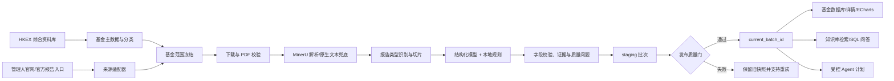
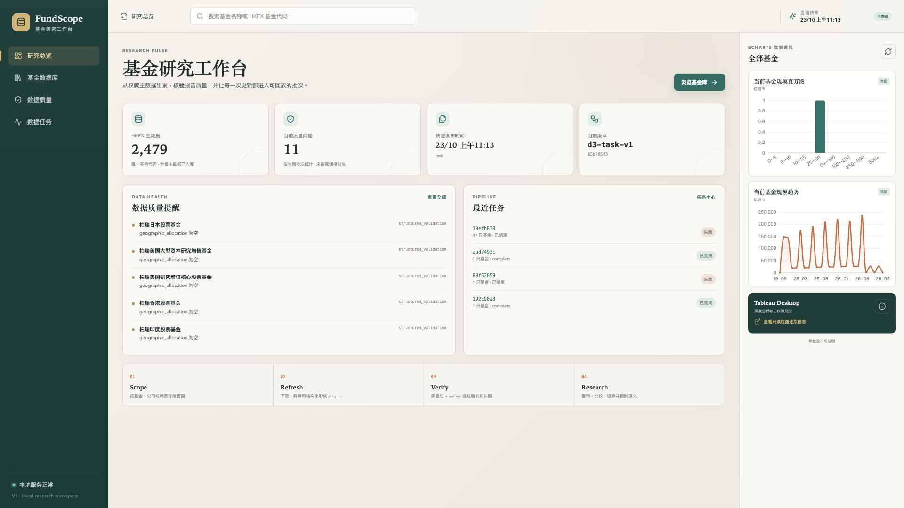
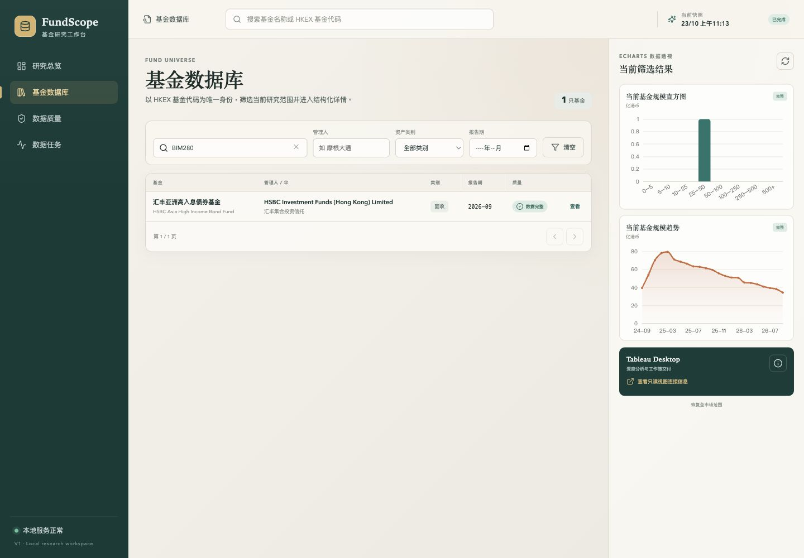
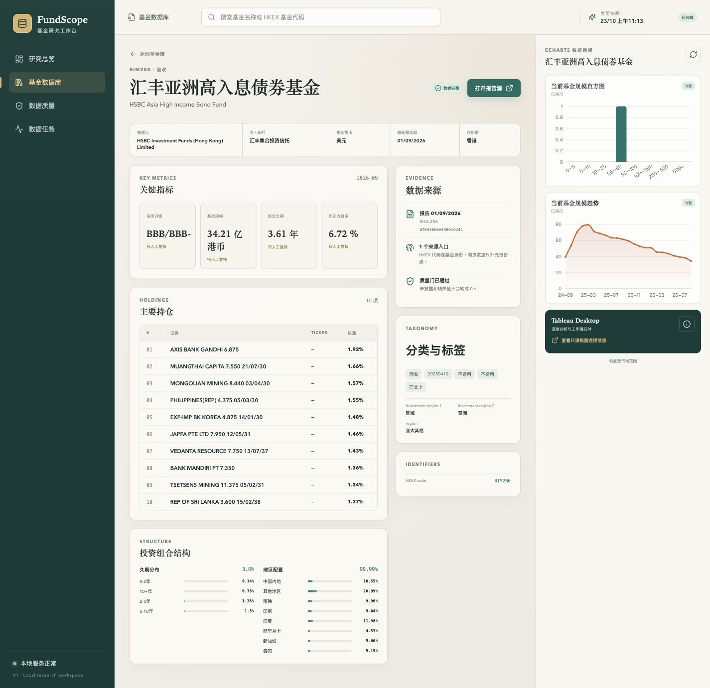
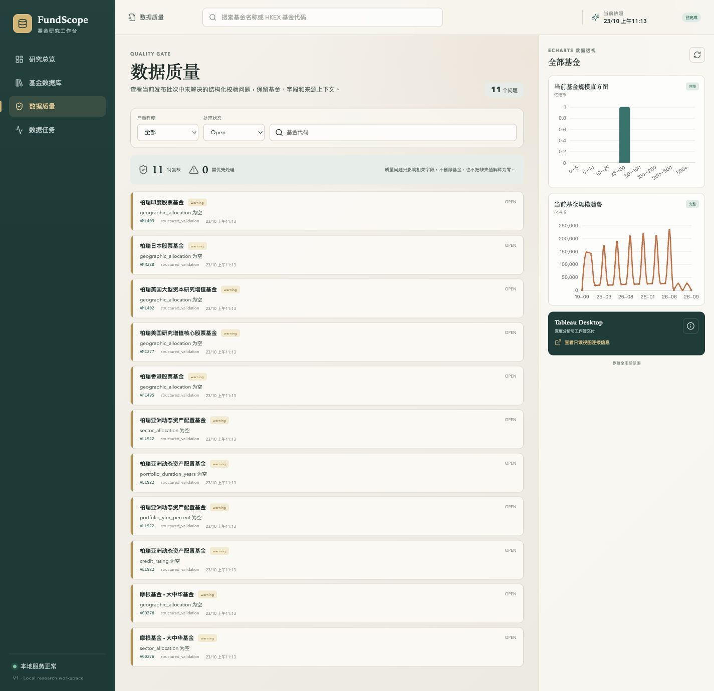
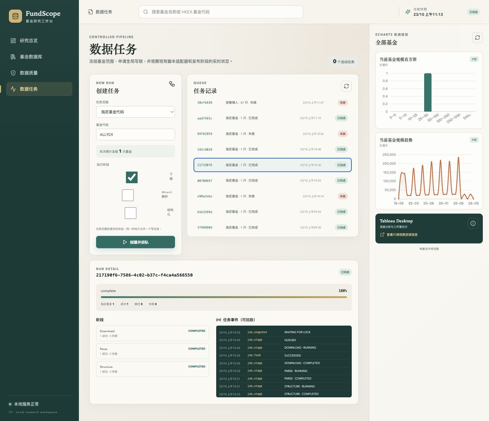
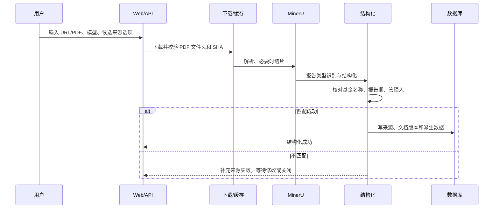
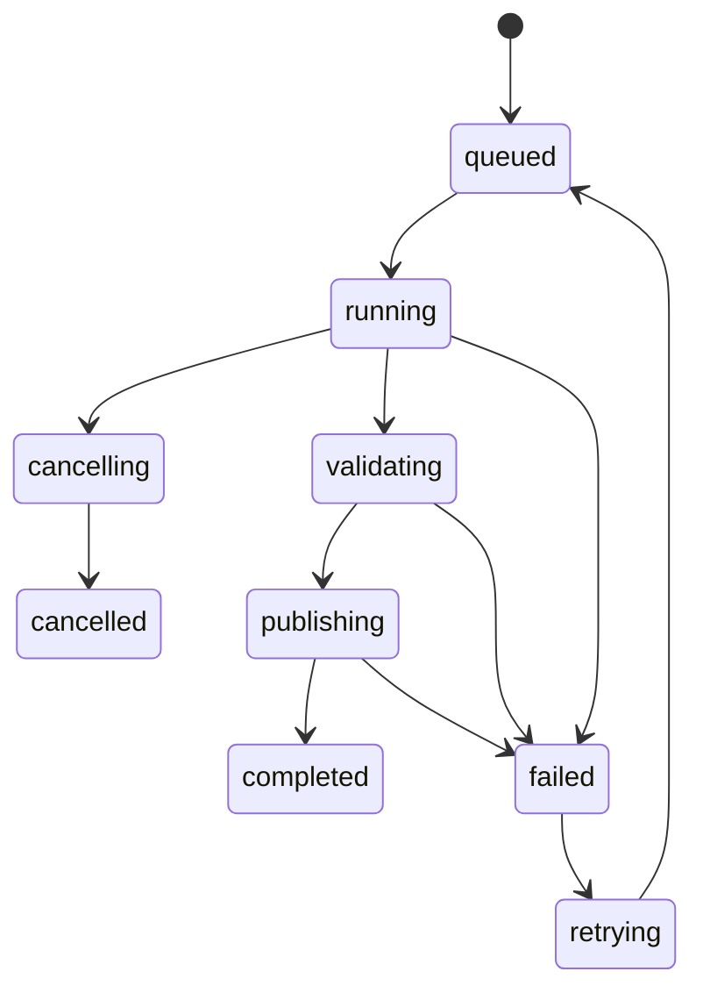
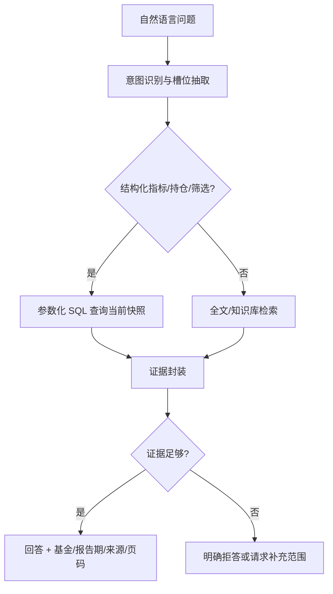

# 基金研究智能看板与知识库 Agent

## 正式用户手册、开发手册与项目路线图

| 项目属性 | 当前内容 |
|---|---|
| 项目 | 香港公募基金研究数据平台（GF FMR Crawl） |
| 版本 | V1 本地单机版 / V2 Windows 局域网版（Windows 分支） |
| 文档版本 | 2026-11-27 |
| 适用对象 | 投研用户、数据运营、开发人员、部署人员 |
| 权威入口 | 本文件；详细设计以 `docs/architecture/`、`docs/refinement/`、`docs/development/` 为准 |

> 本文件覆盖原 `README.md`，是项目对外交付的总手册。它说明当前已经实现的能力、实际运行方式、数据口径、故障处理和后续边界；未实现的功能会明确标注为“设计中”或“待补充”，不把规划内容写成已交付能力。

---

## 目录

1. [项目概览](#一项目概览)
2. [目录与常见问题索引](#二目录与常见问题索引)
3. [安装与运行](#三安装与运行)
4. [用户使用手册](#四用户使用手册)
5. [开发手册](#五开发手册)
6. [项目展望](#六项目展望)
7. [附录：交付检查清单](#七附录交付检查清单)

---

# 一、项目概览

## 1.1 项目定位

本项目面向香港公募基金研究场景，提供从官方主数据和基金管理人报告入口出发的可追溯数据流水线，以及面向投研人员的基金数据库、数据质量看板、任务中心、知识问答和受控 Agent。

核心目标不是“把 PDF 变成一张表”，而是让每一个结论都能回答四个问题：

1. **它对应哪一只基金？**——以 HKEX 基金代码作为唯一主身份。
2. **它来自哪一份报告？**——保留来源 URL、文件哈希、报告类型、报告期和文档页码。
3. **它经过了什么处理？**——下载、解析、切片、结构化、校验、人工复核和发布均有状态记录。
4. **它什么时候对用户可见？**——任务先写入 staging，质量门通过后再以不可变批次切换当前发布快照。

## 1.2 业务能力全景



## 1.3 关键数据边界

| 数据对象 | 权威来源 | 作用 | 是否允许被报告结果覆盖 |
|---|---|---|---|
| 基金代码、管理人、伞/系列、分类、标签、认可日期、历史规模 | HKEX 综合资料库 Excel | 基金主身份和筛选维度 | 否；只能由新的 HKEX 工作簿更新 |
| 月报/半年报/年报入口、运行方式、优先级 | `爬虫list.xlsx`、来源适配器、补充来源 | 发现和下载报告 | 是；按来源优先级和审计记录更新 |
| PDF、Markdown、图片、JSON | 外置状态目录的任务批次 | 原始证据和中间产物 | 不覆盖；按 SHA-256 复用 |
| 指标、持仓、资产配置、证据引用 | 结构化任务结果 | 研究查询和问答 | 按批次追加，不在原批次上覆盖 |
| 当前可见数据 | `PublicationState.current_batch_id` | Web/API 的读取快照 | 仅通过发布事务切换 |

## 1.4 当前交付能力与边界

| 范围 | 当前状态 |
|---|---|
| HKEX 基金主数据 | 已入库，基金代码唯一；支持分类、标签、管理人、伞、币种、上市和 60/40 等筛选 |
| 管理人适配器 | 已接入大量管理人，仍通过覆盖审计持续补缺；每家公司适配器以官方可验证入口为准 |
| 月报下载、解析、结构化 | 已实现下载 → MinerU → 报告契约 → 结构化 → 发布 |
| 半年报/年报 | 支持候选来源、自动识别、必要时切片分页，再进入专用结构化逻辑 |
| 货币基金 | 支持 WAM/WAL、日/周流动资产、资产分布、久期分布、五大/十大持仓及来源证据 |
| 本地模型 | 支持 Ollama `qwen3:4b` 作为结构化模型路线；不替代 MinerU，不自动替代视觉复核 |
| Web 看板 | 首页、基金数据库、基金详情、数据质量、任务中心、知识问答、模型设置 |
| 知识问答 | SQL 优先、知识库证据补充、无足够证据时拒答；支持基金/报告期/指标槽位识别 |
| Agent | 先识别意图并生成计划，写任务必须用户确认；不开放任意 Shell 或任意 URL |
| Bloomberg | 当前通过 `summary.csv` 等汇总文件导入年化收益率和波动率；日点位不入库 |
| Windows | 已提供 `GF_FMR_Server.exe`、局域网 Web、顺序启停、逻辑备份恢复和在线发布约定；发布资产以 GitHub Release 为准 |

## 1.5 核心设计原则

- **SQL 负责数字，模型负责解释**：规模、日期、持仓权重、质量计数优先走数据库查询；模型不能编造缺失数字。
- **原始证据不可替代**：PDF、Markdown、页码、块索引和来源 URL 必须能够回溯。
- **单写多读**：同一时间只允许一个下载/解析/结构化写任务，读查询和问答可并行。
- **不可变批次发布**：任务运行期间写 staging，发布时一次性切换快照；失败不污染当前数据。
- **先匹配身份，再落库结果**：基金代码、报告 URL、原始名称、管理人和分类构成逐级匹配链。
- **失败要可解释**：任务事件、逐基金结果、质量问题和 Worker 日志必须共同解释失败原因。

---

# 二、目录与常见问题索引

## 2.1 代码目录

```text
<repo>/
├── code/                         # 批处理、公司适配器、PDF 解析和结构化
│   ├── companies/<manager>/      # 管理人来源发现/下载适配器
│   ├── common/                   # 浏览器、来源、批次、路径和通用工具
│   ├── structured_data/          # MinerU、报告契约、字段流水线、模型结构化
│   ├── run_all_downloaders.py    # 下载总调度器
│   ├── run_all_mineru.py         # MinerU 批量解析入口
│   └── run_all_structured_data.py# 三类资产结构化总入口
├── platform/
│   ├── api/app/                  # FastAPI、SQLAlchemy、任务 Worker、Agent、查询
│   ├── api/tests/                # API、任务、模型、来源和恢复测试
│   ├── web/src/                  # React 页面、组件、ECharts 和前端测试
│   └── scripts/                  # PostgreSQL/API/Worker/Web 启停、备份、审计
├── docs/
│   ├── architecture/             # C4 架构、部署、时序、数据模型
│   ├── refinement/               # 字段、API、来源、RAG、Agent 和任务契约
│   ├── development/              # 运行手册、适配器、阶段验收和问题复盘
│   └── reports/assets/           # 当前版本界面截图
├── agents/chat.md                # 历史对话和已完成行动记录
├── inputs/                       # 仅在本地状态目录使用；不提交密钥和业务数据
├── config.example.ini            # 无密钥配置模板
└── README.md                     # 本正式手册
```

## 2.2 状态目录与代码包分离

默认状态根目录为仓库上级的 `fund-research-state/`，也可以通过环境变量指定。状态目录承载数据库、PDF、缓存、运行日志、浏览器、依赖和密钥，代码仓库只承载可复现的源代码、模板和文档。

```text
fund-research-state/
├── config.ini                 # 本机密钥和模型设置，禁止提交 Git
├── platform.env.local         # PostgreSQL/API 连接环境
├── inputs/                    # HKEX 工作簿、爬虫工作簿
├── data/                      # 批次、PDF、Markdown、JSON、任务 staging/batches
├── runtime/                   # Playwright、Ollama/其他运行时缓存
├── platform-runtime/          # PostgreSQL、API、Worker、Web 日志和 PID
└── dependencies/venv/         # Python 环境
```

## 2.3 文档索引

| 需求 | 首选文档 |
|---|---|
| 服务器启停、状态目录、备份恢复 | [`docs/development/59-runtime-startup-and-dependency-runbook-20261126.md`](docs/development/59-runtime-startup-and-dependency-runbook-20261126.md) |
| GitHub 归档、Windows 迁移和存储边界 | [`docs/development/58-github-windows-storage-layout-20261126.md`](docs/development/58-github-windows-storage-layout-20261126.md) |
| C4 架构总览 | [`docs/architecture/README.md`](docs/architecture/README.md) |
| 数据库 ER 与字段字典 | [`docs/refinement/03-database-er.md`](docs/refinement/03-database-er.md) |
| 任务时序、锁、staging 和发布 | [`docs/refinement/04-core-task-sequences.md`](docs/refinement/04-core-task-sequences.md) |
| API/SSE/错误码 | [`docs/refinement/06-p0-api-and-event-contracts.md`](docs/refinement/06-p0-api-and-event-contracts.md) |
| 来源适配器契约 | [`docs/refinement/08-p1-source-adapter-contract.md`](docs/refinement/08-p1-source-adapter-contract.md) |
| RAG 证据契约 | [`docs/refinement/09-p1-rag-evidence-contract.md`](docs/refinement/09-p1-rag-evidence-contract.md) |
| 结构化字段血缘 | [`docs/refinement/10-structured-field-lineage.md`](docs/refinement/10-structured-field-lineage.md) |
| 字段流水线加固 | [`docs/refinement/11-field-pipeline-hardening.md`](docs/refinement/11-field-pipeline-hardening.md) |
| 本地 Qwen 4B | [`docs/refinement/12-local-qwen4b-structured-model.md`](docs/refinement/12-local-qwen4b-structured-model.md) |
| 货币基金证据门 | [`docs/refinement/12-money-market-evidence-gating.md`](docs/refinement/12-money-market-evidence-gating.md) |
| 月报/半年报/年报鲁棒解析 | [`docs/refinement/13-report-structured-robustness.md`](docs/refinement/13-report-structured-robustness.md) |
| 任务目标、来源和补充来源 | [`docs/refinement/14-source-collection-task-targets.md`](docs/refinement/14-source-collection-task-targets.md) |
| SQL 优先问答与 Agent | [`docs/refinement/15-chat-sql-first-and-evidence-contract.md`](docs/refinement/15-chat-sql-first-and-evidence-contract.md) |
| 受控 Agent 计划 | [`docs/refinement/16-controlled-agent-plan-contract.md`](docs/refinement/16-controlled-agent-plan-contract.md) |
| 意图识别与路由 | [`docs/refinement/17-agent-intent-and-routing-contract.md`](docs/refinement/17-agent-intent-and-routing-contract.md) |
| 综合资料库更新 | [`docs/refinement/18-master-database-task.md`](docs/refinement/18-master-database-task.md) |

## 2.4 常见问题快速索引

| 现象 | 先看哪里 | 常用处理 |
|---|---|---|
| API 显示 `{"name":"Fund Research Knowledge Agent API"...}` | `platform-runtime/api.log`、`/api/health` | 确认访问的是 API 端口而不是 Web 端口；检查 API 是否返回统一 `data/request_id/meta` |
| Web 显示空响应/431 | API 状态和代理头 | `./platform/scripts/api.sh status`，检查日志和 API 地址；不要把超长 Cookie/请求头带入 API |
| Web 依赖缺失 | `platform/web/package.json`、锁文件 | `cd platform/web && pnpm install --frozen-lockfile` |
| 任务一直排队 | Worker 状态、浏览器预检、租约 | `worker.sh status`、`worker.sh browser-check`；检查 `worker.log` |
| MinerU 退出码 1/2 | `data/<job>/reports/`、`worker.log` | 先看逐基金结果；区分无 PDF、限流、Token、余额、文件大小和结构化失败 |
| `-30001 file size exceeds lightweight API limit` | MinerU manifest | 使用原生文本降级；需要高精度时改用 Token/标准路线或切分 PDF |
| 结构化结果被拒绝发布 | `quality_issues`、publish 事件 | 先修基金匹配；部分无法匹配时允许发布已匹配结果，跳过项进入待复核 |
| 数据来源重复/不显示 | 基金详情“数据来源 → 管理” | 检查来源 `is_visible/is_active`、优先级和当前可见来源 |
| 规模趋势出现远古或未来日期 | `FundScaleHistory`、趋势查询 | 查询只允许月末且不超过今天；低覆盖历史点由 5% 覆盖门过滤 |
| 本地 Qwen 任务走云模型 | 任务 `model_policy`、Worker 环境 | 任务创建时确认“本地 Qwen”；检查 `FACTSHEET_STRUCTURED_PROVIDER=local` 和 Worker 日志 |
| 本地 Qwen 无视觉复核 | 当前能力边界 | 本地路线只替代文本结构化；视觉字段仍标记 review，不自动切云模型 |
| 补充来源下载失败 | 来源响应头和文件头 | 远程地址可能是 HTML/跳转页；下载后必须检查 `%PDF-`，必要时先下载到本地再提交 |
| PostgreSQL 跨平台无法启动 | 数据目录和备份 | 不复制 PostgreSQL 物理目录，使用 `pg_dump/pg_restore` |
| GitHub 推送大文件被拒 | Git LFS 状态 | 数据库 dump 使用 Git LFS 或外置备份，业务数据不直接混入普通 Git 历史 |

---

# 三、安装与运行

## 3.1 macOS 当前状态

当前 macOS 版本没有独立发布包，按“源码 + 外置状态目录”运行。要求：macOS 终端或 `launchd`、Python 3.11+、PostgreSQL 15+、Node.js/pnpm、Playwright Chromium，以及可选的 Ollama `qwen3:4b`。

### 3.1.1 初始化环境

```bash
cd /path/to/GF_FMR_Crawl
source platform/scripts/activate.zsh
python3 code/setup_environment.py

"$FACTSHEET_VENV_ROOT/bin/python" -m pip install -r requirements.txt
PYTHONPATH=platform/api "$FACTSHEET_VENV_ROOT/bin/python" -m pip install \
  -r platform/requirements.lock.txt
"$FACTSHEET_VENV_ROOT/bin/python" -m playwright install chromium
```

### 3.1.2 初始化配置和数据库

```bash
cp config.example.ini "$FACTSHEET_CONFIG"
./platform/scripts/postgres.sh init
set -a
source "$FACTSHEET_STATE_ROOT/platform.env.local"
set +a
PLATFORM_DATABASE_URL="$PLATFORM_DATABASE_URL" \
  "$FACTSHEET_VENV_ROOT/bin/alembic" \
  -c platform/api/alembic.ini upgrade head
```

数据库连接、密钥和业务数据必须留在状态目录，不要放入 Git 工作区。

### 3.1.3 启动全部服务

顺序固定为：PostgreSQL → API → Worker → Web。

```bash
source platform/scripts/activate.zsh
./platform/scripts/postgres.sh start
./platform/scripts/api.sh start
./platform/scripts/worker.sh browser-check
./platform/scripts/worker.sh start
./platform/scripts/web.sh start
```

浏览器访问 `http://127.0.0.1:5173`。检查：

```bash
./platform/scripts/postgres.sh status
./platform/scripts/api.sh status
./platform/scripts/worker.sh status
./platform/scripts/web.sh status
curl -sS http://127.0.0.1:8000/api/health
```

### 3.1.4 停止、重启和日志

```bash
# 正常停止：Web → Worker → API → PostgreSQL
./platform/scripts/web.sh stop
./platform/scripts/worker.sh stop
./platform/scripts/api.sh stop
./platform/scripts/postgres.sh stop

# 单服务重启
./platform/scripts/api.sh restart
./platform/scripts/worker.sh restart
./platform/scripts/web.sh restart

# 查看日志
./platform/scripts/api.sh logs 200
./platform/scripts/worker.sh logs 200
./platform/scripts/postgres.sh logs 200
```

正在执行写任务时不要强行停止 PostgreSQL 或 `kill -9` Worker。先在任务中心取消任务，等待进入 `cancelled`，再停止服务；否则租约过期前新 Worker 不会接管。

### 3.1.5 本地 Qwen 4B

```bash
ollama serve
ollama pull qwen3:4b
curl http://127.0.0.1:11434/api/tags
./platform/scripts/setup_local_qwen.sh
```

模型设置使用：

| 配置 | 推荐值 |
|---|---|
| Base URL | `http://127.0.0.1:11434/v1` |
| 模型 | `qwen3:4b` |
| 并发 | 1 |
| 用途 | 结构化文本抽取、开发测试 |

本地 Qwen 不替代 MinerU；不自动替代视觉复核、联网 Ticker 或知识库向量模型。低置信字段仍应进入质量复核。

## 3.2 Windows 局域网版与在线安装包

### 3.2.1 目标、边界和版本来源

| 项目 | 统一约定 |
|---|---|
| 代码分支 | `windows` |
| 发布标签 | `vYYYY.MM.DD-windows.N`，例如 `v2026.11.27-windows.1` |
| 启动器 | `GF_FMR_Server.exe`，必须与项目目录和状态目录保持相对路径 |
| 在线安装脚本 | `platform/windows/install_online.ps1` |
| 运行包 | `GF_FMR_Windows_Runtime.zip`，不包含 PostgreSQL 物理数据目录和真实密钥 |
| 数据库备份 | `fund_research_*.dump`，使用 Git LFS 或 GitHub Release Asset，不进入普通 Git 大文件历史 |
| 版本清单 | `release.json` 或 GitHub Releases API；安装器只安装明确版本，不使用未锁定的源码快照 |

Windows 发布包是“代码 + 便携运行时 + 安装/恢复脚本”，不是把正在运行的服务器目录原样压缩。PostgreSQL 必须通过逻辑 dump 恢复，不能把 macOS 或另一台机器的 PostgreSQL `data` 物理目录直接复制过来。

### 3.2.2 安装前检查

| 检查项 | 要求 | 验证方式 |
|---|---|---|
| 系统 | Windows 10/11 或 Windows Server x64 | `winver` |
| 权限 | 管理员 PowerShell；防火墙和 PostgreSQL 初始化需要提权 | 右键 PowerShell → 以管理员运行 |
| 磁盘 | 至少 20 GB 可用空间；包含数据库、报告文件和模型缓存时需要更多空间 | `Get-PSDrive` |
| 网络 | 能访问 GitHub Release、基金来源、MinerU/Qwen（如启用云路线） | `Test-NetConnection github.com -Port 443` |
| 浏览器 | Chrome/Edge 或发布包内 Playwright Chromium | Worker 日志中的浏览器预检 |
| 模型 | 本地结构化路线需要 Ollama `qwen3:4b`；不使用本地模型时可跳过 | `ollama list` |

### 3.2.3 在线安装

安装器发布到 GitHub Release 后，在目标 Windows 服务器的管理员 PowerShell 执行：

```powershell
$installer = Join-Path $env:TEMP 'GF_FMR_install_online.ps1'
Invoke-WebRequest `
  -Uri 'https://raw.githubusercontent.com/minus-seven/GF_FMR_Crawl/windows/platform/windows/install_online.ps1' `
  -OutFile $installer

powershell.exe -NoProfile -ExecutionPolicy Bypass -File $installer `
  -Repository 'minus-seven/GF_FMR_Crawl' `
  -InstallRoot 'D:\GF_FMR_Crawl' `
  -StartServer
```

安装器按以下顺序执行：

1. 读取 GitHub Release 版本清单并下载运行包；
2. 校验运行包 SHA-256；
3. 解压代码、便携 Python/Node、PostgreSQL 运行文件和启动器；
4. 创建 `state\config.ini`、`state\runtime\postgres-superuser.txt` 和外置数据目录；
5. 初始化 PostgreSQL，并用 Release 中的逻辑 dump 恢复 `fund_research`；
6. 按选项下载 `qwen3:4b`；
7. 启动 `GF_FMR_Server.exe`。

如果只安装代码、不恢复数据库或不下载模型：

```powershell
powershell.exe -NoProfile -ExecutionPolicy Bypass -File $installer `
  -InstallRoot 'D:\GF_FMR_Crawl' `
  -SkipDatabase `
  -SkipModel
```

### 3.2.4 手动安装与目录布局

无法使用在线安装器时，先下载同一 Release 的运行包并解压到固定目录，例如 `D:\GF_FMR_Crawl`。目录必须保持如下关系：

```text
D:\GF_FMR_Crawl\
├── GF_FMR_Server.exe
├── code\
├── platform\api\
├── platform\web\
├── platform\windows\server_manager.py
└── state\
    ├── config.ini
    ├── data\
    ├── runtime\postgres-superuser.txt
    ├── dependencies\venv\
    ├── dependencies\node22\
    ├── dependencies\ollama\ollama.exe
    └── platform-runtime\postgresql17\pgsql\
```

不要把以下内容放进公开代码包：

```text
state\config.ini                 # API Key 和本机连接配置
state\runtime\postgres-superuser.txt
state\platform-runtime\postgresql17\data\  # PostgreSQL 物理目录
state\data\                     # PDF、任务产物和业务文件
```

### 3.2.5 服务器启动、停止和局域网访问

双击 `GF_FMR_Server.exe`，在管理 UI 中执行操作：

| 操作 | 顺序 | 成功条件 |
|---|---|---|
| 启动服务器 | PostgreSQL → Ollama → API → Worker → Web | Web 健康后打开局域网工作台地址 |
| 停止服务器 | Web → Worker → API → Ollama → PostgreSQL | 端口 5173、8000、11434、5432 释放 |
| 打开工作台 | 使用 UI 显示的 `http://局域网IP:5173/` | 同一局域网电脑可访问 |

首次启动必须允许 UAC 和 Windows 防火墙规则。服务器端只对局域网开放 Web 端口 `5173`；PostgreSQL `5432`、API `8000` 和 Ollama `11434` 默认只监听本机，不应暴露到公网。

浏览器访问示例：

```text
http://192.168.0.110:5173/
```

其他 Windows、macOS 或 Linux 局域网客户端只需要浏览器，不需要安装 Python、PostgreSQL 或 Ollama。

### 3.2.6 启动失败、停止失败与回滚

| 现象 | 排查顺序 | 处理 |
|---|---|---|
| UI 显示防火墙权限错误 | UAC、Windows 防火墙规则、端口 5173 | 以管理员身份重新运行 EXE；局域网测试可暂时手动允许 TCP 5173 |
| 页面一直转圈 | `state\runtime\api-manager.log`、`web-manager.log`、`/api/health` | 先确认 API 8000，再确认 Web 5173 的 `/api/health` 代理；关闭重复浏览器标签后刷新 |
| API 健康检查失败 | PostgreSQL 5432、数据库密码文件、API 日志 | 先恢复数据库，再启动 API；不要复制 PostgreSQL 物理目录 |
| Ollama 不可用 | `ollama list`、`state\runtime\ollama-manager.log` | 执行 `ollama pull qwen3:4b`，或任务中改用云模型路线 |
| 停止按钮无响应 | 管理 UI 日志和端口占用 | 等待当前停止线程完成；必要时管理员 PowerShell 执行 `taskkill /PID <PID> /T /F`，然后重新启动 |
| 升级失败 | 当前版本备份、安装清单、数据库 dump | 保留旧安装目录，恢复数据库逻辑备份，切回上一 Release；不要删除旧 `releases\` 目录 |

### 3.2.7 Windows 发布流程

发布者在 Windows 构建机执行：

```powershell
cd E:\GF_FMR_Crawl
powershell.exe -NoProfile -ExecutionPolicy Bypass -File .\platform\windows\build_server_exe.ps1
powershell.exe -NoProfile -ExecutionPolicy Bypass -File .\platform\windows\build_online_package.ps1 `
  -Version v2026.11.27-windows.1
```

发布前必须完成：

1. `npm.cmd run build` 通过；
2. Python `compileall` 通过；
3. PostgreSQL/API/Worker/Web 顺序启动和反向停止通过；
4. `http://127.0.0.2:5173/api/health`、`http://局域网IP:5173/api/health` 返回 200；
5. `Get-FileHash` 记录 EXE、运行包和数据库 dump 的 SHA-256；
6. 创建 GitHub Release，上传运行包、EXE、数据库 dump 和 `release.json`；
7. 只在发布完成后更新 `windows` 分支中的版本清单。

Release Asset 推荐命名：

```text
GF_FMR_Server.exe
GF_FMR_Windows_Runtime.zip
fund_research_YYYYMMDD_HHMMSS.dump
release.json
```

数据库 dump 大于 100 MB 时必须使用 Git LFS 或 Release Asset，不能使用普通 Git blob。Release 中的数据库文件必须与 `release.json` 的版本、快照 ID 和 SHA-256 对应。

## 3.3 备份与跨平台迁移

```bash
./platform/scripts/d5_backup_restore.sh backup
```

建议同时备份 PostgreSQL 逻辑 dump、`$FACTSHEET_DATA_ROOT`、`$FACTSHEET_STATE_ROOT/inputs/` 和外置 `config.ini`（密钥单独保管）。跨平台恢复使用 `pg_restore` 或项目恢复脚本，不复制数据库物理目录。

---

# 四、用户使用手册

## 4.1 页面导航

| 页面 | 入口 | 用途 |
|---|---|---|
| 总览 | `/` | 当前快照、质量提醒、最近任务和系统工作流 |
| 基金数据库 | `/funds` | 搜索、筛选、排序、勾选集合和进入基金详情 |
| 基金详情 | `/funds/{基金代码}` | 基础信息、来源、指标、持仓、组合图和问答 |
| 知识问答 | `/knowledge` | SQL 优先回答结构化问题，补充报告证据 |
| 数据质量 | `/quality` | 待复核基金列表和单基金确认/编辑 |
| 数据质量详情 | `/quality/{基金代码}` | JSON 层级折叠、问题确认、结构化数据编辑 |
| 数据任务 | `/tasks` | 创建、排队、执行、回放、取消、重试和发布任务 |
| 模型设置 | `/settings` | MinerU、DeepSeek、Qwen 和本地 Qwen 配置 |

### 4.1.1 截图导览

以下截图来自当前版本，作为用户识别页面的视觉参照；截图不替代实时数据库内容。



*图 1：总览页——当前快照、质量提醒和最近任务。*



*图 2：基金数据库——搜索、筛选、排序和基金集合选择。*



*图 3：基金详情——基础信息、来源、指标、持仓和 ECharts 数据透视。*



*图 4：数据质量——待复核清单和问题摘要。*



*图 5：任务中心——创建任务、阶段进度和可回放事件。*

## 4.2 基金数据库：搜索、筛选与集合

功能包括：按代码/中英文名搜索；一级资产类别和二级类别筛选；最新规模升降序；实时基金计数；勾选基金形成临时集合；基于集合创建任务；点击基金进入详情或质量复核。

### 二级类别口径

筛选标签对应 HKEX 原始列，标签之间按“同一行互斥、不同维度可并选”处理。

| 页面维度 | 页面标签 | 原始列/值 |
|---|---|---|
| 资本属性 | 中资 / 外资 / 合资 | U 列 |
| 管理方式 | 主动 / 被动 | X 列 |
| 上市属性 | 上市 / 非上市 | Y 列 |
| 杠杆反向 | 杠反 / 非杠反 | Z 列；“非杠反”合并“非杠反 / 不适用” |
| 币种 | 美元 / 港元 / 人民币 | S 列 |
| 币种 | 多币种 | AC 列“港元，美元”或“港元，美元，人民币” |
| 北上状态 | 已北上 / 审批中 / 非北上 | AK 列 |
| 互联互通 | 互联互通 / 指数符合 / 不适用 | AM 列 |
| 60/40 | 60-40 / 不适用 | AR 列 |

下拉选项会在服务器重启前保持；点击外部区域关闭。选择“港元”只匹配 HKEX S 列原始币种为港元的基金，不以 AC 多币种值替代。

### 使用步骤

1. 打开“基金数据库”，输入代码或名称，或展开资产类别/二级类别。
2. 在不同维度选择标签；在“排序”中选择“最新规模”和“降序/升序”。
3. 再次点击已选排序标签可取消排序。
4. 勾选基金并点击“基于集合创建任务”。
5. 在“数据任务”的“基金集合 ID”下拉框确认集合。

## 4.3 基金详情：来源、数据和图表

详情页基本信息显示管理人、伞/系列、基础货币、认可日期和注册地。认可日期来自综合资料库，不再使用报告期冒充监管认可日期。

### 数据来源与管理

来源按月报、半年报、年报或补充来源分块展示。点选不同来源时，指标、主要持仓、投资组合结构饼图和证据文本同步切换；没有结构数据的来源不显示饼图。

| 操作 | 效果 |
|---|---|
| 显示 | 恢复 UI 默认展示，数据库记录保留 |
| 隐藏 | UI 默认不展示，数据库和知识库仍保留 |
| 删除 | 删除当前基金的来源关联及派生数据；共享原始文档不删除 |

删除当前可见来源后自动切换到最新可见来源；没有可见来源时显示空状态。

### 补充来源

“补充来源”可输入 URL 或本地 PDF，选择模型并查看预计用时。流程为：



右上角最小化只收起对话框，任务继续；关闭会取消当前补充来源任务。半年报/年报先判断是否多基金报告，必要时切片对应章节；持仓超过十条时取前十大，计算股债比和投资组合结构。

### ECharts 数据透视

右侧包括当前基金规模趋势和投资组合结构饼图。点选来源后按来源报告期更新；组合标签按关键字归并，如“现金”“现金及其他”“現金及其他”合并。规模趋势只纳入不晚于今天的月末日期，并过滤低覆盖历史点；该过滤不删除数据库历史。

## 4.4 数据任务：下载、解析、结构化

### 任务目标

1. **基金月报**：按月报逻辑下载、解析、结构化；
2. **半年报**：使用候选半年报来源、切片和半年报逻辑；
3. **综合资料库**：下载/校验/缓存 HKEX 工作簿，完成后手动或自动落库。

### 任务范围与阶段

范围支持全量、管理人、资产类别、指定基金、指定基金集合以及已有任务产物子集续跑。阶段固定为：

```text
下载 → 解析（MinerU） → 结构化（DeepSeek / Qwen / 本地 Qwen 4B） → 发布
```

创建页面显示预计耗时。估算受 PDF 数量、缓存、并发、外部限流和本地硬件影响，不是 SLA；本地 Qwen 默认单并发并按每份报告分钟级估算。

### 操作步骤

1. 选择目标、范围、输入任务和阶段。
2. 结构化阶段选择模型路线。
3. 确认冻结基金数和预计耗时，点击“创建并排队”。
4. 查看右侧任务卡片、阶段进度、逐基金结果和可回放事件。
5. 失败时先查看基金级失败原因，再重试或从已有阶段继续。
6. 综合资料库任务完成后确认导入；校验动态基金数、代码非空和唯一性。



运行中的任务只写 staging；`completed` 不等于所有基金都有结果，需查看失败/跳过明细和质量门提示。

## 4.5 数据质量：确认与编辑

“数据质量”一级页列出所有待复核基金，每行显示基金代码/名称、管理人、资产类别、基础币种、注册地、报告期、问题数和摘要。点击整行或基金详情的“待复核”进入单基金复核页。

- **确认**：确认问题已人工核验，写入审计记录；
- **编辑**：编辑结构化指标、持仓和资产分配；
- **JSON 层级折叠**：按对象、数组和字段层级折叠/展开；
- **证据核对**：显示来源、报告期、页码和原始字段；
- **问答入口**：直接追问异常原因和原文位置。

编辑只改变当前基金派生结构化数据，不改写共享原始文档；备注应说明人工判断和数据口径。

## 4.6 知识问答

问答页面默认不提供额外筛选栏，基金代码、报告期和指标可直接写入问题。回答路径如下：



适合问题：规模筛选、基金比较、持仓/报告页码、质量问题追溯。当前快照没有足够证据、没有基金范围或需要未接入实时数据时，系统应拒答或请求补充，不让模型猜值。

## 4.7 受控 Agent

Agent 先识别意图、抽取基金/范围/报告类型/报告期/字段/Top N，再生成计划和预计影响。用户点击“确认并创建任务”后才复用任务状态机和写锁。未确认前不会下载、解析、结构化或写入队列；Agent 不能执行任意 Shell、任意 URL 或未经确认的写操作。

## 4.8 模型设置

模型设置可配置 MinerU、DeepSeek、Qwen 和本地 Ollama；密钥只保存于外置 `config.ini`，默认隐藏，不进入日志和 Git。新设置只影响后续任务，运行中任务不动态切换模型。

## 4.9 结构化结果和命令行入口

月报通路为：

```text
来源适配器 → 下载/校验 → factsheet → MinerU Markdown/content_list/图片
→ 报告类型/语言/版式 → 本地优先标量 + 模型抽取
→ 字段证据/校验/修正审计 → JSON/CSV/XLSX → API 批次发布
```

半年报/年报增加多基金识别和章节切片。货币基金重点字段包括报告截至日、YTM、WAM/WAL、日/周流动资产、资产/久期分布、银行和证券持仓、注册地、类型、股债比以及原文说明文本。

```bash
python code/run_all_downloaders.py
python code/run_all_mineru.py data/<run_id> --mode auto
python code/run_all_structured_data.py data/<run_id>
python code/run_all_fixed_income.py data/<run_id>/factsheet/固收
python code/run_all_equity_fund.py data/<run_id>/权益
python code/structured_data/audit_fixed_income_outputs.py \
  --pdf-dir data/<run_id>/factsheet/固收 \
  --json-dir data/<run_id>/structure_data/_work/fixed_income/per_pdf
```

---

# 五、开发手册

## 5.1 macOS 环境适配

```bash
export FACTSHEET_STATE_ROOT=/path/to/fund-research-state
export FACTSHEET_DATA_ROOT="$FACTSHEET_STATE_ROOT/data"
export FACTSHEET_RUNTIME_ROOT="$FACTSHEET_STATE_ROOT/runtime"
export PLATFORM_RUNTIME_ROOT="$FACTSHEET_STATE_ROOT/platform-runtime"
export FACTSHEET_VENV_ROOT="$FACTSHEET_STATE_ROOT/dependencies/venv"
export FACTSHEET_CONFIG="$FACTSHEET_STATE_ROOT/config.ini"
```

新代码必须通过 `code/common_paths.py` 或平台配置读取路径，不得写入 `/Users/<name>/...` 绝对路径。正式 Worker 必须在真实 Terminal、macOS `launchd` 或 Windows Service 中运行；自动化代理会话只适合静态测试。

```bash
./platform/scripts/worker.sh browser-check
./platform/scripts/install_worker_launchd.sh
```

## 5.2 代码结构与职责

| 路径 | 责任 | 维护重点 |
|---|---|---|
| `code/companies/` | 管理人适配器和官方入口发现 | 不猜随机 URL；验证基金名、报告期和 `%PDF-` |
| `code/common/` | 浏览器、来源候选、批次和路径 | 跨平台路径、可重试和可审计 |
| `code/structured_data/` | MinerU、报告契约、字段流水线和模型结构化 | raw/meta/evidence 不丢失 |
| `platform/api/app/models/` | SQLAlchemy 数据模型 | 变更需 Alembic 迁移 |
| `platform/api/app/importers/` | HKEX/crawler/structured 导入 | 基金身份匹配和批次继承 |
| `platform/api/app/worker/` | 任务阶段和子进程适配 | manifest 产出；API 负责发布 |
| `platform/api/app/services/` | 查询、发布、问答、Agent、质量 | 统一业务口径 |
| `platform/web/src/` | React 页面、组件、ECharts 和事件 | 与 API 契约一致、可回放 |
| `platform/scripts/` | 启停、迁移、备份、审计和验证 | 生产操作优先脚本化 |

## 5.3 技术栈与选型

Python/Playwright 负责采集和 PDF；MinerU 提供文档中间产物；OpenAI-compatible API 统一云模型和 Ollama；PostgreSQL + pgvector 负责正式数据、任务和知识库；SQLAlchemy/Alembic 负责模型迁移；FastAPI 提供 API/OpenAPI/SSE；React/TypeScript + ECharts 提供 Web 看板。选择这些技术的共同原因是：可审计、可测试、可跨平台、可将模型和数据库写入边界隔离。

## 5.4 原子功能算法与代码定位

### 主数据与基金身份

以 HKEX 基金代码生成稳定 UUID，导入管理人、伞、份额、上市、分类、标签、规模和改名历史；crawler 行按序号、管理人、基金名、伞名和历史名称匹配，无法唯一匹配时保留原行并写质量问题；结构化结果按基金代码 → 原始名称 → 来源 URL → 规范化名称 → 管理人 → 资产类别逐级匹配。

代码：`platform/api/app/importers/service.py`、`app/importers/hkex_data.py`、`app/importers/crawler_data.py`。Debug 时先打印 `fund_code/name_cn/manager/source_url` 四元组和 `match_method`。

### 来源适配器与下载

适配器优先调用官网目录/API/详情页，必要时使用 Playwright；候选入口必须验证基金名、报告期、HTTP 状态、Content-Type 和 `%PDF-` 文件头；以基金、类别、报告期和 SHA 归档，并输出 manifest、逐基金结果和覆盖报告。

代码：`code/run_all_downloaders.py`、`code/common/browser_fetch.py`、`code/common/fund_link_backfill.py`、`code/companies/<manager>/`、`platform/scripts/audit_monthly_coverage.py`。

### MinerU 解析与兜底

PDF 先计算 SHA-256 复用缓存；Token 路线优先 Precise/VLM，轻量路线走 Agent；结果查询使用滑动窗口限流、429 冷却和指数退避；认证/接口失败时 auto 降级 Agent；Agent 遇 `-30001/10MB` 时生成原生文本 Markdown，并在 manifest 写 `fallback_from/fallback_reason`。

代码：`code/structured_data/parse_mineru_pdf.py`、`code/run_all_mineru.py`、`platform/api/app/worker/adapters.py`。Debug 先读 `mineru_run_report_*.json`，按错误码区分 Token、限流、文件大小、无 PDF 和下载失败。

### 报告契约与字段流水线

通过标题、截至日、目录和关键词识别月报/半年报/年报及语言/版式；多基金半年报先识别目录和章节再切片，失败才整本解析。字段流水线先计算锚点覆盖率，低于阈值回退 generic；本地规则先抽取规模、日期、久期、YTM、评级，只有带页码/块索引/引文的值才 enforce 合并；模型和视觉复核补充复杂矩阵。

代码：`report_contract.py`、`annual_report_split.py`、`field_pipeline.py`、`local_first.py`、`evidence_contract.py`、`pipelines/`。Debug 看 `_meta.report_contract`、`_meta.pipeline`、`_meta.field_provenance`、`data.field_evidence`，不要只修改最终 Excel。

### 货币基金、固收和半年报

金额单位由报告币种和字段上下文决定，港币统一为亿港币、美元统一为百万美元；WAM/WAL/YTM 不互相替代；资产/久期分布只接受明确表格/图表证据；持仓按权重取前十大，股债比由类型分类汇总；合计异常只进入 review，不强行归一到 100%。

代码：`extract_fixed_income.py`、货币基金 prompt/抽取模块、`combine_fixed_income.py`、`audit_fixed_income_outputs.py`。

### 批次、发布、查询和恢复

任务范围冻结后，Worker 只写 staging；发布前继承当前快照结构化结果，再覆盖实际更新基金；校验 manifest、任务基金匹配、质量门和显著减少保护；允许部分匹配结果发布，未匹配项写质量问题；事务成功后切换 `current_batch_id`，失败清理 staging 而保留旧快照。

代码：`services/jobs.py`、`publication.py`、`importers/service.py`、`worker/main.py`、`worker/adapters.py`、`services/queries.py`。

### 知识库、问答与 Agent

文档按页/章节/表格切片并建立全文/向量索引；意图识别抽取基金、报告期、指标、Top N 和操作权限；数字问题走参数化 SQL，解释问题走检索与重排；回答封装 claim/citation/source/page/excerpt，证据不足时拒答；写任务必须先计划、再确认。

代码：`platform/api/app/knowledge/`、`services/chat.py`、`services/intent.py`、`services/agent.py`、`platform/scripts/evaluate_intent.py`。

### 综合资料库与 Bloomberg

综合资料库校验动态行数、基金代码非空/唯一和必要列；旧爬虫进度转换为标准任务事件；导入时继承旧结构化结果。Bloomberg 导入只写年化收益率和年化波动率，日点位仅用于计算/审计，不写正式基金表。

代码：`services/master_database.py`、`api/routes/jobs.py`、`platform/scripts/import_bloomberg_summary.py`。

## 5.5 Debug 方法与 AI 提示词

```text
1. 明确现象：页面、任务、基金代码、报告期、请求 ID
2. 确认快照：snapshot_id / batch_id / current_batch_id
3. 查任务：job 状态、阶段、事件序号、租约
4. 查文件：PDF、SHA、manifest、stage report、meta JSON
5. 查数据库：来源、文档版本、指标、质量问题、发布事件
6. 查模型：provider、model、token、请求次数、fallback_reason
7. 写最小回归测试
8. 先重跑单基金/小集合，最后才重跑全量
```

推荐给 AI 的排障提示词：

```text
你是本项目的代码排障工程师。请只基于仓库代码、数据库 schema、任务事件和给定日志分析。
现象：<页面/任务/错误原文>
基金代码：<可选>；报告期：<可选>；任务 ID/请求 ID：<可选>
已知产物路径：<PDF、manifest、meta、report>
期望：<应该显示/落库/继续发布什么>

请按以下格式输出：
1. 证据链：API → Worker → 文件 → importer → DB → UI；
2. 根因：区分数据、匹配、模型、并发、UI 和环境问题；
3. 最小修复：文件路径、函数名和变更范围；
4. 回归测试：输入、预期结果和命令；
5. 风险：旧快照、共享文档、其他基金和未完成任务影响；
6. 不确定项：需要数据库或网络验证的内容。
不要删除原始文件、不要重置数据库、不要把密钥写入日志。
```

## 5.6 阶段计划、需求和局限

| 阶段 | 已交付需求 | 当前局限 |
|---|---|---|
| Phase 0 | 正确性、日期、身份和批次基础约束 | 旧历史数据仍需逐批复核 |
| Phase 1 | 状态披露、任务事件、调用收敛 | 外部服务失败仍依赖可重试性 |
| Phase 2 | 字段流水线、报告契约、管理人 profile | 新版式需持续补画像 |
| Phase 3 | 输出、证据、页码/块索引和 review | 视觉证据仍可能需要人工确认 |
| D1–D5 | PostgreSQL、API、Worker、Web、发布和恢复 | V2 多人权限/Windows 服务仍需正式验收 |
| 知识 Agent | SQL-first、证据问答、意图金标准、受控计划 | 复杂开放式研究问题仍需人工参与 |
| 适配器扩展 | 多管理人官方入口接入与覆盖审计 | 站点改版、反爬和无月报管理人仍会产生缺口 |

---

# 六、项目展望

## 6.1 AI 知识库

下一阶段重点是把可核验知识链做成平台能力：增量索引、新文档 SHA 触发切片和向量化、SQL + 全文 + 向量 + rerank 混合检索、时间/来源感知回答、人工复核反哺字段规则和管理人 profile、持续运行意图/问答/证据评测，以及 Qwen 4B 与复杂/视觉模型的分层路由。

## 6.2 来源采集能力演进

可评估参考 [D4Vinci/Scrapling](https://github.com/D4Vinci/Scrapling)：它定位为从单次 HTTP 请求到完整爬取的 Python 框架，支持静态/动态页面、浏览器渲染、选择器抽取、并发爬取、重试、暂停恢复以及 MCP/Agent 接口。本项目未来可把它作为来源适配器层的候选技术，而不是直接替换当前适配器；引入前必须通过来源契约、浏览器权限、审计和合规验收。

## 6.3 Windows 局域网版

Windows 局域网版已经具备便携运行包、`GF_FMR_Server.exe` 顺序启停、逻辑备份恢复、局域网 Web 访问和 GitHub Release 发布约定。后续增强包括 Windows Service/NSSM 托管、DPAPI 凭证保护、登录会话、HTTPS、局域网访问控制、三名投研用户只读并发和全局单写锁。

## 6.4 研究交付能力

后续可补充：自动生成 XLSX/DOCX 研究报告；货币基金收益率、流动性、久期、股债比和银行敞口统一比较；Bloomberg API 历史点位；跨报告期差异解释和异常告警；管理人月报覆盖率、来源健康度和版式漂移监控。

## 6.5 明确不做的方向

- 不让 Agent 绕过确认直接写任务或改正式数据；
- 不把模型猜测当成事实；
- 不把原始 PDF、密钥、数据库物理目录混入代码发布包；
- 不以单次网页抓取成功替代长期来源健康监控；
- 不在没有质量门和证据契约的情况下扩大到全自动研究结论。

---

# 七、附录：交付检查清单

## 7.1 用户验收

- [ ] 能打开首页、基金数据库、基金详情、数据质量、任务中心和知识问答。
- [ ] Windows 双击 `GF_FMR_Server.exe` 后能看到管理 UI，且 UAC 提权成功。
- [ ] 点击启动后按 PostgreSQL → Ollama → API → Worker → Web 顺序显示健康状态。
- [ ] 启动完成后自动打开局域网工作台，另一台 Windows 或 macOS 浏览器可访问。
- [ ] 点击停止后按 Web → Worker → API → Ollama → PostgreSQL 释放端口。
- [ ] 在线安装器能校验 Release 版本并恢复 PostgreSQL 逻辑 dump。
- [ ] 能按 HKEX 基金代码搜索并打开详情。
- [ ] 能按二级类别多选，且“港元/多币种/非杠反”口径正确。
- [ ] 能勾选基金形成集合并在任务中心使用集合 ID。
- [ ] 能创建月报、半年报和综合资料库任务。
- [ ] 能看到阶段进度、逐基金结果和可回放事件。
- [ ] 能从来源管理执行显示/隐藏/删除，并验证当前来源切换。
- [ ] 能在数据质量页确认或编辑结构化结果。
- [ ] 能提出带基金代码和报告期的问答，并看到来源与页码证据。

## 7.2 开发验收

- [ ] 代码不包含 macOS 用户绝对路径。
- [ ] `windows` 分支包含 Windows 适配代码、启动器和发布脚本。
- [ ] GitHub Release 同时记录运行包、EXE、数据库 dump 和 SHA-256。
- [ ] 数据库 dump 使用 Git LFS 或 Release Asset，未作为普通 Git 大文件提交。
- [ ] 密钥、数据库、PDF 和任务数据位于外置状态目录。
- [ ] PostgreSQL 可通过逻辑备份恢复。
- [ ] Worker 浏览器预检通过。
- [ ] MinerU 失败可按错误类型分类，文件大小错误有兜底。
- [ ] 结构化任务不会因为少量无法匹配记录而整体拒绝发布。
- [ ] 发布前继承当前结构化快照，并启用显著减少保护。
- [ ] Web 测试和构建通过，API 关键测试通过。
- [ ] 结构化输出保留 raw/meta/evidence 和修正审计。
- [ ] 150 道意图评测集可重复运行。

## 7.3 运行后应保留的证据

```text
任务 ID / 请求 ID
任务事件历史
download_run_report_*.json
mineru_run_report_*.json
structured_run_summary_*.json
每份 PDF 的 manifest.json 和 *.meta.json
结构化 combined JSON/CSV/XLSX
质量问题与发布事件
PostgreSQL 逻辑备份
```

这些文件共同构成一次可审计运行，不建议只保留最终 Excel。
