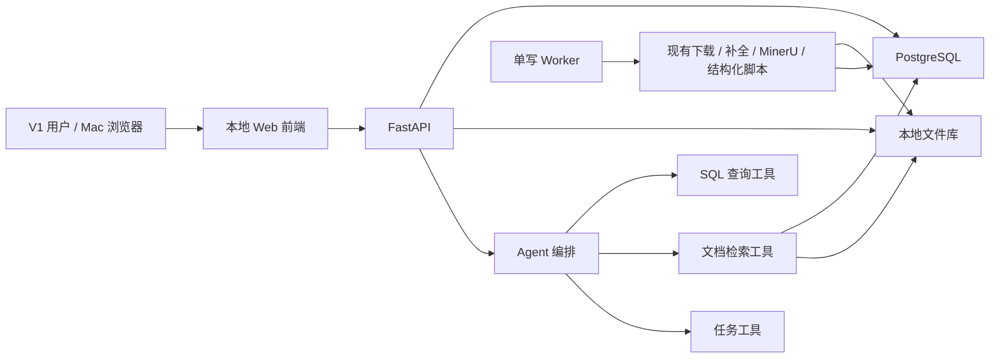

# 基金研究智能看板与知识库 Agent PRD

版本：v1.0  
日期：2026-10-22  
状态：需求基线  
产品形态：本地 Web 应用；V2 扩展到 Windows 共享服务器

## 1. Summary

本项目把现有的基金报告下载、解析和结构化脚本升级为面向投研人员的知识库看板与 Agent。用户可以用预设条件批量更新基金报告，也可以在自然语言模式下调取数据、比较基金、追踪变化并生成带原文页码引用的表格和报告。V1 在单台 Mac 上完成完整功能验收；V2 将同一套能力部署到 Windows 服务器，供约 3 名投研人员共享使用。

## 2. Contacts

| 角色 | 人员/团队 | 职责 |
|---|---|---|
| 项目发起人与 V1 验收人 | 当前用户 | 确定业务范围、提供验收样本、确认上线 |
| 开发与数据维护 | 当前项目开发人员 | 数据源适配、平台开发、模型与提示词维护 |
| 投研用户 | 约 3 名投研人员 | 执行基金筛选、分析任务和报告生成，参与 V2 验收 |

## 3. Background

### 3.1 当前基础

项目已完成 27 家基金管理人的页表和爬虫补全通路。基金主数据已完成 HKEX
2,479 只权威基金导入；当前下载和覆盖率验收范围约为 775 只。下载模块已形成
PDF、MinerU Markdown、结构化 JSON 和 Excel 的批处理链路。现有数据目录约
1.6 GB、6,000 余个文件。

数据源职责已固定：

- `HKEX基金综合资料库_完整_20261008.xlsx` 是基金代码、名称、管理人、伞、
  分类、标签、名称历史和规模快照的权威来源；
- `爬虫list.xlsx` 只提供 775 条基金范围的月报链接、下载命令和来源适配信息；
- 已发布 PDF、Markdown 和结构化结果提供报告正文、指标和证据。

上一轮已验证的覆盖基线约为 **683/775 = 88.1%**。以当前名单计算，V1 的 90% 目标至少需要覆盖 **698 只**，仍有至少 **15 只**的增量空间。

当前结构化处理主要使用 Qwen 和 MinerU 云端 API：

- MinerU 将 PDF 转成 Markdown、表格、图片和版面数据；
- Qwen3.7-Max 做主要字段抽取和分析；
- Qwen3.7-Max 固定日期版本用于失败回退；
- Qwen3.7-Plus 用于页面截图和复杂表格视觉复核。

项目历史记录中已有 775 次成功的 Qwen 调用、10,978,617 tokens。按公开原始价格和缓存用量估算，约花费 14.78 美元，不含 MinerU 账户套餐费用。该数字说明系统已经具备可用基础，但也说明需要模型调用预算、权限和审计能力。

### 3.2 当前问题

1. 下载、解析和结构化主要依赖命令行、Excel 与本地目录，任务状态和历史版本难以统一管理。
2. 投研人员需要手工选择脚本、理解文件路径并核对多份 PDF。
3. 结构化 Excel 可以回答固定问题，但无法快速查询报告原文、解释变化或生成分析报告。
4. 当前外部 API Key 保存在本地配置文件中，不适合多人共享环境。
5. 现有页面和脚本缺少统一的模型路由、调用记录、失败补数和成本统计。
6. 不同基金公司和数据源的名称、伞结构、月报与财报通路差异大，需要保持可审计的适配规则。

### 3.3 为什么现在做

下载模块已覆盖主要基金公司，结构化流程也已产生可验证结果。现在把这些分散能力统一到数据库、看板和 Agent，可以复用现有投入，同时解决投研人员在“找文件、跑脚本、对表格、核原文”上的重复工作。

### 3.4 替代方案

| 替代方案 | 优点 | 不足 | 本项目差异 |
|---|---|---|---|
| 浏览器手工下载 + Excel | 灵活、无需开发 | 重复劳动、无法统一追踪、容易错配 | 固化来源适配、批次和血缘 |
| 通用 BI 工具，如 Superset、Metabase | 图表和权限成熟 | 不管理爬虫、PDF 版本和 Agent 文档链路 | 先完成领域数据模型，再输出 BI 可用视图 |
| OpenBB 等金融数据平台 | 金融数据接口丰富 | 不解决现有基金官网 PDF 和结构化流程 | 聚焦基金报告与投研知识库 |
| Dify、RAGFlow 等知识库平台 | RAG 和工作流启动快 | 与现有任务系统、数据库和发布审计耦合较弱 | 自建业务主链路，可复用 RAG 思想 |
| 通用聊天机器人 | 交互自然 | 容易无引用、数据来源不透明、无法执行内部任务 | Agent 只能调用已注册工具，并强制引用 |

参考项目：

- [Apache Superset](https://github.com/apache/superset)
- [Metabase](https://github.com/metabase/metabase)
- [OpenBB](https://github.com/OpenBB-finance/OpenBB)
- [Dify](https://github.com/langgenius/dify)
- [RAGFlow](https://github.com/infiniflow/ragflow)
- [LangGraph](https://github.com/langchain-ai/langgraph)

## 4. Objective

### 4.1 产品目标

为基金投研人员提供一个统一工作台，完成以下闭环：

```text
选择基金
→ 更新最新报告
→ 解析和结构化
→ 查询、比较和追踪
→ 定位原文
→ 生成表格和报告
```

产品必须满足两种工作方式：

1. 不调用外部生成模型时，仍可完成基金查询、筛选、统计、图表和导出。
2. 使用外部模型时，可完成自然语言问答、原文引用、复杂比较和 Agent 自动任务。

### 4.2 Key Results

所有指标以任务开始时的基金名单为固定分母，任务运行中名单变化不回写本次验收。

| Key Result | 定义 | V1 目标 | V2 目标 |
|---|---|---:|---:|
| 预设任务覆盖率 | 下载、解析或取得允许的财报替代文件并形成可查询结果的基金数 / 任务开始时基金数 | **≥90%** | 保持 ≥90% |
| 问答准确率 | 内部固定评测集中，答案事实正确或足以支持正确结论的题目占比 | **≥80%** | 保持 ≥80% |
| 原文引用正确率 | 引用确实指向正确基金、报告、页码且支持答案的引用数 / 全部引用数 | **≥95%** | 保持 ≥95% |
| 单基金基础查询 | 结构化查询与统计页面从提交到完整返回的 P95，不等待大模型生成 | **≤2 秒** | ≤2 秒 |
| 批量查询/统计 | 确定性 SQL 查询、聚合和表格生成；`n` 为本次基金数，P95 不超过 `2n` 秒 | **≤2n 秒** | ≤2n 秒 |
| 全量更新 | 当前批次全部符合条件基金完成下载、解析和结构化的目标时间；按缓存可用、外部服务正常的条件测量 | **≤2 小时** | ≤2 小时 |
| 共享访问 | 可同时查看、搜索和问答的用户数 | 1 | 3 |

验收样本：

- 覆盖率按当前 775 只基金名单验证，至少 **698 只**成功，即 90%。
- 问答准确率至少使用 100 道题：事实查询、跨基金比较、数值统计、趋势变化、原文定位、无答案问题各不少于 10 道。
- 引用正确率逐条人工核对“基金名、文档版本、页码、原文内容”四项。

## 5. Market Segment(s)

### 5.1 一线基金投研人员

主要用户，约 3 人。需要批量获取最新基金报告、快速比较产品、查询投资构成，并能够追溯每个结论来自哪份文件、哪一页。

核心约束：

- 熟悉基金业务，但不要求懂命令行或爬虫；
- 需要中文自然语言查询；
- 必须能验证模型答案；
- 对数据错配、过期报告和伪造引用零容忍；
- 需要 Excel、Word、PNG 和 Tableau 等常用研究交付形式。

### 5.2 投研团队负责人或运营管理员

V2 用户。需要看到团队共用的数据状态、任务进度、数据覆盖、模型费用和失败原因，并管理用户、默认模型 Key 与任务队列。

核心约束：

- 所有用户必须看到一致的数据版本；
- 任务不能同时写坏正式数据；
- 能分配或撤销权限；
- 能追踪谁在何时执行了什么任务；
- 出现失败时能看到明确原因和补救方法。

### 5.3 数据开发与平台维护人员

V1 和 V2 的支撑用户。负责适配公司脚本、工具注册、数据库迁移、模型配置和发布，不直接替投研人员执行日常查询。

核心约束：

- 新增工具必须受控注册；
- Agent 不能任意执行 Shell 或修改生产脚本；
- 数据、代码和密钥必须分离；
- macOS 开发结果能够迁移到 Windows；
- 出现错误时保留完整日志和可重放参数。

## 6. Value Proposition(s)

### 6.1 一线基金投研人员

- **Who：** 需要持续跟踪大量基金公司和产品的投研人员。
- **Why：** 最新月报分散在数十家官网，文件命名和下载通路不一致；人工下载、整理和核对原文占用大量时间。
- **What before：** 在浏览器、Excel、PDF 和聊天工具之间反复切换，难以确认数据是否最新，也难以复核模型结论。
- **How：** 通过预设任务自动下载和结构化，通过 SQL 看板完成统计，通过 RAG 问答和 Agent 调用内部工具，所有结论返回原文引用。
- **What after：** 用一次选择完成批量更新，用自然语言完成比较和追踪，几分钟内产出带来源的表格和报告。
- **Alternatives：** 手工下载、Excel、通用金融终端、普通文档问答。选择本产品的理由是它同时拥有机构级基金来源适配、统一数据版本和可追溯原文。

价值主张：**让投研人员从整理基金文件转向研究基金本身，并且每个结论都能回到原文。**

### 6.2 投研团队负责人或运营管理员

- **Who：** 管理约 3 人研究团队和共享基金资料的管理者。
- **Why：** 不同人各自保存 Excel 和 PDF，容易出现版本不一致、重复下载和费用无法归集。
- **What before：** 依赖个人电脑和共享盘，任务状态靠口头同步，模型费用和 API Key 难以管理。
- **How：** 使用中央数据库、单写多读任务锁、批次快照、用户级模型凭证和审计日志。
- **What after：** 团队看到同一份已发布数据，任务互不覆盖，费用和来源可追踪。
- **Alternatives：** 共享文件夹、Excel 协作、每个人独立安装。选择本产品的理由是数据一致、任务可控、更新可回滚。

价值主张：**让团队共享同一份可信数据，同时保留每个人的分析空间和费用边界。**

### 6.3 数据开发与平台维护人员

- **Who：** 维护 27 家基金公司脚本、数据模型和 Agent 工具的开发人员。
- **Why：** 官网结构经常变化，PDF 形态复杂，直接让大模型自由操作脚本会产生安全和可维护性风险。
- **What before：** 分散脚本、命令行日志和手工表格，错误难以复现。
- **How：** 使用数据库主数据、工具注册表、标准化输出、任务状态机、版本化模型和可观测性。
- **What after：** 能按基金、批次和工具版本定位问题，并在 Mac 验证后迁移至 Windows。
- **Alternatives：** 继续维护单体命令行程序或直接采用通用 Agent 平台。选择本产品的理由是领域流程、权限和审计均可控。

价值主张：**把不稳定的网站差异封装在可测试的适配器中，让 Agent 使用工具而不是猜测流程。**

## 7. Solution

### 7.1 用户体验与核心流程

#### 7.1.1 首页

首页展示：

- 基金总数、公司和伞数量；
- 最近一次成功批次；
- 最新报告期和过期报告数量；
- 当前覆盖率及 90% 目标达成情况；
- 缺口原因分布；
- 当前运行任务或“无运行任务”；
- 模型调用次数、token 和费用；
- 可快速进入基金浏览、知识库、Agent 和任务中心。

#### 7.1.2 预设任务流程

```text
选择范围：全量 / 公司 / 标签 / 单基金
→ 选择阶段：下载 / 解析 / 结构化 / 全流程
→ 查看预计基金数和缺口
→ 提交任务
→ 获取任务锁
→ staging 执行
→ 查看实时状态和失败原因
→ 成功后发布数据库快照并释放任务锁
```

规则：

- 任务开始时冻结基金名单和数量；
- 运行中其他用户只能读取上一份已发布快照；
- 同一时间只允许一个写任务；
- 任务完成后数据库和文件原子发布；
- 失败任务不回滚已下载的原始文件，但不能污染正式业务数据。

#### 7.1.3 基础查询流程

```text
筛选公司/标签/基金/报告期
→ SQL 查询结构化数据
→ 表格和图表
→ 导出 XLSX/PNG/DOCX
```

该流程不调用外部生成模型，断网时仍可运行。

#### 7.1.4 自然语言研究流程

```text
输入问题
→ 识别基金、日期、指标和分析意图
→ 结构化数据查询 + 文档混合检索
→ 重排并选择证据
→ 外部模型生成回答
→ 展示答案、表格、图表和原文引用
```

如果问题只涉及统计，系统优先使用 SQL；涉及报告解释和原文时使用 RAG。检索不到可靠证据时应明确说明并停止推断。

#### 7.1.5 Agent 智能模式

```text
输入任务
→ 生成结构化执行计划
→ 校验工具、参数和权限
→ 用户确认计划
→ 单写任务锁
→ 调用已注册工具
→ 自动重试、切换已注册备用通路或补充缺失文件
→ 产出数据表、分析文本、日志和引用
```

### 7.2 Key Features

#### 7.2.1 产品与平台

| ID | 功能 | V1 目标 | V2 目标 |
|---|---|---|---|
| PLAT-01 | 应用形态 | Mac 本地 Web 应用，单用户；浏览器访问本机地址 | Windows 服务器运行，Windows/mac 浏览器访问 |
| PLAT-02 | 用户与权限 | 本地单用户，无复杂角色 | 管理员、投研用户；每人独立账号 |
| PLAT-03 | 任务执行模式 | 单个写任务；其余查询操作可继续 | 3 人同时查看、搜索、问答；单写多读；请求可排队 |
| PLAT-04 | 数据发布 | 下载/解析/结构化先写 staging；成功后原子发布 | 延续 V1，并支持批次审计和多人可见状态 |
| PLAT-05 | Excel 定位 | `爬虫list.xlsx` 作为 V1 初始导入和导出格式 | 数据库为唯一主数据，Excel 只做导入/导出 |
| PLAT-06 | 审计与回溯 | 保存任务、模型、提示词、工具和产物版本 | 增加用户级操作、费用和权限审计 |

#### 7.2.2 数据与基金主数据

| ID | 功能 | V1 目标 | V2 目标 |
|---|---|---|---|
| DATA-01 | PostgreSQL 主库 | 建立公司、伞、基金、份额、补充报告来源、标签、文档、任务、解析、指标表 | 在共享服务器运行同一正式 schema |
| DATA-02 | 批次与快照 | 每次任务有固定 `batch_id`，发布后切换当前快照 | 保留批次编号以支持追溯，不额外建设快照管理界面 |
| DATA-03 | 文档版本 | PDF、Markdown、结构化结果通过哈希去重并保留版本 | 增加来源文件变更和多人下载审计 |
| DATA-04 | 数据血缘 | 字段可追踪到文档、页码、解析器、模型和提示词 | 保持，并记录新接入数据源的来源 |
| DATA-05 | 数据质量 | 基金、日期、币种、金额、权重、来源约束 | 保持现有规则约束和异常展示 |
| DATA-06 | 现有基金来源 | 使用现有 27 家公司下载/补全脚本 | 保持并增加工具版本管理 |
| DATA-07 | 港交所月度基金库 | 不新增实时来源 | 按港交所发布状态增量更新月度基金数据库 |
| DATA-08 | ETF 历史查询 | 不包含 | 从港交所及披露易获取 ETF 历史数据 |
| DATA-09 | 互认基金持仓历史 | 不包含 | 从披露易/中证登相关披露获取历史持仓 |
| DATA-10 | Bloomberg 历史点位 | 不包含 | 通过已授权的 Bloomberg API 查询历史指标和时点数据 |

#### 7.2.3 下载与任务中心

| ID | 功能 | V1 目标 | V2 目标 |
|---|---|---|---|
| TASK-01 | 预设范围 | 全量、指定公司、指定标签、指定基金 | 保持 |
| TASK-02 | 下载策略 | 最新月报优先；无月报时允许年报/中报等替代 | 保持，并展示文件类型和替代原因 |
| TASK-03 | 现有爬虫调用 | 接入 27 家公司脚本和补全逻辑 | 扩展新数据源和工具版本管理 |
| TASK-04 | 覆盖统计 | 按任务开始名单计算覆盖率，目标 ≥90% | 保持相同口径 |
| TASK-05 | 失败处理 | 记录错误、支持单基金重试、切换已注册备用通路 | 保持，并支持多人查看统一失败状态 |
| TASK-06 | 进度与日志 | 阶段、基金、成功、跳过、失败、耗时、原因 | 3 人实时查看，不建设额外通知系统 |
| TASK-07 | 任务取消 | V1 可取消当前本地任务 | V2 仅发起人或管理员可取消 |
| TASK-08 | 任务锁 | 数据库租约锁 + heartbeat，防重复执行 | 同一全局写锁，支持排队和崩溃自动释放 |

#### 7.2.4 PDF 解析与结构化

| ID | 功能 | V1 目标 | V2 目标 |
|---|---|---|---|
| PARSE-01 | PDF 解析 | MinerU precise + VLM；保留 Markdown、表格、图片和页码 | 增加并行批处理和解析器健康监控 |
| PARSE-02 | 解析降级 | MinerU 失败时使用本地 PDF 文本层并标记质量风险 | 保持 |
| PARSE-03 | 权益基金抽取 | 基金规模、前十大持仓、地区、行业、报告期、分红等 | 保持 |
| PARSE-04 | 固收基金抽取 | 规模、久期、收益率、评级、期限、地区、持仓等 | 保持 |
| PARSE-05 | 复杂页面复核 | Qwen3.7-Plus 查看选定页面或表格图片 | 保持 |
| PARSE-06 | 结果校验 | JSON 校验、权重合计、日期、币种、来源一致性 | 保持 |
| PARSE-07 | 缓存 | 按 PDF 哈希、解析器和模型版本复用 | 使用共享缓存以减少重复解析 |

#### 7.2.5 看板与基础查询

| ID | 功能 | V1 目标 | V2 目标 |
|---|---|---|---|
| VIEW-01 | 基金总览 | 公司、标签、伞、报告期、规模、最新状态 | 3 人共享查看同一份已发布快照 |
| VIEW-02 | 基金详情 | 基本信息、下载记录、解析状态、结构化和原文入口 | 保持多人查看 |
| VIEW-03 | 筛选与排序 | 公司、标签、大类、报告期、文件状态等 | 保持 |
| VIEW-04 | 基础统计 | 数量、规模、分布、覆盖率、缺口、趋势；提供 Tableau 可读取的稳定统计视图 | 保持相同视图，不建设自定义看板设计器 |
| VIEW-05 | 跨基金比较 | 最多可选择多个基金横向比较结构化字段 | 保持 |
| VIEW-06 | 时间变化 | 按月/季度/年对比结构化指标 | 保持 |
| VIEW-07 | 无模型查询 | 不调用外部模型即可完成，目标单基金 P95 ≤2 秒 | 保持可用 |
| VIEW-08 | 批量统计 | `n` 为本次基金数，目标 P95 ≤`2n` 秒 | 保持并优化缓存 |
| VIEW-09 | 数据透视与 Tableau 交付 | Web 右侧“数据透视”使用 1～2 个 ECharts 预设图，如当前基金规模直方图和规模趋势；Tableau Desktop 通过只读 PostgreSQL 视图提供深入分析和研究工作簿交付 | 保持 ECharts 网页图表和 Tableau Desktop 工作簿出口 |
| VIEW-10 | 数据质量页 | 缺失文档、过期报告、解析错误、字段异常 | 保持 |
| VIEW-11 | 原文定位 | 打开 PDF 和 Markdown，并定位到指定页码 | 保持，支持通过系统内部链接打开同一原文 |

ECharts 网页图表与 Tableau Desktop 工作簿的筛选和指标口径必须一致：

- 两侧共同使用只读数据库视图，不允许 Tableau 回写业务表；
- Web 内全部图表由 ECharts 渲染，右侧规模直方图和规模趋势必须跟随当前已发布快照和当前基金范围；
- 预设视图的基金、标签、报告期筛选条件由用户选择；
- V1 验收必须完成 ECharts 图表刷新和一次 Tableau Desktop 工作簿打开或交付。

#### 7.2.6 知识库与自然语言问答

| ID | 功能 | V1 目标 | V2 目标 |
|---|---|---|---|
| RAG-01 | 文档切片 | 按页、章节、表格切片，保留基金、报告期和页码 | 保持 |
| RAG-02 | 检索策略 | 结构化 SQL + 全文检索 + 本地向量检索 + rerank | 保持，并优化共享缓存 |
| RAG-03 | 单基金问答 | 查询事实、解释报告、定位原文 | 保持 |
| RAG-04 | 跨基金比较 | 比较规模、持仓、地区、行业、久期、评级等 | 保持 |
| RAG-05 | 变化追踪 | 说明两个报告期之间哪些指标和文字发生变化 | 保持 |
| RAG-06 | 原文引用 | 每条事实性结论至少有一个“文档 + 页码”引用 | 保持引用可点击跳转 |
| RAG-07 | 无答案处理 | 证据不足时拒绝编造，并说明缺少什么数据 | 保持 |
| RAG-08 | 引用验收 | 引用正确率 ≥95% | 保持 ≥95% |
| RAG-09 | 问答验收 | 100 道内部题准确率 ≥80% | 保持 ≥80% |

#### 7.2.7 Agent 智能模式

| ID | 功能 | V1 目标 | V2 目标 |
|---|---|---|---|
| AGENT-01 | 自然语言任务 | 将任务拆成结构化步骤并选择已注册工具 | 保持 |
| AGENT-02 | 执行确认 | 涉及写文件或下载时，先显示计划和影响范围 | 保持执行确认 |
| AGENT-03 | 工具范围 | 只能调用已注册的下载、解析、结构化、查询和报告工具 | 增加港交所、ETF、互认基金和 Bloomberg 工具 |
| AGENT-04 | 失败重试 | 对超时和临时错误限次重试；切换已注册备用通路 | 保持队列和重试状态，不建设额外通知系统 |
| AGENT-05 | 写任务控制 | 执行前申请全局任务锁 | 3 人共享同一锁，其他任务排队 |
| AGENT-06 | 任务产物 | 保留计划、调用记录、文件、表格、报告和错误 | 保持，并记录用户和费用 |
| AGENT-07 | 安全 | 禁止任意 Shell、脚本生成、未审批工具和任意 URL | 保持相同安全边界 |
| AGENT-08 | 新工具接入 | 开发人员注册，自动测试后人工批准 | V2 新数据源沿用相同注册流程 |

#### 7.2.8 模型与 API Key

| ID | 功能 | V1 目标 | V2 目标 |
|---|---|---|---|
| MODEL-01 | 外部模型开关 | 可完整关闭外部生成模型，基础功能仍可用 | 保持 |
| MODEL-02 | 固定模型白名单 | 预置 Qwen3.7-Max、固定版本回退和 Qwen3.7-Plus | 保持相同白名单；扩充模型不纳入 V2 |
| MODEL-03 | 默认 Key | 使用同一套项目 Key | 使用服务器统一管理的公司 Key |
| MODEL-04 | 个人 Key | V1 用户可覆盖同一模型的默认 Key | 每名投研人员可保存并选择自己的 Key |
| MODEL-05 | Key 限制 | 用户不能修改 provider、base URL 和 model ID | 保持 |
| MODEL-06 | Key 安全 | macOS Keychain/环境变量；禁止日志和前端明文 | Windows Credential Manager/DPAPI、加密数据库 |
| MODEL-07 | 用量与费用 | 记录调用、token、模型、耗时和估算费用 | 增加按用户、任务和模型的用量汇总 |
| MODEL-08 | 回退 | 主模型失败切固定版本模型 | 保持相同回退规则 |

固定模型配置：

- 默认结构化抽取：`deepseek-flash`（非思考模式）
- 复杂文本备用：`deepseek-v4-pro`
- 视觉复核：`deepseek-flash`
- 兼容保留：`qwen3.7-max`、`qwen3.7-max-2026-06-08`、`qwen3.7-plus`
- PDF 解析：MinerU `vlm`
- 本地检索向量：优先使用本地 Embedding

#### 7.2.9 输出与外部数据

| ID | 功能 | V1 目标 | V2 目标 |
|---|---|---|---|
| OUTPUT-01 | 对话文本 | 展示回答、依据、指标口径和限制 | 保持 |
| OUTPUT-02 | 在线表格 | 排序、筛选、分页、下载 | 保持 |
| OUTPUT-03 | XLSX | 导出结构化结果和引用清单 | 保持 |
| OUTPUT-04 | DOCX | 生成带标题、表格、图表和来源页的简要报告 | 保持 |
| OUTPUT-05 | PNG | 导出看板和 Agent 生成图表 | 保持 |
| OUTPUT-06 | Bloomberg | 不包含 | 通过已授权 Bloomberg API 查询历史点位 |

### 7.3 Technology

#### 7.3.1 V1 本地架构



建议技术：

- 后端：Python 3.11、FastAPI、Pydantic、SQLAlchemy、Alembic；
- 前端：React + TypeScript + Vite；表格使用 AG Grid，图表使用 ECharts；
- 数据库：PostgreSQL + pgvector；
- 文件：本地目录，路径和 SHA-256 入库；
- 任务：独立 Worker，数据库任务表和租约锁；
- PDF：MinerU，必要时降级到本地文本层；
- 模型：OpenAI-compatible Qwen 客户端；
- Agent：显式状态机，必要时引入 LangGraph；
- 报告：Markdown、python-docx、openpyxl、PyMuPDF/图表渲染；
- 图表：Web 内使用 ECharts；Tableau Desktop 连接 PostgreSQL 只读视图作为分析和交付出口；
- 日志：结构化 JSON 和浏览器实时进度。

#### 7.3.2 数据模型

至少包含：

- `managers`：基金管理人；
- `umbrellas`：伞基金；
- `funds`：基金主数据；
- `share_classes`：份额、币种、ISIN；
- `fund_report_sources`：crawler 月报链接、备选链接、下载命令和匹配状态；
- `tags`、`fund_tags`：标签；
- `documents`、`document_versions`：报告文件；
- `jobs`、`job_steps`、`job_attempts`、`job_events`：任务状态；
- `job_locks`：单写租约；
- `parse_runs`：解析器版本和产物；
- `fund_metrics`：结构化指标；
- `fund_holdings`：前十大持仓；
- `fund_allocations`：地区、行业、期限、评级分布；
- `document_pages`、`document_chunks`、`chunk_embeddings`：知识库；
- `model_profiles`、`model_credentials`：模型和凭证；
- `agent_runs`、`tool_calls`、`citations`：Agent 审计；
- `artifacts`：报告、图表和导出文件。

发布原则：

1. 原始文件不可变，新版本新增记录；
2. 任务只写 staging 或带 `batch_id` 的未发布记录；
3. 成功后在事务中切换当前快照；
4. 所有看板默认读取当前已发布快照；
5. 每个回答保存所用快照和文档版本。

#### 7.3.3 V2 Windows 共享部署

- 服务器本机运行 PostgreSQL、FastAPI、Worker 和 Agent；
- 3 名用户通过局域网浏览器访问；
- 代码通过私有 GitHub 仓库和 Windows 构建发布包交付；
- 数据、配置、日志和密钥不进入发布包；
- PostgreSQL 使用 Windows 服务，FastAPI/Worker 使用服务启动器；
- 服务器具备定时备份和恢复演练；
- 数据库不是共享文件，客户端不得直接连接数据库；
- Tableau Desktop 通过服务器数据库只读视图连接；Web 右侧数据透视由 ECharts 直接渲染。

### 7.4 Assumptions and Open Questions

1. **全量更新 2 小时的计算范围**暂定义为：对任务开始时名单中符合条件的最新报告完成下载、解析和结构化，不包含所有历史报告的冷启动重跑。若要求从零重建全部历史资料，需单独设定 SLA。
2. `2n` 秒中的 `n` 暂定义为本次请求基金数量，适用于确定性 SQL 查询、统计和表格生成；包含外部大模型推理和多轮 Agent 的任务不受此指标约束。
3. 90% 覆盖率按任务锁定时的基金名单计算。若 775 只名单中每只都有符合业务许可的月报或替代财报，目标为至少 698 只。
4. V1 的问答准确率由当前唯一验收人按预先编写的 100 道题和标准答案人工判定。
5. V1 的 Web 右侧数据透视完全由 ECharts 实现，不依赖 Tableau Server/Cloud；Tableau Desktop 用于深入分析和研究工作簿交付，需要本机 Desktop 许可证。
6. V1 的外部模型能力允许使用现有 Qwen 和 MinerU 云 API。若后续禁止报告外传，需另立本地模型项目。
7. 外部模型不可用时，“基础模式”的全部查询、统计和导出必须保持可用，不能因 RAG 或 Agent 故障阻断。
8. API Key 当前由外置状态目录中的明文 `config.ini` 管理，代码包只保留 `config.example.ini`。线上共享前必须使用受批准的密钥存储并轮换 Key。
9. Qwen 和 MinerU 的并发、限流、费用会影响 2 小时目标，需要在真实 775 只名单上压测。
10. Bloomberg API 和部分港交所数据需要相应许可证、账号或网络权限，V2 上线前需确认。
11. “港交所月度基金数据库实时更新”定义为任务执行时能获取港交所当时已公开发布的最新数据，不建设分钟级流式同步。
12. V1 ECharts 数据透视不依赖 Tableau；Tableau 工作簿交付验收需要本机可用的 Tableau Desktop 许可证。

### 7.5 Risks

| 风险 | 影响 | 缓解方式 |
|---|---|---|
| 2 小时全量更新无法只靠串行 MinerU 完成 | 无法达到 KR | 缓存复用、并发下载、有限并发解析、分批模型调用、性能压测 |
| 部分基金没有月报或官网已下线 | 覆盖率低于 90% | 月报优先、财报替代、港交所兜底、明确缺口原因 |
| 外部网站变更或反爬 | 任务失败或误配 | 来源适配器、回归测试、备用通路、人工复核 |
| 模型答案或引用错误 | 影响研究判断 | SQL 优先、严格检索、页码引用、禁止证据不足时编造 |
| PDF 表格解析错误 | 结构化指标错误 | 校验规则、视觉复核、异常标记、人工确认 |
| Key 泄漏 | 费用和合规风险 | Keychain/DPAPI、服务端保存、掩码、审计、轮换 |
| 多人并发修改 | 数据版本混乱 | 全局单写锁、staging、发布事务和快照 |
| Windows/mac 路径和进程差异 | 部署失败 | 平台适配层、双系统冒烟测试、Windows 构建 |
| V1 范围过大 | 延迟交付 | 先打通端到端主链路，再扩展模板和高级来源 |

## 8. Release

### 8.1 V1：Mac 单机完整验收集

V1 由一名用户在一台 Mac 上开发和验收。它必须完成端到端产品闭环，而不是技术演示。

| 发布项 | V1 范围 |
|---|---|
| 数据库 | PostgreSQL 正式主库 |
| 数据导入 | HKEX 2,479 只基金、775 条 crawler 补充、661 条改名及现有结构化结果迁入数据库 |
| 下载任务 | 全量、公司、标签、基金；现有爬虫补全通路 |
| 任务控制 | 单写任务锁、staging、发布快照、失败重试 |
| 看板 | 总览、基金浏览、详情、数据质量和任务中心 |
| 基础查询 | 无外部模型可用；P95 ≤2 秒；批量统计 ≤2n 秒 |
| 知识库 | 页级切片、向量+全文检索、rerank |
| 问答 | 单基金、跨基金比较、变化追踪、原文页码引用 |
| Agent | 自然语言任务、工具调用、失败处理、补数和报告输出 |
| 输出 | 文本、在线表格、XLSX、DOCX、PNG |
| 图表与交付 | Web 右侧 ECharts 规模直方图和规模趋势；Tableau Desktop + PostgreSQL 只读视图作为分析和交付出口 |
| 模型 | Qwen 固定白名单、默认 Key、个人同模型 Key 覆盖 |
| 验收 | 覆盖率 ≥90%、问答 ≥80%、引用 ≥95% |

建议实施顺序：

1. 建立 PostgreSQL 数据模型和 Excel 迁移；
2. 接入现有下载/解析/结构化脚本和任务锁；
3. 建立总览、基金查询和基础统计；
4. 建立页级知识库和带引用问答；
5. 建立 Agent 工具注册、计划和失败恢复；
6. 接入 DOCX、XLSX、PNG、ECharts 预设图和 Tableau Desktop 工作簿；
7. 完成 100 题评测、775 只基金覆盖和 2 小时压测。

### 8.2 V2：Windows 三人共享与扩展

| 发布项 | V2 范围 |
|---|---|
| 部署 | Windows 服务器常驻运行 |
| 用户 | 约 3 人共享访问，管理员与投研用户分权 |
| 并发 | 多读单写，任务队列，快照隔离 |
| 代码发布 | 私有 GitHub、Windows Runner、版本化发布包、回滚 |
| 数据源 | 港交所月度基金库、ETF 历史、互认基金中证登持仓、Bloomberg |
| 图表与交付 | 保持 ECharts 网页图和 Tableau Desktop 只读工作簿通路，不引入 Tableau Server |
| 密钥 | 公司默认 Key + 用户个人同模型 Key，加密保存 |
| 运维 | 服务自启动、备份、基础运行监控和审计 |

### 8.3 明确不做

- 不在 V1 实现 Windows 服务部署和多用户认证；
- 不让用户输入任意模型、任意 Base URL；
- 不允许 Agent 任意执行 Shell、修改或生成生产爬虫；
- 不建设 Tableau Server/Web 嵌入，也不建设多人 Tableau 编辑协作；
- 不建设评论、批注、收藏、自定义看板设计器或事件标注；
- 不做团队共享任务模板和定时通知；
- 不在 V2 自动扩充新的外部模型供应商；
- 不把全部 PDF 压缩成普通文本块而丢失页码；
- 不在没有证据时生成确定结论；
- 不提供买卖建议、交易执行或自动下单；
- 不把 PDF 本体存入 PostgreSQL；
- 不承诺无缓存条件下 2 小时重建全部历史数据；
- 不建设 Tableau Server/Web 嵌入，也不在 V1 接入 Bloomberg。
