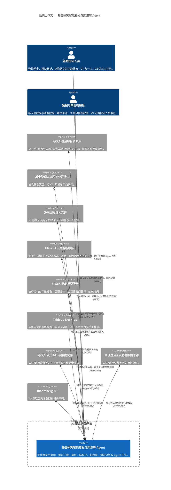

# Level 1 — System Context — 基金研究智能看板与知识库 Agent

> **Diagram type**: System Context  
> **Scope**: 用户、基金研究平台、外部基金数据源、模型服务、分析工具和收益数据源之间的关系  
> **Audience**: 产品负责人、投研用户、开发人员、运维人员

## Overview

基金研究平台把港交所基金名单、基金管理人官网报告、MinerU 解析、Qwen 结构化抽取、数据库查询和 Agent 分析连成一条可追踪的流程。V1 在单台 Mac 上供一人完成全部功能验收；V2 在 Windows 主机上供约三名投研人员共享。

V1 的下载覆盖率按任务开始时选择的基金名单计算，当前基线为 775 只。系统数据模型支持港交所全部 2,479 只基金，27 家已适配管理人先打通链路，其他管理人分批加入。V1 不调用 Bloomberg，收益分析所需的净总回报由投研人员导入；V2 再接入 Bloomberg API。

基金主身份以 HKEX 综合资料库的 2,479 个唯一基金代码为准；crawler 工作簿
中的 775 行只提供月报页面链接、运行方式和来源适配信息，不能作为基金主数据。

## Diagram

## Legend

- 实线箭头表示数据或请求方向。
- 箭头文字说明业务意图。
- `V1` 表示 Mac 单机原型必须实现。
- `V2` 表示 Windows 共享版本或后续数据扩展。
- 外部系统只提供数据、解析或模型能力，不作为正式业务数据库。

## Elements

| Element | Type | Technology | Responsibility | Version |
|---|---|---|---|---|
| 基金投研人员 | Person | — | 选择基金范围，执行下载、查询、比较、追踪和报告任务 | V1、V2 |
| 数据与平台管理员 | Person | — | 导入月度名单与收益文件，维护适配器、模型和权限 | V1、V2 |
| 基金研究平台 | Software System | FastAPI、React、Python Worker、PostgreSQL | 管理基金研究全链路和正式数据 | V1、V2 |
| 港交所基金综合资料库 | External System/Data Source | XLSX | 提供月度基金全量名单、分类和历史规模 | V1、V2 |
| 基金管理人官网与公开接口 | External System | HTTPS、HTML、JSON、PDF | 提供月报、年报和替代财报 | V1 27 家起步 |
| 净总回报导入文件 | External Data Source | XLSX | 提供无 Bloomberg 环境下的收益数据 | V1 |
| MinerU | External System | Cloud API | 解析 PDF 版面、表格和图片 | V1、V2 |
| Qwen | External System | OpenAI-compatible API | 结构化抽取、视觉复核、问答和 Agent | V1、V2 |
| Tableau Desktop | External System | Tableau、PostgreSQL/JDBC | 连接只读统计视图进行深入分析、制作和交付工作簿 | V1、V2 |
| 港交所公开 API 与披露文件 | External System | HTTPS/API/PDF | 自动更新港交所基金和 ETF 数据 | V2 |
| 中证登及互认基金披露来源 | External System | HTTPS/PDF | 获取历史持仓披露 | V2 |
| Bloomberg API | External System | Bloomberg API | 自动获取历史净总回报 | V2 |

## Key Relationships

| From | To | Intent | Protocol |
|---|---|---|---|
| 投研人员 | 平台 | 选择名单、提交任务、查询分析和下载报告 | HTTPS/JSON、SSE |
| 管理员 | 平台 | 导入主数据和收益文件，配置来源和模型 | HTTPS/文件上传 |
| 平台 | 港交所基金综合资料库 | 读取全量基金主数据 | XLSX |
| 平台 | 基金管理人官网 | 发现并下载最新报告 | HTTPS/JSON/HTML/PDF |
| 平台 | MinerU | 提交 PDF 并取回 Markdown、表格和图像 | HTTPS/API |
| 平台 | Qwen | 提交上下文与页面图像，请求抽取和回答 | HTTPS/API |
| Tableau Desktop | 平台 | 查询已发布统计视图 | PostgreSQL/JDBC |
| 平台 | 港交所公开 API | 增量读取基金和 ETF 披露 | HTTPS/API |
| 平台 | 中证登披露来源 | 获取互认基金历史持仓 | HTTPS/PDF |
| 平台 | Bloomberg API | 拉取净总回报时间序列 | Bloomberg API |

## Notable Architectural Decisions

1. **Excel 是输入交换格式，PostgreSQL 是最终数据源。** 这样可以避免多人任务同时修改工作簿。
2. **模型厂商不是系统边界内的组件。** MinerU 和 Qwen 可替换，平台保存自己的输入、输出和审计记录。
3. **收益数据按版本接入。** V1 和 V2 的收益来源不同，但统一进入 `return_series`，下游分析口径一致。
4. **月报底稿不逐页自动复制。** 系统实现可复用的预设分析工具，按当前选择实时计算。
5. **Web 内以 ECharts 为主。** 浏览器图表由业务 API 返回统计数据后由 React ECharts 渲染；Tableau Desktop 读取同一只读视图，承担深入分析与工作簿交付。

## Assumptions

- V1 的 90% 覆盖率针对任务开始时当前选择的 775 只基金，即至少 698 只。
- HKEX 共 187 个规范化管理人实体；当前 27 个公司适配组并非与法人实体一一对应，
  其余管理人的来源适配在主链路稳定后分批完成。
- V1 不具备 Bloomberg 权限时，不把缺失收益数据当成零。
- `月报底稿 v2` 是分析方法和字段口径参考；V1 不自动生成整本 19 页底稿。
- 内部共享盘、OA、Wind 和邮件未纳入当前系统边界。
- V1 Tableau 工作簿输出依赖本机 Tableau Desktop 许可证，不需要 Tableau Server/Cloud 嵌入端点。

## Links to Other Levels

- ↓ [Level 2 Container](02-container.md)
- → [架构总览](README.md)
