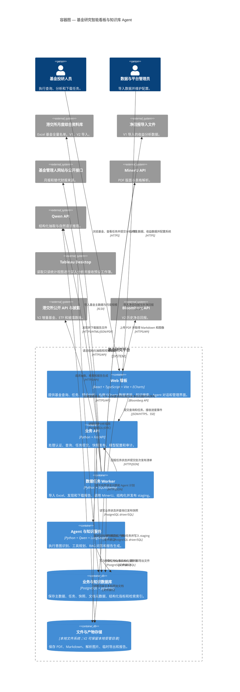

# Level 2 — Container — 基金研究智能看板与知识库 Agent

> **Diagram type**: Container  
> **Scope**: 可独立部署或运行的 Web、API、Worker、Agent、数据库和文件存储  
> **Audience**: 开发、测试、运维和架构评审

## Overview

V1 在 Mac 上运行一个本地 Web 应用。V2 保持相同容器边界，将 Web、API、Worker、Agent 和 PostgreSQL 放到 Windows 服务器。Web 页面的全部图表由 React ECharts 渲染；Tableau Desktop 通过只读数据库视图承担深入分析和研究交付；模型和解析器通过受控适配器调用。

系统采用模块化单体思路，不拆成大量微服务。只有长任务 Worker 和 Agent Runtime 分开进程运行，以便隔离超时、崩溃和资源消耗。

## Diagram

## Legend

- Person：使用系统的角色。
- Container：独立运行的应用、Worker 或存储。
- ContainerDb：持久化数据存储。
- 实线箭头：请求、写入或读取方向。
- V1 使用 Mac 本地文件系统；V2 仍可先使用受管本地目录，不强制引入 MinIO。
- Bloomberg 与港交所实时 API 只在 V2 启用。

## Elements

| Container | Technology | Responsibility | V1 | V2 |
|---|---|---|---|---|
| Web 看板 | React、TypeScript、Vite、ECharts、AG Grid | 页面、ECharts 图表、表格、任务状态、问答和导出入口 | 本机浏览器 | 局域网浏览器 |
| 业务 API | Python、FastAPI、Pydantic | 查询、认证、任务、发布、配置和 SSE | 单用户 | 三用户和角色 |
| 数据任务 Worker | Python | Excel 导入、下载、MinerU、Qwen 抽取和 staging | 单 Worker | 单写 Worker，可独立重启 |
| Agent 与知识服务 | Python、LangGraph、Qwen adapter | 意图识别、工具计划、RAG、引用和报告 | 完整验收 | 共享使用 |
| 业务与知识数据库 | PostgreSQL + pgvector | 主数据、任务、快照、指标、文档和向量 | 本机服务 | Windows 服务 |
| 文件与产物存储 | 本地文件系统 | PDF、Markdown、图片、DOCX、XLSX、PNG | Mac 数据目录 | Windows 受管目录 |

## Key Relationships

| From | To | Intent | Protocol |
|---|---|---|---|
| Web 看板 | 业务 API | 查询基金、提交任务、接收进度和问答结果 | JSON/HTTPS、SSE |
| 业务 API | PostgreSQL | 查询已发布快照并管理任务和配置 | SQL |
| 业务 API | 文件存储 | 提供 PDF、Markdown 和下载产物 | 文件接口 |
| Agent | Qwen | 获取推理、工具决策和回答 | HTTPS/API |
| Agent | PostgreSQL | 检索结构化事实与向量 | SQL |
| Worker | 基金管理人网站 | 下载最新报告 | HTTPS |
| Worker | MinerU | 上传 PDF 并获取解析产物 | HTTPS/API |
| Worker | PostgreSQL | 申请锁、领取任务并写入 staging | SQL |
| Worker | 业务 API | 回报结果并提交批次发布清单 | HTTPS/JSON |
| Tableau | PostgreSQL | 读取只读统计视图 | JDBC |

## Notable Architectural Decisions

1. **模块化单体优先。** 三名用户不需要独立微服务注册、API 网关或消息集群。
2. **Worker 独立进程。** 网站下载和模型解析可能长时间阻塞，不能影响 API 和只读查询。
3. **PostgreSQL 承担任务队列和单写锁。** 第一阶段不引入 Redis 或 RabbitMQ。
4. **Agent Runtime 与规则计算分开。** SQL 查询和模板报告保持确定性，模型只负责需要理解的任务。
5. **文件内容不进入 Git，PDF 也不进入数据库。**
6. **网页图表与 Tableau 工作簿职责分离。** 网页全部使用 ECharts；Tableau Desktop 通过只读视图进行深入分析和交付，不引入 Web 嵌入依赖。

## Assumptions

- V1 每次只执行一个写任务。
- V2 允许三人读取，但仍只允许一个全局写任务。
- pgvector 和 PostgreSQL 全文检索可以满足 V1 小规模知识库。
- V2 暂不建设高可用集群。
- V1、V2 的浏览器图表不依赖 Tableau 服务；Tableau Desktop 许可证仅影响工作簿分析与交付功能。

## Links to Other Levels

- ↑ [Level 1 Context](01-context.md)
- ↓ [Web 前端组件](03-component-web-frontend.md)
- ↓ [业务 API 组件](03-component-api-service.md)
- ↓ [数据任务 Worker 组件](03-component-ingestion-worker.md)
- ↓ [Agent 组件](03-component-agent-service.md)
- ↓ [知识库组件](03-component-knowledge-service.md)
- → [V1 部署](04-deployment-v1-mac.md)
- → [V2 部署](04-deployment-v2-windows.md)
- → [任务发布动态图](05-dynamic-task-publication.md)
