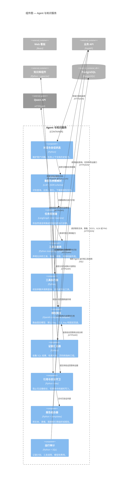

# Level 3 — Component — Agent 与知识服务

> **Diagram type**: Component  
> **Scope**: 自然语言意图、执行计划、工具调用、模型路由、失败恢复和研究报告  
> **Audience**: AI 工程、后端开发、产品负责人、投研验收

## Overview

Agent 服务负责处理自然语言问题和中长期分析任务。它不直接操作文件系统、数据库或命令行，而是调用经过注册的确定性工具。

模型只负责理解问题、选择工具、组织结论和撰写报告。基金数值、日期、状态和统计口径由 SQL 和规则服务提供。

## Diagram

## Legend

- 自然语言解析和文本生成使用 LLM。
- SQL 查询、任务执行和文件导出使用确定性工具。
- 模型和工具都必须经过审计。
- Agent 不能直接访问宿主机 Shell。

## Model Profiles

| Profile | V1 Model | V2 Model | Purpose |
|---|---|---|---|
| `analysis` | Qwen3.7-Max | 保持不变 | 复杂分析、比较和报告 |
| `fallback` | Qwen3.7-Max 固定日期版本 | 保持不变 | 主模型异常或结构输出失败 |
| `vision` | Qwen3.7-Plus | 保持不变 | PDF 页面和图表复核 |

模型、Base URL 和能力由平台固定。用户只能覆盖同一模型的 API Key。

## Elements

| Component | Type | Technology | Responsibility | Version |
|---|---|---|---|---|
| 对话与会话状态 | Component | Python | 维护问题、快照范围、计划状态和会话上下文 | V1、V2 |
| 意图与参数解析 | Component | Qwen、JSON Schema | 识别查询、比较、变化、下载和报告意图 | V1、V2 |
| 任务规划器 | Component | Python、LangGraph | 将意图转换为可验证、可审计的执行图 | V1、V2 |
| 工具注册表 | Component | Python manifest、JSON Schema | 声明工具版本、参数、权限和副作用 | V1、V2 |
| 工具执行器 | Component | Python | 校验参数、调用批准工具并处理返回 | V1、V2 |
| 模型网关 | Component | OpenAI-compatible adapter | 路由固定模型、凭证范围和受控回退 | V1、V2 |
| 证据汇总器 | Component | Python | 合并 SQL 事实、检索片段、页码和口径 | V1、V2 |
| 引用与安全守卫 | Component | Python rules、Schema validation | 阻止无证据结论、越权操作和任意命令 | V1、V2 |
| 报告组合器 | Component | Markdown、python-docx、图表模板 | 组装文本、表格、图表和来源页 | V1、V2 |
| 运行审计 | Component | Python、PostgreSQL | 保存计划、调用、token、费用和错误 | V1、V2 |

## Tool Categories

| Tool category | V1 | V2 |
|---|---|---|
| 基金与标签查询 | 支持 | 支持 |
| 结构化统计 | 支持 | 支持 |
| 文档检索与原文定位 | 支持 | 支持 |
| 预设分析 | 支持 | 支持 |
| 下载与解析任务 | 支持 | 支持 |
| 失败重试和补数 | 支持 | 支持 |
| XLSX、DOCX、PNG | 支持 | 支持 |
| 港交所实时基金库 | 不包含 | 支持 |
| ETF 历史 | 不包含 | 支持 |
| 互认基金持仓历史 | 不包含 | 支持 |
| Bloomberg 历史点位 | 不包含 | 支持 |

## Key Relationships

| From | To | Intent | Protocol / Technology |
|---|---|---|---|
| 业务 API | 对话与会话状态 | 转发已认证问题和任务上下文 | HTTP/JSON |
| 对话与会话状态 | 意图与参数解析 | 请求意图分类和实体抽取 | Python invocation |
| 意图与参数解析 | 任务规划器 | 返回规范化意图和约束 | JSON Schema |
| 任务规划器 | 工具注册表 | 查询已批准工具、版本和参数定义 | Python registry API |
| 任务规划器 | 引用与安全守卫 | 校验工具权限、写入副作用和证据范围 | Python invocation |
| 工具执行器 | 业务 API | 调用基金查询、任务、分析和导出能力 | HTTPS/JSON |
| 工具执行器 | 知识库组件 | 检索证据、片段和页码 | HTTP/JSON |
| 意图、规划器、证据汇总器 | 模型网关 | 请求语义解析、计划和回答生成 | Python invocation |
| 模型网关 | Qwen API | 调用固定模型及批准的回退模型 | HTTPS/API |
| 引用与安全守卫 | 报告组合器 | 交付通过证据和权限校验的内容 | Python invocation |
| 报告组合器 | 业务 API | 请求持久化报告和下载产物 | HTTPS/JSON |
| 运行审计 | PostgreSQL | 追加 Agent 运行、工具和模型调用记录 | PostgreSQL transaction |

## Execution Rules

1. 先判断问题是数值统计、文档解释还是写任务。
2. 数值统计必须使用 SQL 查询工具，不让模型自行计算原始表格。
3. 文档解释必须调用知识库并带回页码。
4. 下载和解析任务必须经过 API 任务服务。
5. 执行写任务前必须获得全局任务锁。
6. Agent 只能重试或切换注册表中的备用工具。
7. 无法完成时返回明确原因，不生成虚假结果。

## Failure and Recovery

| Failure | Action |
|---|---|
| 模型超时 | 重试一次固定模型 |
| 模型限流 | 等待并有上限地重试 |
| 个人 Key 余额不足 | 暂停并让用户选择是否切换公司 Key |
| 工具参数错误 | 修复一次结构化参数，再失败则停止 |
| 下载来源失败 | 尝试已注册备用来源 |
| 检索证据不足 | 拒绝回答并说明缺少的资料 |
| 任务锁被占用 | 进入队列或显示当前任务 |
| Worker 崩溃 | 等到租约过期后重新领取 |

## Notable Architectural Decisions

1. Agent 是受限编排器，不是自由代码执行器。
2. 工具注册表使用版本化 manifest，不把工具名称直接写进提示词。
3. 回答保存工具调用、快照、模型、token 和引用。
4. 模型输出不能绕过数值校验和引用校验。

## Assumptions

- V1 使用 Qwen 现有 OpenAI-compatible 接口。
- V1 的个人 Key 覆盖只允许相同模型 profile。
- Agent 对话并发不会修改正式快照。
- `LangGraph` 是实现建议；若 V1 状态机规模较小，可保留相同状态与审计模型并改用纯 Python 状态机。

## Links to Other Levels

- ↑ [Container](02-container.md)
- ↔ [业务 API](03-component-api-service.md)
- ↔ [知识库](03-component-knowledge-service.md)
- → [任务发布动态图](05-dynamic-task-publication.md)
