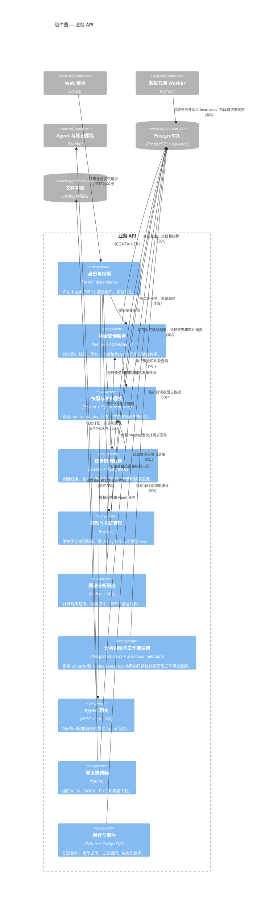

# Level 3 — Component — 业务 API

> **Diagram type**: Component  
> **Scope**: FastAPI 业务服务内部职责和存储交互  
> **Audience**: 后端开发、数据库设计、测试

## Overview

业务 API 是所有写操作和读操作的统一入口。它负责用户身份、基金查询、任务提交、快照发布、模型配置、ECharts 透视数据、Tableau 工作簿元数据和 Agent 调用。

写任务并不在 API 进程内执行。API 只创建任务并传达状态，实际工作由独立 Worker 完成。

## Diagram



## Legend

- Component：运行在 API 进程中的职责模块。
- 黑色箭头表示调用方向。
- Worker 和 Agent 是独立容器。
- 数据库和文件存储是持久化容器。

## Elements

| Component | Type | Technology | Responsibility | Version |
|---|---|---|---|---|
| 身份与权限 | Component | FastAPI dependency | 识别用户并执行角色、资源和操作授权 | V1 单用户；V2 三角色 |
| 基金查询服务 | Component | Python、SQLAlchemy | 查询基金、伞、管理人、文档和指标 | V1、V2 |
| 快照与发布服务 | Component | Python、PostgreSQL transaction | 管理批次状态、staging 校验、发布和回滚 | V1、V2 |
| 任务协调服务 | Component | FastAPI、PostgreSQL | 创建任务、排队、租约锁、取消和进度读取 | V1、V2 |
| 模型与凭证管理 | Component | FastAPI、加密存储适配器 | 管理固定模型配置和个人同模型 Key | V1、V2 |
| 预设分析服务 | Component | Python、参数化 SQL | 计算确定性统计和预设分析结果 | V1、V2 |
| 分析视图与工作簿注册 | Component | PostgreSQL view、元数据表 | 为 ECharts 和 Tableau Desktop 提供同口径只读视图及工作簿元数据 | V1、V2 |
| Agent 网关 | Component | Python HTTP client、SSE | 转发问答、计划和执行确认 | V1、V2 |
| 导出协调器 | Component | Python、openpyxl、python-docx | 组织 XLSX、DOCX、PNG 和在线表格导出 | V1、V2 |
| 审计与事件 | Component | Python、PostgreSQL | 追加操作、模型、工具、费用和错误记录 | V1、V2 |

## API Boundary

建议将 API 划分为以下逻辑端点：

```text
GET    /api/funds
GET    /api/funds/{code}
GET    /api/funds/{code}/documents
GET    /api/funds/{code}/metrics
GET    /api/analytics/overview
POST   /api/analytics/query
GET    /api/analytics/perspectives
GET    /api/analytics/tableau/workbooks
POST   /api/jobs
GET    /api/jobs/scope-options
GET    /api/jobs/{id}
GET    /api/jobs/{id}/events
POST   /api/jobs/{id}/cancel
POST   /api/internal/jobs/{id}/events
POST   /api/internal/jobs/{id}/publish
POST   /api/imports/hkex
POST   /api/imports/returns
POST   /api/chat
POST   /api/agent/plans
POST   /api/agent/runs
POST   /api/exports
GET    /api/model-profiles
PUT    /api/model-credentials/{profile_id}
```

接口细节在实现阶段使用 OpenAPI 定义，以上仅表示边界。

## Key Relationships

| From | To | Intent | Protocol / Technology |
|---|---|---|---|
| Web 看板 | 身份与权限 | 携带会话和用户身份请求业务能力 | HTTPS/JSON、Cookie 或 Bearer Token |
| 身份与权限 | 基金查询、任务、Agent、模型管理 | 校验角色、资源范围和操作许可 | 进程内依赖注入 |
| 基金查询服务 | 快照与发布服务 | 确定本次请求允许读取的已发布快照 | Python 调用 |
| 基金查询服务 | PostgreSQL | 读取基金、文档和指标 | PostgreSQL driver、参数化 SQL |
| 预设分析服务 | PostgreSQL | 执行确定性聚合、比较和导出查询 | PostgreSQL driver、参数化 SQL |
| 任务协调服务 | PostgreSQL | 创建任务、申请租约锁并更新状态 | PostgreSQL transaction |
| 数据任务 Worker | PostgreSQL | 领取任务、续约 heartbeat 并写 staging | PostgreSQL transaction |
| 数据任务 Worker | 快照与发布服务 | 提交 manifest 并申请发布批次 | HTTPS/JSON |
| Agent 网关 | Agent 与知识服务 | 转发问答、计划和执行确认 | HTTP/JSON、SSE |
| 模型与凭证管理 | PostgreSQL | 保存固定配置和加密凭据状态 | PostgreSQL driver |
| 导出协调器 | 文件存储 | 读取模板并保存导出产物 | 受管文件接口 |
| Tableau Desktop | PostgreSQL | 读取只读统计视图 | PostgreSQL/JDBC |
| 审计与事件 | PostgreSQL | 追加不可变操作和调用记录 | PostgreSQL append-only table |

## Notable Architectural Decisions

1. 写任务由数据库任务表协调，不通过 API 进程执行。
2. 任务锁身份、heartbeat 和过期时间保存在 PostgreSQL，保证崩溃后可恢复。
3. 查询接口必须绑定快照 ID；运行中任务不会污染只读结果。
4. API 不接受任意 SQL。Agent 使用参数化查询工具。
5. 个人模型 Key 写入后只返回“已配置”和掩码信息。
6. 只有 API 的发布服务切换 `current_batch_id`；Worker 不直接发布正式快照。

### 2026-11-09 周验收补充

知识问答和受控 Agent 已接入同一快照边界：查询只读已发布快照，写任务先生成计划并等待确认，确认后复用现有 Job/Worker/发布链路。Worker 的租约和 heartbeat 仍由 PostgreSQL 管理；开发环境若后台进程生命周期受限，应使用进程管理器或前台会话，不把“启动命令返回”当作常驻成功。

## Assumptions

- V1 可以使用本地单用户身份，但仍保留用户和审计字段。
- V2 的身份系统未定，可接本地账号或公司 SSO。
- PostgreSQL advisory lock 足以满足单台服务器的全局写锁。

## Links to Other Levels

- ↑ [Container](02-container.md)
- → [数据任务 Worker](03-component-ingestion-worker.md)
- → [Agent](03-component-agent-service.md)
- → [动态任务发布流程](05-dynamic-task-publication.md)
