# Level 3 — Component — 数据任务 Worker

> **Diagram type**: Component  
> **Scope**: Excel 导入、基金来源发现、报告下载、解析、结构化、校验与 staging 发布  
> **Audience**: 数据工程师、爬虫开发、测试、运维

## Overview

Worker 承载现有下载、补全、MinerU 和结构化脚本。它把“脚本集合”变成可恢复、可观察的任务执行器。

V1 先覆盖 27 家已适配管理人，但基金主数据模型覆盖港交所全部 2,479 只。新增管理人只需要注册来源适配器，不改变 API、数据库和前端主流程。

Excel 导入器将 HKEX 主数据与 crawler 补充数据分开处理：HKEX 提供基金稳定
身份、关系、分类、标签、改名和规模；crawler 工作表提供
`monthly_report_url`、备选链接和 `run_command`。补充行通过基金代码、
管理人、伞、名称和改名历史匹配到唯一基金；未匹配行保留为质量问题。

## Diagram

```mermaid
C4Component
    title 组件图 — 数据任务 Worker

    Container_Ext(api, "业务 API", "FastAPI")
    ContainerDb_Ext(db, "PostgreSQL", "PostgreSQL")
    ContainerDb_Ext(files, "文件存储", "本地文件系统")
    System_Ext(hkex_file, "港交所月度资料库", "Excel")
    System_Ext(return_file, "净回报文件", "Excel")
    System_Ext(manager_sites, "基金管理人网站", "HTTPS/HTML/JSON")
    System_Ext(mineru, "MinerU", "Cloud API")
    System_Ext(qwen, "Qwen", "HTTPS/API")

    Container_Boundary(worker, "数据任务 Worker") {
        Component(job_runner, "任务运行器", "Python", "领取任务、维持 heartbeat、执行步骤并回报状态。")
        Component(lock_guard, "写锁守卫", "PostgreSQL advisory lock", "保证全系统只有一个写任务执行。")
        Component(master_importer, "港交所资料导入器", "openpyxl + validation", "读取主数据和改名表，生成 staging 主数据。")
        Component(return_importer, "净回报导入器", "openpyxl + validation", "导入收益数据并关联基金代码。")
        Component(adapter_registry, "来源适配器注册表", "Python plugins + manifest", "登记 27 家及后续管理人来源、参数和版本。")
        Component(source_backfill, "来源补全器", "Python + company fund_link scripts", "摸查缺失月报链接/运行方式，限制到冻结行，回写平台来源。")
        Component(report_downloader, "报告下载器", "requests + Playwright", "发现月报、年报或中报并下载 PDF。")
        Component(file_gate, "文件校验与去重", "Python + SHA-256", "验证 PDF、命名、哈希和来源元数据。")
        Component(parser, "解析编排器", "Python + MinerU client", "提交 PDF、缓存解析产物并保留页码。")
        Component(extractor, "结构化抽取器", "Python + Qwen client", "抽取权益和固收结构化字段。")
        Component(quality_gate, "质量校验器", "Python rules", "检查日期、币种、权重合计、引用和字段完整性。")
        Component(staging_writer, "staging 写入器", "SQLAlchemy", "把候选文件、元数据和结构化结果写入未发布批次。")
        Component(artifact_exporter, "确定性报表生成器", "openpyxl、python-docx、图表渲染", "生成 XLSX、DOCX 和 PNG。")
    }

    Rel(job_runner, lock_guard, "申请和续约全局写锁", "PostgreSQL")
    Rel(job_runner, adapter_registry, "选择来源适配器")
    Rel(job_runner, source_backfill, "执行已适配管理人的来源补全")
    Rel(job_runner, master_importer, "执行基金名单导入")
    Rel(job_runner, return_importer, "执行净回报导入")
    Rel(job_runner, report_downloader, "执行报告发现和下载")
    Rel(job_runner, parser, "请求解析已下载 PDF")
    Rel(job_runner, extractor, "请求结构化字段")
    Rel(job_runner, quality_gate, "验证候选数据")
    Rel(job_runner, staging_writer, "写入 staging")
    Rel(job_runner, artifact_exporter, "生成用户请求的文件")
    Rel(job_runner, api, "回报任务阶段、进度和结果", "HTTP/JSON")

    Rel(master_importer, hkex_file, "读取基金、伞、管理人、标签和规模", "XLSX")
    Rel(return_importer, return_file, "读取净总回报与补净回报", "XLSX")
    Rel(adapter_registry, report_downloader, "提供基金来源、代码和查询规则")
    Rel(report_downloader, manager_sites, "查询并下载最新报告", "HTTPS")
    Rel(source_backfill, manager_sites, "按公司脚本发现月报入口和运行参数", "HTTPS/Playwright")
    Rel(source_backfill, staging_writer, "写入补全后的 I/J 来源", "SQLAlchemy")
    Rel(report_downloader, file_gate, "提交候选 PDF")
    Rel(file_gate, files, "保存经过校验的原始文件", "文件接口")
    Rel(file_gate, staging_writer, "提交哈希和文件元数据")
    Rel(parser, mineru, "上传 PDF 并获取解析包", "HTTPS/API")
    Rel(parser, files, "保存 Markdown、图片和页面结构", "文件接口")
    Rel(extractor, qwen, "提交解析内容和页面图像", "HTTPS/API")
    Rel(staging_writer, db, "写入带 batch_id 的候选记录", "SQL")
    Rel(artifact_exporter, files, "保存 XLSX、DOCX 和 PNG", "文件接口")
```



## Legend

- Component：Worker 内的执行步骤。
- 每个步骤返回结构化结果，不能只依赖终端日志。
- 原始 PDF、解析产物和导出文件进入文件存储。
- staging 记录在成功发布前对普通用户不可见。

## Processing Stages

```text
validate_scope
→ import_master_or_returns
→ resolve_sources
→ probe_and_backfill_sources
→ download_documents
→ validate_and_store_files
→ parse_documents
→ extract_structured_fields
→ validate_results
→ write_staging
→ request_snapshot_publish
→ await_publish_confirmation
```

每个阶段需要：

- `status`；
- 开始和结束时间；
- 处理总数；
- 成功、跳过、失败数量；
- 可重试错误类别；
- 部分产物；
- 结构化日志。

## Elements

| Component | Type | Technology | Responsibility | Version |
|---|---|---|---|---|
| 任务运行器 | Component | Python | 领取任务、执行步骤、回报进度和错误 | V1、V2 |
| 写锁守卫 | Component | PostgreSQL advisory lock、heartbeat | 保证全系统同一时间只有一个活动写任务 | V1、V2 |
| 港交所资料导入器 | Component | openpyxl、Pydantic | 校验并导入主数据、改名和规模宽表 | V1、V2 |
| 净回报导入器 | Component | openpyxl、Pydantic | 导入净总回报并关联稳定基金键 | V1；V2 可被 Bloomberg 补充 |
| 来源适配器注册表 | Component | Python plugin manifest | 注册来源规则、版本、权限和健康检查 | V1 27 家；V2 扩展到全量 |
| 来源补全器 | Component | Python、公司 `*_fund_link.py` | 仅处理任务冻结行，补全缺失或无效的月报链接和运行方式并写入 PostgreSQL | V1、V2 |
| 报告下载器 | Component | requests、Playwright | 发现、下载并验证最新月报或替代财报 | V1、V2 |
| 文件校验与去重 | Component | pypdf、PyMuPDF、SHA-256 | 验证 PDF、提取元数据并生成不可变版本 | V1、V2 |
| 解析编排器 | Component | MinerU client、PyMuPDF | 调用 MinerU 并保留页级和表格结构 | V1、V2 |
| 结构化抽取器 | Component | Qwen client、JSON Schema | 抽取权益和固收字段并保留模型响应 | V1、V2 |
| 质量校验器 | Component | Python rules | 检查日期、金额、币种、权重和来源一致性 | V1、V2 |
| staging 写入器 | Component | SQLAlchemy | 写入带 `batch_id` 的候选数据 | V1、V2 |
| 确定性报表生成器 | Component | openpyxl、python-docx、图表渲染 | 生成 XLSX、DOCX 和 PNG | V1、V2 |

## Source Adapter Contract

每个管理人适配器应提供：

```text
adapter_id
version
matches(row)                  # 是否负责该基金
discover_documents(row)       # 返回候选文档和来源
download(document)            # 下载到受控临时目录
extract_metadata(document)    # 报告期、类型、URL 和语言
health_check()                # 探测站点与解析规则
```

已适配管理人还需提供来源补全能力：

```text
probe(rows)                   # 判断基础缺失和公司特有缺口
backfill(rows)                # 输出 OK/SKIP 及补全后的 I/J
```

补全执行顺序与原 GUI 一致：

1. 探测来源缺口，先下载已经完整的来源；
2. 按工作表调用公司补全脚本，只处理 `job_fund_scope` 对应的 Excel 行；
3. 解析脚本的 `OK` / `SKIP` 行，把 I/J 写入 `fund_report_sources`；
4. 对补全成功的基金执行下载。

平台为每个任务复制一份隔离的 `爬虫list.xlsx`，仅把数据库中待补全目标行
的 I/J 清空，再交给公司补全脚本。正式 Excel 的 I/J 既不作为平台补全结果
自动加载，也不被平台修改。`fund_report_sources` 是平台运行时权威来源；
后续 D1 重复导入不得用旧 Excel 空值覆盖数据库中的有效补全结果。

扩展其他管理人时，新增适配器不得修改数据库 schema 或 Agent 工具调用协议。

## Key Relationships

| From | To | Intent | Protocol / Technology |
|---|---|---|---|
| 任务运行器 | 写锁守卫 | 申请、续约和释放全局租约 | PostgreSQL transaction |
| 任务运行器 | 来源适配器注册表 | 选择本次基金对应的已批准来源适配器 | Python plugin interface |
| 任务运行器 | 来源补全器 | 对已适配管理人的缺失来源执行 probe 和 backfill | Python invocation |
| 任务运行器 | 港交所资料导入器 | 执行月度基金主数据导入 | Python invocation |
| 任务运行器 | 净回报导入器 | 执行净总回报文件导入 | Python invocation |
| 任务运行器 | 报告下载器 | 执行范围冻结后的文件发现与下载 | Python invocation |
| 任务运行器 | 解析编排器 | 提交已校验 PDF 并取得解析产物 | Python invocation |
| 任务运行器 | 结构化抽取器 | 从解析内容提取候选字段 | Python invocation |
| 任务运行器 | 质量校验器 | 校验候选数据并标注 review | Python invocation |
| 任务运行器 | staging 写入器 | 写入未发布批次并生成发布清单 | Python invocation |
| 任务运行器 | 业务 API | 回报进度、提交 manifest 并申请批次发布 | HTTP/JSON |
| 报告下载器 | 基金管理人网站 | 查询基金页、公告和 API 并下载 PDF | HTTPS/HTML/JSON/PDF |
| 来源补全器 | 基金管理人网站 | 查找官网基金页、月报入口和下载参数 | HTTPS/Playwright |
| 来源补全器 | PostgreSQL | 持久化补全后的 I/J 和补全状态 | PostgreSQL transaction |
| 文件校验与去重 | 文件存储 | 保存不可变原始文件和解析产物 | 受管文件接口 |
| 解析编排器 | MinerU | 提交 PDF 并取得 Markdown、图像和页码 | HTTPS/API |
| 结构化抽取器 | Qwen | 提交页面、表格和 Schema 请求结构化结果 | HTTPS/API |
| staging 写入器 | PostgreSQL | 写入带 `batch_id` 的候选记录 | PostgreSQL transaction |
| 确定性报表生成器 | 文件存储 | 保存 XLSX、DOCX 和 PNG 产物 | 受管文件接口 |

## Failure Handling

- 超时/网络错误：指数退避，限次重试；
- 页面结构变化：记录适配器错误，停止盲试；
- 月报缺失：按已注册策略尝试年报、中报或港交所；
- 管理人已适配但补全未命中：保存 `SKIP` 原因，不猜测 I/J；
- 管理人未适配：保留来源缺口并跳过，不影响其他基金；
- 补全脚本失败：该基金标记失败，补全状态和脚本写入来源 metadata；
- 补全成功后先提交数据库，再尝试下载；下载失败不回滚已补全 I/J；
- 下载默认允许 3 次尝试（首次 + 2 次重试），重试间等待 5 秒；
- 批量下载最多 5 路并发，不同管理人可并行，同一管理人保持串行；
- MinerU 默认按独立 PDF 36 路并发；单份 PDF 内部仍按原流程串行，
  模式、模型和质量规则与 GUI 一致；
- MinerU 按 PDF SHA-256 跨批次复用缓存，优先 Precise，其次 Agent；
- 结构化默认使用 DeepSeek Flash 非思考模式并复用 `model_workers=32`，
  单类别使用 32 路；固收与权益同时存在时各使用 16 路并并行执行；
- 下载每完成 10 只基金提交一次范围进度，长任务无需等待阶段结束才更新；
- 文件不是 PDF：废弃该文件，不写入正式版本；
- 结构化校验失败：写入 `review`，保留原始响应；
- 任务取消：终止子进程并保留 staging 审计；
- Worker 崩溃：锁过期后允许恢复，不发布半成品。

## Notable Architectural Decisions

1. 现有 27 家脚本通过适配器包装，不直接由 Web API 拼接命令。
2. 任务结果以数据库和产物清单为准，终端日志只用于诊断。
3. 月报优先，财报只作为明确标记的替代来源。
4. V1 的定制来源适配允许继续演进，但统一输出契约保持稳定。
5. 补全脚本复用原 GUI 的 `OK/SKIP` 契约，平台通过 `--rows` 限制到冻结范围。
6. 平台补全写 PostgreSQL，不写正式 Excel；数据库有效值优先于 Excel 空值。

## Assumptions

- 新增其余管理人实体时优先复用通用网页发现逻辑，再开发专用适配器。
- 所有外部文件均可保存到服务器受管目录。
- 2 小时全量更新要求缓存复用和有限并发，具体并发参数需要压测。

## Links to Other Levels

- ↑ [Container](02-container.md)
- ↔ [API](03-component-api-service.md)
- → [知识库](03-component-knowledge-service.md)
- → [任务发布动态图](05-dynamic-task-publication.md)
