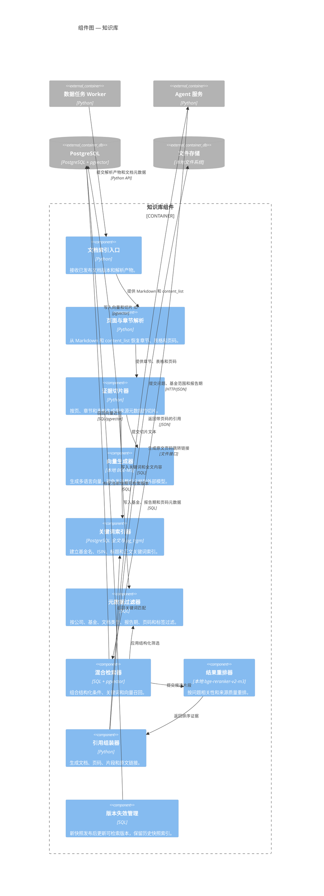

# Level 3 — Component — 知识库

> **Diagram type**: Component  
> **Scope**: PDF 页面结构、切片、索引、混合检索、重排和引用  
> **Audience**: 数据工程、搜索/RAG 开发、投研验收

## Overview

知识库把基金月报、年报和替代财报变成可按基金、报告期、章节和页码检索的证据层。V1 必须支持语义搜索，但基础全文搜索和原文定位在关闭外部生成模型时仍可使用。

数字问题优先使用结构化数据库；知识库主要用于解释、原文定位和文字变化追踪。

## Diagram



## Legend

- 文档解析和结构化内容来自已发布数据。
- 切片始终保留 `fund_id`、`document_id`、`report_period` 和 `page_number`。
- 全文和 SQL 筛选在无生成模型时仍可工作。
- Embedding 和 Reranker 优先本地运行。

## Index Unit

每个知识库切片至少包含：

```text
chunk_id
snapshot_id
fund_id
document_id
document_version
manager_id
umbrella_id
report_type
report_period
section_title
page_number
content
content_hash
embedding
parser_version
```

表格切片应额外包含：

- 表格标识；
- 表头；
- 单位；
- 行数和列数；
- 原页位置；
- 相邻文本标题。

## Retrieval Rules

1. 先按用户选择的基金、公司和报告期过滤。
2. 对基金名、ISIN、报告类型做结构化匹配。
3. 使用关键词检索召回明确名称和术语。
4. 使用向量检索召回语义相近内容。
5. 使用 reranker 合并排序。
6. 如果最佳证据低于阈值，返回“证据不足”。
7. 每个事实性结论至少绑定一个可打开的证据。

## V1 vs V2

| 能力 | V1 | V2 |
|---|---|---|
| 页级和章节切片 | 支持 | 支持 |
| 表格切片 | 支持 | 支持 |
| 本地 Embedding | 支持 | 支持 |
| 全文检索 | 支持 | 支持 |
| 混合召回和 rerank | 支持 | 支持 |
| 页码引用 | 支持 | 支持 |
| 共享增量索引 | 单机缓存 | 多用户共享缓存 |
| 历史快照检索 | 保留已发布来源 | 保留并支持跨批次追溯 |

## Elements

| Component | Type | Technology | Responsibility | Version |
|---|---|---|---|---|
| 文档索引入口 | Component | Python | 接收已发布解析产物并启动增量索引 | V1、V2 |
| 页面与章节解析 | Component | Python、Markdown parser | 恢复章节、表格、页面和相邻标题 | V1、V2 |
| 证据切片器 | Component | Python | 生成页级、章节级和表格级证据切片 | V1、V2 |
| 向量生成器 | Component | 本地 BGE-M3 | 生成中英多语言向量并记录模型版本 | V1、V2 |
| 关键词索引器 | Component | PostgreSQL FTS、pg_trgm | 检索基金名、ISIN、标题和正文关键词 | V1、V2 |
| 元数据过滤器 | Component | PostgreSQL indexes | 按基金、文档、报告期、页码和标签过滤 | V1、V2 |
| 混合检索器 | Component | SQL、pgvector | 合并结构化过滤、关键词和向量召回 | V1、V2 |
| 结果重排器 | Component | 本地 bge-reranker-v2-m3 | 按相关性和来源质量重排候选证据 | V1、V2 |
| 引用组装器 | Component | Python | 输出文档版本、页码、片段和原文链接 | V1、V2 |
| 版本失效管理 | Component | PostgreSQL | 管理快照可见性和历史版本保留 | V1、V2 |

## Key Relationships

| From | To | Intent | Protocol / Technology |
|---|---|---|---|
| 数据任务 Worker | 文档索引入口 | 提交已发布文档和解析产物清单 | HTTP/JSON 或 Python API |
| 页面与章节解析 | 证据切片器 | 提供章节树、表格、页码和结构元数据 | Python object |
| 证据切片器 | 向量生成器 | 请求多语言向量 | Python invocation |
| 证据切片器 | 关键词索引器 | 写入全文、标题和关键词 | PostgreSQL SQL |
| 证据切片器 | 元数据过滤器 | 写入基金、报告期和页码过滤字段 | PostgreSQL SQL |
| 向量生成器 | PostgreSQL | 写入向量和模型版本 | pgvector/SQL |
| Agent 服务 | 混合检索器 | 提交问题、快照、基金和报告期范围 | HTTP/JSON |
| 混合检索器 | 元数据过滤器 | 先应用范围和权限过滤 | SQL |
| 混合检索器 | 关键词索引器 | 召回名称、术语和精确文本 | PostgreSQL FTS |
| 混合检索器 | PostgreSQL | 召回向量近邻并合并候选 | pgvector/SQL |
| 混合检索器 | 结果重排器 | 提交候选证据并请求排序 | Python invocation |
| 结果重排器 | 引用组装器 | 返回达到阈值的证据 | JSON |
| 引用组装器 | 文件存储 | 生成当前文档版本的页码跳转地址 | 受管文件接口 |
| 引用组装器 | Agent 服务 | 返回可点击证据和口径说明 | JSON |

## Notable Architectural Decisions

1. 切片不能脱离来源页码。
2. 查询先过滤基金和报告期，再做向量近似检索。
3. 表格数值不作为纯文本最终答案，必须回到结构化事实。
4. 本地 Embedding 是默认方案，减少报告内容外发。
5. 新快照发布时采用增量索引，不重建全部文档。

## Assumptions

- V1 的文档数量在单机 PostgreSQL/pgvector 可承受范围内。
- BGE-M3 和 bge-reranker-v2-m3 是建议默认模型，需要在 Mac 上完成中英文检索效果与资源占用验证。
- 如果后续检索效果不足，再评估独立向量数据库或搜索引擎。
- 报告内容若发送到 MinerU 或 Qwen，必须先确认公司对数据出境、供应商保留策略和禁止训练条款的要求。

## Links to Other Levels

- ↑ [Container](02-container.md)
- ↔ [Agent](03-component-agent-service.md)
- ↔ [数据任务 Worker](03-component-ingestion-worker.md)
