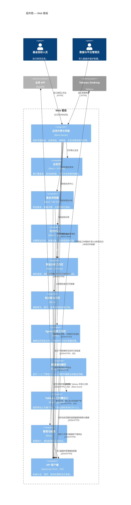

# Level 3 — Component — Web 看板

> **Diagram type**: Component  
> **Scope**: React Web 看板内部的功能组件  
> **Audience**: 前端开发、产品设计、业务验收

## Overview

Web 看板是投研人员唯一需要安装或打开的客户端界面。V1 在 Mac 本地浏览器打开，V2 通过局域网访问 Windows 服务器。页面把“选基金、跑任务、看结果、问问题、导出报告”组织成同一个工作区。

前端不持有数据库连接和模型密钥，业务数据和图表都通过业务 API 获取。右侧数据透视由 ECharts 渲染；Tableau Desktop 只用于打开工作簿开展深入分析和交付。

## Diagram

## Legend

- Component：浏览器中的功能区域或前端服务。
- Researcher/Admin：用户角色。
- 外部 API：系统业务后端。
- ECharts：负责 Web 右侧 1～2 个预设数据透视图的实时渲染。
- Tableau Desktop：打开预设工作簿进行深入分析和研究交付。
- SSE：服务器发送事件，用于任务进度和流式回答。

## Elements

| Component | Technology | Responsibility | V1 | V2 |
|---|---|---|---|---|
| 应用外壳与导航 | React Router | 页面框架、快照条、任务进度、权限入口和全局错误处理 | 单用户 | 三角色登录状态 |
| 总览页 | React、ECharts | 覆盖、缺口、新鲜度、任务和成本摘要 | 完整 | 共享状态 |
| 基金浏览器 | React、AG Grid | 全量基金筛选、详情和横向比较 | 支持 2,479 只数据模型 | 共享查询 |
| 任务中心 | React、SSE | 全量/公司/标签/基金任务和进度 | 单写任务 | 全局单写、多人查看 |
| 预设分析工作区 | React、ECharts | 透视、趋势、瀑布和分类分析 | 预设工具 | 保持 |
| 知识库与问答 | React | 文档搜索、自然语言问答和引用定位 | 完整 | 保持 |
| Agent 任务工作区 | React | 自然语言任务、计划确认和结果 | 完整 | 保持 |
| 数据透视侧栏 | React、ECharts | 展示当前基金规模直方图和规模趋势，限制为两个预设视图 | 完整 | 保持 |
| Tableau 工作簿出口 | React、Tableau Desktop 文件链接 | 下载或打开预设工作簿继续分析和交付 | 支持 | 保持 |
| 管理与配置 | React | 模型配置、凭证掩码、数据质量 | 本地管理 | 用户和权限管理 |
| API 客户端 | TypeScript | 统一 API 请求、流式处理、重试和错误展示 | 完整 | 完整 |

## Key Relationships

| From | To | Intent | Protocol |
|---|---|---|---|
| 基金浏览器 | 业务 API | 查询基金、报告和分析指标 | HTTPS/JSON |
| 任务中心 | 业务 API | 创建任务并订阅任务事件 | HTTPS/JSON、SSE |
| 知识库与问答 | 业务 API | 提交问题和证据范围 | HTTPS/JSON、SSE |
| Agent 工作区 | 业务 API | 提交任务计划并确认执行 | HTTPS/JSON |
| 管理面板 | 业务 API | 导入数据、维护模型与工具 | HTTPS/JSON |
| 数据透视侧栏 | 业务 API | 获取透视数据和图表元数据 | HTTPS/JSON |
| 数据透视侧栏 | Tableau 工作簿出口 | 触发工作簿深入分析 | React event |
| Tableau 工作簿出口 | 业务 API | 获取工作簿元数据和下载地址 | HTTPS/JSON |
| Tableau 工作簿出口 | Tableau Desktop | 打开预设工作簿进行深入分析和交付 | 本地文件链接 |

## Notable Architectural Decisions

1. 前后端分离，但 V1 仍由同一个本地进程托管前端静态文件。
2. 任务和 Agent 都使用 SSE 推送进度，避免轮询。
3. 前端不直接访问 PostgreSQL，避免权限和 SQL 安全边界失控。
4. Web 右侧 1～2 个图表全部由 ECharts 渲染；Tableau Desktop 只承担深入分析和研究交付，不嵌入网页。
5. 分析页只提供预设问题，不建设自由拖拽看板设计器。

## Assumptions

- 浏览器可使用现代 Chrome、Edge 或 Safari。
- V1 用户接受在本机打开本地 Web 页面。
- V2 的业务用户只需要浏览器即可查看全部数据透视；Tableau Desktop 用于打开工作簿进行深入分析和交付。
- V1 Tableau 交付验收要求本机具备可用的 Tableau Desktop 许可证。

## Links to Other Levels

- ↑ [Container](02-container.md)
- → [API 组件](03-component-api-service.md)
- → [V1 部署](04-deployment-v1-mac.md)
- → [V2 部署](04-deployment-v2-windows.md)
