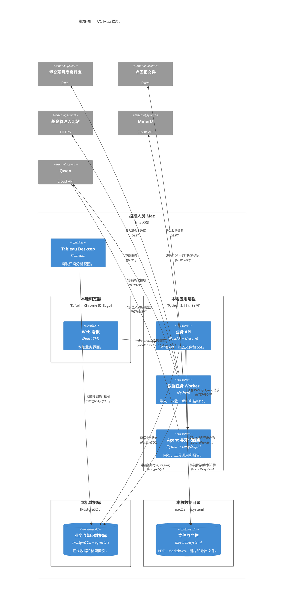

# Deployment — V1 Mac 单机部署

> **Diagram type**: Deployment  
> **Scope**: V1 在单台 Mac 上运行的本地 Web、API、Worker、Agent、数据库和文件存储  
> **Audience**: 开发、测试、项目验收人

> 当前运行时目录、依赖安装和服务启停以 [运行环境、依赖与服务器启停手册](../development/59-runtime-startup-and-dependency-runbook-20261126.md) 为准；本文保留 V1 单机架构背景。

## Overview

V1 采用本地 Web 应用形态。用户启动应用后，本机运行 PostgreSQL、FastAPI、Worker、Agent 和前端静态页面，浏览器访问 `127.0.0.1`。数据不依赖公司服务器，适合完成全功能验收。

V1 只允许一个用户使用，也保持全局单写任务限制，以便提前验证 V2 的发布机制。

## Diagram



## Legend

- macOS 主机是 V1 唯一运行节点。
- 浏览器和应用进程都在本机。
- PostgreSQL 作为本机服务运行。
- 文件保存到应用专用数据目录。
- Tableau Desktop 直接连接本机只读数据库视图。

## Runtime Processes

| Process | Startup | Shutdown | Notes |
|---|---|---|---|
| PostgreSQL | 本地服务或应用启动器 | 正常关闭并完成 checkpoint | 正式主库 |
| FastAPI | `uvicorn` | 停止接收新请求后退出 | 绑定 `127.0.0.1` |
| Worker | 原生 Terminal 前台进程或用户级 launchd | 等待或终止当前任务；启动前执行 Playwright 预检 | 只能一个写任务；不能从受限 Agent 子进程启动 |
| Agent | Python 子进程 | 完成流式响应后退出 | 支持 Qwen API |
| Browser | 系统默认浏览器 | 用户关闭 | 可自动打开 |

## Elements

| Element | Type | Technology | Responsibility | Version |
|---|---|---|---|---|
| 投研人员 Mac | Deployment Node | macOS x64/arm64 | 承载 V1 全部本地运行组件和受管数据 | V1 |
| 本地浏览器 | Container | Safari、Chrome 或 Edge | 提供全部业务界面和原文查看 | V1 |
| 业务 API | Container | Python 3.11、FastAPI、Uvicorn | 查询、任务、发布、配置和 SSE | V1 |
| 数据任务 Worker | Container | Python | Excel 导入、下载、解析、结构化和 staging | V1 |
| Agent 与知识服务 | Container | Python、LangGraph、BGE-M3 | 问答、工具编排、检索和报告 | V1 |
| PostgreSQL | Container DB | PostgreSQL、pgvector | 正式数据、任务、快照和检索索引 | V1 |
| 文件与产物 | Container DB | macOS filesystem | PDF、Markdown、图像和导出文件 | V1 |
| Tableau Desktop | Container | Tableau | 连接只读视图并刷新预设工作簿 | V1 |
| 主管人官网、MinerU、Qwen | External System | HTTPS/API | 提供报告、解析和模型能力 | V1 |

## Key Relationships

| From | To | Intent | Protocol / Technology |
|---|---|---|---|
| 浏览器 | 业务 API | 提交查询、任务和问答，接收进度 | localhost HTTPS/JSON、SSE |
| 业务 API | PostgreSQL | 查询已发布快照并管理任务、配置和审计 | PostgreSQL wire protocol |
| 业务 API | 文件存储 | 提供 PDF 和导出产物 | 受管文件接口 |
| 业务 API | Agent 与知识服务 | 转发问答和智能任务 | HTTP/JSON、SSE |
| Worker | PostgreSQL | 申请租约锁、领取任务并写入 staging | PostgreSQL transaction |
| Worker | 文件存储 | 保存原始报告、解析结果和导出产物 | 受管文件接口 |
| Worker | 基金管理人网站 | 发现并下载最新报告 | HTTPS/HTML/JSON/PDF |
| Worker | MinerU | 提交 PDF 并取回页面解析 | HTTPS/API |
| Worker | Qwen | 请求结构化抽取和页面复核 | HTTPS/API |
| Agent 与知识服务 | Qwen | 请求语义分析、计划和回答 | HTTPS/API |
| Tableau Desktop | PostgreSQL | 刷新只读统计视图 | PostgreSQL/JDBC |

## Notable Architectural Decisions

1. V1 使用 `127.0.0.1` 本地 Web 形态，以降低客户端安装成本。
2. PostgreSQL、API、Worker 和 Agent 即使同机部署也保持独立进程边界，以便验证 V2 的故障隔离。
3. 应用代码、配置、数据和备份分目录放置，升级不覆盖业务文件。
4. 外部模型不可用时，API、SQL、全文检索和确定性导出继续提供服务。
5. V1 不在本地实现 Windows 服务、多用户权限和 Bloomberg 网关。

## Local Data Layout

建议目录：

```text
~/Library/Application Support/FundResearchAgent/
  app/
  config/
  data/
    raw/
    parsed/
    exports/
    _cache/
  backups/
  logs/
```

应用代码和用户数据分离。升级不能覆盖数据目录。

## V1 Deployment Constraints

- 不支持三名用户同时写。
- 不连接 Bloomberg。
- 支持导入港交所基金综合资料库和净回报文件。
- 支持 27 家已适配管理人的报告下载。
- 支持 Qwen 和 MinerU。
- 支持 Tableau Desktop 读取统计视图。
- 右侧数据透视全部由 ECharts 渲染；Tableau Desktop 用于工作簿分析和研究交付。
- 支持基础模式，即关闭 Qwen 后仍可查询和导出。

## Operational Checks

1. 启动时检查 PostgreSQL 可用。
2. 执行 Alembic migration。
3. 检查数据目录读写权限。
4. 检查 Qwen/MinerU 配置，但不因不可用阻断基础模式。
5. 启动 API 和 Worker。
6. 浏览器访问健康检查后再打开首页。
7. 退出时停止 Worker，避免残留子进程。

## Assumptions

- Mac 已安装或随应用提供 Python 运行时。
- PostgreSQL 由安装器或开发环境提供。
- V1 使用 `127.0.0.1`，不需要外部用户认证。
- 外部 API Key 保存在 macOS Keychain 或以安全方式注入。
- Tableau 工作簿功能依赖本机 Tableau Desktop 许可证，不依赖 Tableau Server/Cloud。

## Links to Other Levels

- ↑ [Container](02-container.md)
- → [V2 Windows 部署](04-deployment-v2-windows.md)
- → [任务发布动态图](05-dynamic-task-publication.md)
