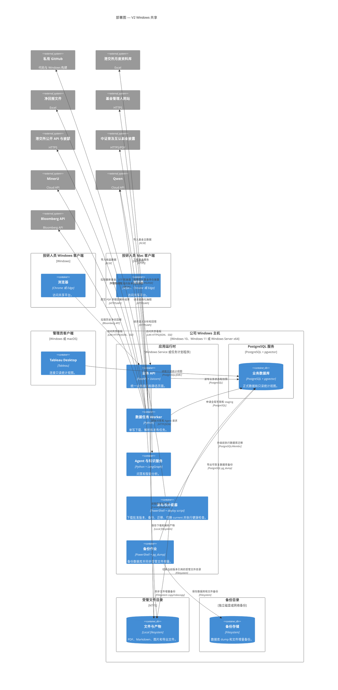

# Deployment — V2 Windows 三人共享

> **Diagram type**: Deployment  
> **Scope**: Windows 主机运行共享平台，约三名投研人员从 Windows/macOS 浏览器访问  
> **Audience**: 开发、运维、平台管理员、业务负责人

> 当前 Windows 状态目录、Worker Service 安装、依赖和启停命令以 [运行环境、依赖与服务器启停手册](../development/59-runtime-startup-and-dependency-runbook-20261126.md) 为准。

## Overview

V2 将 V1 的相同容器部署到一台常开 Windows 主机。三名用户共享同一个 PostgreSQL 和文件目录，但全系统仍只执行一个写任务。读操作、搜索和问答可以并行。

代码由私有 GitHub 仓库管理，通过 Windows CI 构建发布包。服务器不保存 Git 工作区，也不在运行时安装未经锁定的依赖。

## Diagram



## Legend

- 三个客户端只使用浏览器；不需要 Python。
- 服务器承载业务 API、Worker、Agent、PostgreSQL 和文件。
- Tableau 通过只读数据库角色访问统计视图。
- GitHub 只用于代码和发布包，不参与业务运行。
- 应用数据、密钥和日志不进入 Git。

## Network and Security

- 服务只监听公司局域网或受控反向代理。
- PostgreSQL 不直接暴露公网。
- Tableau 连接只允许指定客户端 IP 和只读账号。
- 用户可以访问 API，但不可执行任意 SQL。
- 所有模型 Key 在服务端加密保存。
- SSE 和普通 API 都需要登录会话。

## Elements

| Element | Type | Technology | Responsibility | Version |
|---|---|---|---|---|
| Windows/Mac 客户端 | Deployment Node | 受支持浏览器 | 通过局域网访问统一工作台 | V2 |
| 公司 Windows 主机 | Deployment Node | Windows 10/11 或 Server x64 | 承载共享应用、数据库、文件和备份 | V2 |
| 业务 API | Container | FastAPI、Uvicorn | 认证、查询、任务、发布和静态页面 | V2 |
| 数据任务 Worker | Container | Python | 单写导入、下载、解析、结构化和发布 | V2 |
| Agent 与知识服务 | Container | Python、LangGraph | 共享问答、检索和报告生成 | V2 |
| 发布与升级器 | Container | PowerShell、deploy script | 执行受控发布、迁移、切换和回滚 | V2 |
| 备份作业 | Container | PowerShell、pg_dump | 定时备份数据库和受管文件 | V2 |
| PostgreSQL | Container DB | PostgreSQL、pgvector | 正式数据、任务、检索索引和只读视图 | V2 |
| 文件与产物 | Container DB | NTFS 受管目录 | 报告、解析产物和导出文件 | V2 |
| 私有 GitHub | External System | Git、GitHub Actions | 保存源码并构建版本化 Windows 发布包 | V2 |
| Tableau Desktop | Container | Tableau Desktop | 读取只读统计视图 | V2 |
| 外部数据与模型服务 | External System | HTTPS/API | 基金、港交所、Bloomberg、MinerU 和 Qwen | V2 |

## Key Relationships

| From | To | Intent | Protocol / Technology |
|---|---|---|---|
| Windows/Mac 浏览器 | 业务 API | 共享查询、搜索、问答和任务状态 | LAN HTTPS/JSON、SSE |
| 业务 API | PostgreSQL | 读写业务状态并读取已发布快照 | PostgreSQL wire protocol |
| 业务 API | 文件存储 | 读取文档和保存导出产物 | 受管文件接口 |
| 业务 API | Agent 与知识服务 | 转发问答和 Agent 请求 | HTTP/JSON、SSE |
| Worker | PostgreSQL | 申请全局写锁并写入 staging | PostgreSQL transaction |
| Worker | 基金管理人网站 | 下载报告和替代财报 | HTTPS |
| Worker | MinerU 与 Qwen | 请求解析、抽取和复核 | HTTPS/API |
| Worker | 港交所、披露来源、Bloomberg | 拉取 V2 增量数据和收益时间序列 | HTTPS/API、Bloomberg API |
| 发布与升级器 | 私有 GitHub | 下载已批准版本化发布包 | HTTPS |
| 发布与升级器 | PostgreSQL | 执行迁移和版本健康检查 | PostgreSQL/Alembic |
| 备份作业 | PostgreSQL | 生成数据库备份 | PostgreSQL pg_dump |
| 备份作业 | 文件与备份存储 | 同步受管文件和备份 | Filesystem、robocopy |
| Tableau Desktop | PostgreSQL | 读取只读统计视图 | PostgreSQL/JDBC |

## Notable Architectural Decisions

1. 服务器不使用 Git 工作区运行生产代码，只部署经过构建和批准的不变版本包。
2. `releases` 与 `current` 分离，发布失败时可恢复上一版本和数据备份。
3. Windows 服务负责常驻进程，数据库和文件备份独立于业务 API 运行。
4. PostgreSQL 和文件目录是同一发布快照的两个组成部分，发布与备份必须记录一致的 `batch_id` 或版本号。
5. 三名用户共享只读能力，但全局仍只允许一个写任务。

## Release Layout

```text
D:\FundResearchAgent\
  releases\
    v0.3.0\
    v0.2.0\
  current\
  data\
  backups\
  logs\
  config\
```

发布流程：

```text
GitHub 私有仓库
→ Windows Runner 构建
→ 生成版本化 ZIP
→ 管理员批准发布
→ deploy.ps1
→ 备份数据库
→ 执行 migration
→ 切换 current
→ 启动 API 和 Worker
→ 健康检查
```

## V2 Data Additions

- 港交所月度基金和 ETF 数据；
- 港交所/披露易历史资料；
- 中证登与互认基金历史持仓；
- Bloomberg 历史净总回报；
- 其他管理人实体的来源适配。

## Operational Limits

- 三名用户可读取、搜索和问答；
- 只允许一个写任务；
- 其他执行请求进入队列；
- 读取始终基于最近已发布快照；
- 不依赖 Tableau Server/Cloud；Web 图表全部由 ECharts 渲染；
- 不建设 Kubernetes 或微服务集群。

## Assumptions

- 公司可提供一台常开 Windows x64 主机。
- 三名用户位于可访问服务器的局域网或 VPN。
- 服务器可访问基金管理人网站、MinerU、Qwen 和可选 Bloomberg。
- 发布包可以以 Windows 服务或任务计划方式启动。

## Links to Other Levels

- ↑ [Container](02-container.md)
- ← [V1 Mac 部署](04-deployment-v1-mac.md)
- → [任务发布动态图](05-dynamic-task-publication.md)
