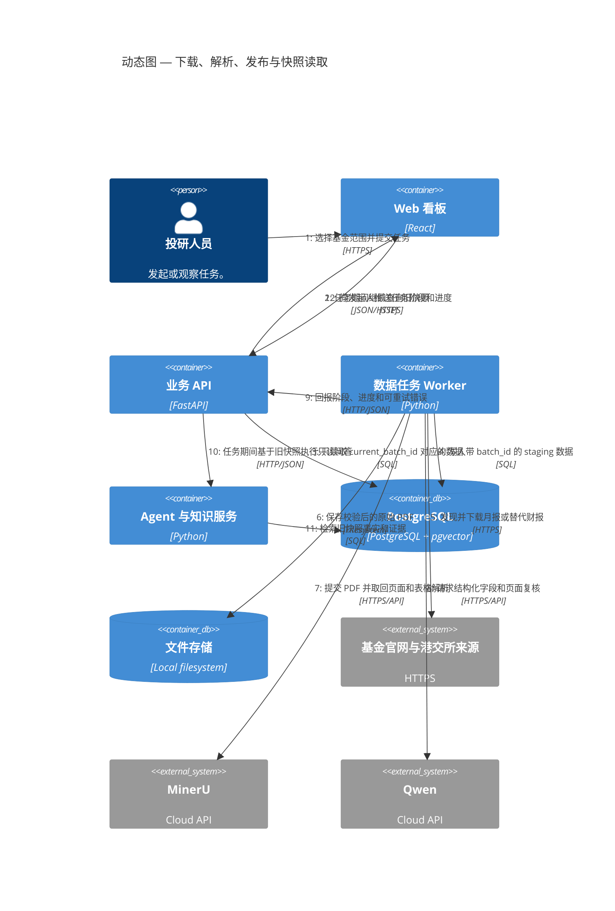

# Dynamic — 下载、解析、发布与快照读取

> **Diagram type**: Dynamic  
> **Scope**: 用户提交一个下载和解析任务，以及任务运行期间的快照隔离  
> **Audience**: 后端、Worker、数据库、测试和业务验收

## Overview

所有下载、解析和结构化写操作都经过同一流程。任务是唯一写入者，数据库全局锁保证多人环境不会同时写坏正式快照。

任务运行期间，其他用户仍可查询、搜索和生成报告，但只能读取上一份已发布快照。

## Diagram



## Legend

- 编号由 Mermaid 按 `Rel` 声明顺序生成。
- Worker 是唯一执行下载和写 staging 的组件。
- API 的发布服务是唯一切换 `current_batch_id` 的组件。
- 发布事务成功前，`current_batch_id` 不变化。
- 任务失败时不切换快照。

## Snapshot State Machine

```text
queued
→ locked
→ resolving_sources / backfilling_sources
→ downloading
→ parsing
→ structuring
→ validating
→ publishing
→ completed
```

异常状态：

```text
partially_failed
retrying
failed
cancelled
lease_expired
```

## Elements

| Element | Type | Technology | Responsibility | Version |
|---|---|---|---|---|
| 投研人员 | Person | — | 冻结任务范围、提交任务并查看旧快照结果 | V1、V2 |
| Web 看板 | Container | React、SSE | 提交任务和展示实时状态 | V1、V2 |
| 业务 API | Container | FastAPI、PostgreSQL | 创建任务、申请锁、控制发布和传输事件 | V1、V2 |
| 数据任务 Worker | Container | Python | 执行下载、解析、结构化并写 staging | V1、V2 |
| Agent 与知识服务 | Container | Python | 在任务期间基于已发布快照完成只读分析 | V1、V2 |
| PostgreSQL | Container DB | PostgreSQL + pgvector | 保存任务、锁、staging、发布指针和可读快照 | V1、V2 |
| 文件存储 | Container DB | Local filesystem | 保存不可变文件版本和导出产物 | V1、V2 |
| 基金官网与港交所 | External System | HTTPS/API/PDF | 提供最新报告与披露 | V1、V2 |
| MinerU 与 Qwen | External System | HTTPS/API | 解析和结构化 PDF | V1、V2 |

## Key Relationships

| From | To | Intent | Protocol / Technology |
|---|---|---|---|
| 投研人员 | Web 看板 | 选择范围、提交任务并查看状态 | HTTPS |
| Web 看板 | 业务 API | 创建任务、查询状态和读取快照 | HTTPS/JSON、SSE |
| 业务 API | PostgreSQL | 写入任务并申请全局租约锁 | PostgreSQL transaction |
| Worker | PostgreSQL | 领取已锁定任务、续约并写 staging | PostgreSQL transaction |
| Worker | 基金官网与港交所 | 发现和下载月报或替代财报 | HTTPS/HTML/JSON/PDF |
| Worker | MinerU | 提交 PDF 并获取页级解析结果 | HTTPS/API |
| Worker | Qwen | 请求结构化抽取和复杂表格复核 | HTTPS/API |
| Worker | 文件存储 | 保存原始文件、解析产物和批次清单 | 受管文件接口 |
| Worker | 业务 API | 回报阶段、进度和错误 | HTTP/JSON |
| Worker | 业务 API | 提交 batch manifest 并申请发布 | HTTP/JSON |
| 业务 API | PostgreSQL | 校验发布条件并在事务中切换当前快照 | PostgreSQL transaction |
| 业务 API | Web 看板 | 推送实时任务事件 | SSE |
| 业务 API | Agent 与知识服务 | 请求基于旧快照的只读分析 | HTTP/JSON |

## Database Invariants

1. `current_batch_id` 只能指向 `published` 状态批次。
2. 同一时间最多一个活动写任务持有有效租约。
3. staging 记录不能出现在面向普通用户的当前快照查询中。
4. 文件必须和文档版本、SHA-256 和 `batch_id` 关联。
5. 任务成功发布和释放锁必须位于同一最终事务或受控两阶段步骤。
6. 发布失败的批次保留为不可见审计记录。

## Failure Cases

| Case | Result |
|---|---|
| 下载部分失败但达到覆盖率 | 可发布部分结果，并保留 SKIP 原因 |
| 下载失败导致低于要求 | 用户决定继续、重试或取消 |
| MinerU 单文件失败 | 尝试本地文本降级并标记质量 |
| Qwen 抽取失败 | 使用固定 fallback 模型或标记 review |
| Worker 崩溃 | 锁租约过期，任务可恢复或标记失败 |
| 发布事务失败 | 当前快照保持不变 |
| 用户取消 | 停止子进程，不发布 staging |

## Notable Architectural Decisions

1. 任务进度和业务状态都由 PostgreSQL 保存。
2. 文件在 staging 阶段完成校验后再进入受管版本目录。
3. 用户可以在任务中查询旧快照，不会看到部分结果。
4. 发布是显式动作，不以所有子进程退出作为默认成功条件。

## Assumptions

- PostgreSQL 租约锁足以满足单服务器部署。
- 原始文件按 SHA-256 去重。
- 发布失败不会产生半可见批次。

## Links to Other Levels

- ↑ [Container](02-container.md)
- ↔ [API 组件](03-component-api-service.md)
- ↔ [Worker 组件](03-component-ingestion-worker.md)
