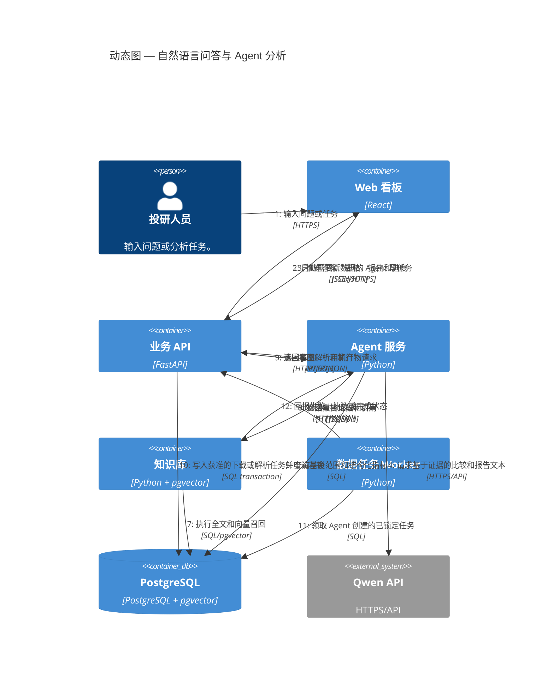

# Dynamic — 自然语言问答与 Agent 分析

> **Diagram type**: Dynamic  
> **Scope**: 自然语言问题从界面到证据、工具和最终报告的执行顺序  
> **Audience**: AI 工程、前端、后端、投研验收

## Overview

该流程用于两类任务：

- 单问题查询或跨基金比较；
- 需要下载、统计和生成文档的智能任务。

Agent 先判断问题类型，再调用 SQL、知识库或任务工具。所有事实性结论都绑定数据库口径或原文页码。

## Diagram

## Legend

- 读问题在已发布快照上执行。
- 写任务通过任务服务执行，不直接由 Agent 修改数据库。
- SQL 查询和知识库检索都受用户选择范围与权限限制。
- 模型只看到完成任务所需的数据。

## Query Routing

| Query type | Primary route | Example |
|---|---|---|
| 数值事实 | SQL tool | 某基金 2026 年 8 月规模 |
| 分类统计 | SQL + preset analytics | 主动权益按管理人分布 |
| 报告解释 | RAG | 为什么该基金久期下降 |
| 跨基金比较 | SQL + RAG | 比较两只基金的地区配置 |
| 变化追踪 | 两个快照 SQL + RAG | 本月与上月行业配置变化 |
| 新数据请求 | Agent plan + Worker task | 补齐某公司最新月报 |
| 正式报告 | Analysis tools + templates | 生成指定基金研究报告 |

## Guardrails

- 数值型问题不能只依赖语言模型心算。
- 引用必须指向当前快照中的文档版本。
- 无证据时回答“现有资料不足”。
- 用户个人 Key 不得出现在提示词、日志或返回结果。
- 没有任务锁时不得执行写任务。
- Agent 只能使用工具注册表中的批准版本。

## Elements

| Element | Type | Technology | Responsibility | Version |
|---|---|---|---|---|
| 投研人员 | Person | — | 提出自然语言问题或分析任务并确认写入计划 | V1、V2 |
| Web 看板 | Container | React、SSE | 收集问题、展示计划和带引用结果 | V1、V2 |
| 业务 API | Container | FastAPI | 认证、任务创建、快照绑定和流式返回 | V1、V2 |
| Agent 服务 | Container | Python、LangGraph | 意图解析、计划、工具调用和答案组织 | V1、V2 |
| 知识库 | Container | Python、PostgreSQL/pgvector | 全文与向量检索、重排和引用组装 | V1、V2 |
| 数据任务 Worker | Container | Python | 执行经用户确认的下载、解析或补数任务 | V1、V2 |
| PostgreSQL | Container DB | PostgreSQL + pgvector | 保存结构化事实、任务、快照和检索索引 | V1、V2 |
| Qwen API | External System | HTTPS/API | 提供固定白名单模型推理 | V1、V2 |

## Key Relationships

| From | To | Intent | Protocol / Technology |
|---|---|---|---|
| 投研人员 | Web 看板 | 输入问题、查看计划和确认写任务 | HTTPS |
| Web 看板 | 业务 API | 提交问题、快照范围和后续操作 | HTTPS/JSON、SSE |
| 业务 API | Agent 服务 | 转发已认证问答或 Agent 请求 | HTTP/JSON |
| Agent 服务 | Qwen API | 识别意图、生成计划和综合证据 | HTTPS/API |
| Agent 服务 | PostgreSQL | 查询基金范围和结构化指标 | SQL |
| Agent 服务 | 知识库 | 检索报告片段和页码 | HTTP/JSON |
| 知识库 | PostgreSQL | 执行全文和向量召回 | PostgreSQL FTS、pgvector |
| 知识库 | Agent 服务 | 返回重排证据和引用 | JSON |
| Agent 服务 | 业务 API | 返回答案、引用和产物请求 | HTTP/JSON |
| 业务 API | Web 看板 | 推送答案、表格、报告和进度 | SSE/JSON |
| 业务 API | PostgreSQL | 写入获准写任务并申请全局锁 | PostgreSQL transaction |
| Worker | PostgreSQL | 领取任务并写入 staging | PostgreSQL transaction |
| Worker | 业务 API | 回报补数任务状态 | HTTP/JSON |

## Notable Architectural Decisions

1. Agent 与 Worker 解耦，避免模型进程长期持锁。
2. 每个答案保存 `snapshot_id`、工具调用和引用。
3. 简单查询走 SQL，减少 token 成本和幻觉风险。
4. Agent 报告先由确定性模板组装，再由模型补充解释。

## Assumptions

- V1 的单基金问答和跨基金比较均在当前已发布快照上完成。
- 需要新报告或补数时，Agent 只创建任务计划，由 Worker 在获得全局写锁后执行。
- Qwen 不可用时，基础查询、全文搜索和确定性导出仍可完成，但自然语言总结不可用。
- 检索证据不足或引用校验失败时，系统拒绝给出事实性结论。

## Links to Other Levels

- ↑ [Container](02-container.md)
- ↔ [Agent 组件](03-component-agent-service.md)
- ↔ [知识库组件](03-component-knowledge-service.md)
- ↔ [任务发布动态图](05-dynamic-task-publication.md)
