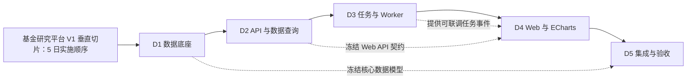

# 基金研究平台 V1 垂直切片开发计划

> 版本：v0.1  
> 日期：2026-10-22  
> 状态：已确认执行范围  
> 周期：1 个开发周，5 个开发日  
> 资源：1 名主开发人员 + AI 辅助  
> 依据：[PRD](../PRD-Fund-Research-Knowledge-Agent.md)、[C4 架构](../architecture/README.md)、[开发细化视图](../refinement/README.md)
>
> 执行状态：D1、D2、D3、D4、D5 已完成，见
> [平台 D1 运行说明](../../platform/README.md)。
> 下一阶段计划：[2026-10-26 至 2026-10-30 每日开发计划](03-week-20261026-next-stage-plan.md)。

## 1. 计划目标

本计划不承诺在一周内完成完整 V1，而是在 5 个开发日内交付一条可运行、可验收的纵向切片：

```text
基金主数据进入原生 PostgreSQL
→ FastAPI 提供当前快照、基金、质量和任务接口
→ Worker 调用现有下载、解析和结构化能力
→ 单基金任务受全局写锁控制并产生可重放事件
→ React Web 展示基金、数据质量、任务进度和两个 ECharts 图表
```

本周结束时，开发人员应能在本机启动 PostgreSQL、API、Worker 和 Web，完成“查看基金 → 创建一个受控任务 → 观察任务结果 → 回到 Web 查看当前快照”的完整演示。

“M3 Web 开发”严格控制在 1 个开发日内。为此，D2 必须冻结 Web 所需的 API 响应结构，D3 必须提供可联调的任务接口；D4 不承担数据库重构、Worker 重写或大规模 UI 探索。

## 2. 范围边界

### 2.1 本周必须交付

- macOS 原生 PostgreSQL 15+ 和 pgvector。
- HKEX 2,479 只基金权威主数据导入，以及 27 家公司、775 条 crawler 来源补充。
- 批次、文档、指标、持仓、配置和任务相关的核心数据表。
- 现有结构化 JSON 到数据库的可重复导入。
- FastAPI 的当前快照、基金列表、基金详情、质量问题和 ECharts 数据接口。
- 全局单写锁、冻结基金范围、任务事件和最小发布指针。
- Worker Adapter 调用现有下载、MinerU 和结构化脚本。
- 至少一只基金的真实任务闭环，或在外部服务不可用时使用本地缓存完成等价链路验证。
- React Web 的基金列表、基金详情、数据质量、任务进度和两个 ECharts 图表。
- Web 使用 ECharts；Tableau Desktop 通过只读数据库视图和工作簿出口保留，不嵌入 Web。
- 数据库迁移、基础种子数据、自动化测试、启动和恢复说明。

### 2.2 本周明确不做

- 27 家公司全部迁移到新的 Worker 适配器协议。
- 1,531 份历史 PDF 的全量重新下载、解析和结构化。
- 完整的历史快照管理、任务队列、崩溃自动接管和复杂回滚。
- 页级知识库、全文检索、pgvector 检索和 reranker。
- RAG 问答、引用校验、100 题问答评测。
- Agent 工具注册、自然语言计划、自动补数和多轮报告生成。
- DOCX、PNG 和完整 Tableau 工作簿生成。
- 90% 覆盖率复验、2 小时全量更新和完整 V1 性能验收。
- V2 Windows 部署、多用户和权限体系。

### 2.3 范围变更规则

执行过程中只能在不推迟 D4 Web 和 D5 验收的前提下增加内容。若 D1 或 D3 出现阻塞，优先缩减覆盖人数、历史数据和高级交互，不缩减以下主干：

1. 原生 PostgreSQL 数据源；
2. FastAPI 查询；
3. 单写任务锁；
4. Worker 调用现有业务代码；
5. Web + ECharts；
6. 端到端可重复演示。

## 3. 架构落位

本周不改变现有 C4 容器边界，只实现其中的最小闭环。Agent 与知识服务容器本周不启动。

| C4 容器 | 本周实现内容 | 复用策略 | 周末状态 |
|---|---|---|---|
| Web 看板 | React、TypeScript、Vite、ECharts | 新建最小前端，不复制旧 Tkinter GUI 布局 | D4 已完成查询、详情、质量和任务闭环 |
| 业务 API | FastAPI、Pydantic、SQLAlchemy | 新平台层，遵循 OpenAPI v0.3 | D2 查询和 D3 任务均已实现 |
| 单写 Worker | Python 独立进程 | 通过 Adapter 调用现有 `code/run_all_*.py` 和公司脚本 | 可执行单基金任务 |
| PostgreSQL | PostgreSQL 15+、pgvector | 按 ER 文档先创建核心表 | 当前快照和任务状态落库 |
| 受管文件库 | 版本目录、SHA-256、manifest | 复用现有批次目录和哈希逻辑 | 最小 staging 与发布 |
| Agent / Knowledge Service | 本周不实现 | 保留现有 RAG 契约 | 不启动 |

### 3.1 建议代码布局

```text
platform/
  api/
    app/
      api/
      core/
      db/
      models/
      schemas/
      services/
    alembic/
    tests/
  worker/
    adapters/
    tests/
  web/
    src/
      api/
      components/
      pages/
      charts/
    tests/
  scripts/
```

现有 `code/companies/`、`code/structured_data/` 和三个 `run_all_*.py` 保持原位。Worker Adapter 优先以“白名单命令 + 参数对象 + 结构化结果”的方式调用它们，避免复制业务匹配和模型提示词。

## 4. 实施顺序



图中实线表示顺序；虚线表示后续验收需要持续遵守的前置产物。D2 已冻结
Web 所需的快照、基金、质量和 ECharts 契约；D3 只新增任务契约。

## 5. D1：建立原生 PostgreSQL 数据底座

### 5.1 目标

让基金主数据、已有结构化结果、批次和任务基础数据进入 PostgreSQL，后续 Web 和 API 不再直接读取 Excel 或临时目录作为正式查询数据源。

### 5.2 执行任务

1. 安装并验证原生 PostgreSQL 15+、pgvector 扩展和本地开发配置。
2. 创建应用数据库、迁移账号、应用运行账号和 Tableau 只读账号。
3. 建立 `platform/api/alembic/`，配置 SQLAlchemy 和 Alembic。
4. 创建第一批核心表：
   - `managers`、`umbrellas`、`funds`；
   - `fund_source_ids`、`fund_classifications`、`fund_tags`；
   - `dataset_batches`、`documents`、`document_versions`、`document_subjects`；
   - `jobs`、`job_fund_scope`、`job_steps`、`job_attempts`、`job_events`、`job_locks`；
   - `fund_metrics`、`fund_holdings`、`fund_allocations`；
   - `quality_issues`、`publication_state`。
5. 添加主键、外键、唯一约束、状态约束和查询索引；缺失值保持 `NULL`，不转换为 0。
6. 编写 `爬虫list.xlsx` 导入器：
   - 从 HKEX `主数据` 导入 2,479 个唯一基金代码和 23 个月末规模快照；
   - 从 HKEX `改名` 导入 661 条基金改名记录；
   - 读取 27 张 crawler 页表，保存 775 条月报链接、运行方式和匹配状态；
   - crawler 记录按基金代码、管理人、伞、当前名称和改名历史匹配 HKEX；
   - 无法唯一匹配时保留在 `fund_report_sources` 并写入质量问题，禁止猜测；
   - 导入过程可重复执行，重复数据不新增副本。
7. 编写已有结构化 JSON 导入器：
   - 导入规模、报告期、持仓、地区和行业配置；
   - 写入关联的 `document_version_id`；
   - 将 meta 中的 `review` 和 `validation_issues` 写入 `quality_issues`；
   - 保留来源文件和报告期，缺失字段保持为空。
8. 创建当前快照发布指针和至少一条初始 `published` 批次记录，供 API 查询。
9. 增加数据库初始化、重置和种子数据脚本。

### 5.3 D1 验收门

- [x] PostgreSQL 17.11、pgvector 0.8.1 和后端应用均能正常连接。
- [x] HKEX 2,479 只基金全部进入 `funds`，基金代码与 HKEX 主数据一致。
- [x] 775 条 crawler 补充记录全部进入 `fund_report_sources`，775 条唯一匹配。
- [x] 重复执行导入不会产生重复基金，相同输入返回 `no_op=true`。
- [x] 最新历史结构化批次导入成功：62 指标、200 持仓、266 配置。
- [x] 当前批次 9 个 `review` 原因可在 `quality_issues` 查询。
- [x] 缺失值保持 `NULL`；2026-08-31 规模仅 926 条非空记录。
- [x] 空库执行完整迁移，有数据持久库执行幂等升级，迁移检查均通过。

### 5.4 当日降级

若稳定基金代码无法确认，保留内部 UUID 和来源映射，不阻塞 API；但不得用名称猜测外部基金代码。

## 6. D2：实现 FastAPI 与确定性查询

> 执行状态：已于 2026-10-22 完成。

### 6.1 目标

在 D1 数据底座之上提供稳定 API，使 D4 Web 可以只依赖 OpenAPI 响应开发，不必了解数据库表或文件布局。

### 6.2 执行任务

1. 创建 FastAPI 应用、配置加载、错误信封和请求追踪。
2. 按 Pydantic 定义统一响应：
   - `snapshot_id`；
   - `request_id`；
   - 数值、单位、质量状态；
   - 稳定的错误码。
3. 实现以下接口：
   - `GET /api/health`；
   - `GET /api/snapshots/current`；
   - `GET /api/funds`；
   - `GET /api/funds/{fund_code}`；
   - `GET /api/funds/{fund_code}/metrics`；
   - `GET /api/quality/issues`；
   - `GET /api/analytics/perspectives`。
4. 基金列表至少支持管理人、资产类别、报告期、状态、基金名称和分页。
5. 基金详情返回基本信息、最新报告、规模、持仓、地区、行业和固收指标。
6. 实现两个 ECharts 数据视图：
   - 当前基金范围规模直方图；
   - 当前基金范围规模趋势。
7. 建立 PostgreSQL 只读视图：
   - Web/ECharts 数据视图；
   - Tableau Desktop 只读视图；
   - 不向 Tableau 暴露任务锁、模型凭证等内部表。
8. 由 FastAPI 生成 OpenAPI v0.3，并与现有契约做字段和错误码差异检查。
9. 为查询层编写单元测试和数据库集成测试。

### 6.3 D2 验收门

- [x] API 只从 PostgreSQL 和受管文件元数据读取正式查询结果。
- [x] 2,479 只基金可通过分页、管理人和关键词查询。
- [x] 基金详情可以显示缺失、待复核和质量问题状态。
- [x] 两个 ECharts 接口返回快照、单位、质量和图表数据。
- [x] Tableau 只读视图可连接，且无法访问内部任务表。
- [x] OpenAPI 可生成，7 个 D2 路由已固化。
- [x] 实际 HTTP 单基金详情 30 次请求 P95 为 4.88 ms，低于 2 秒。

### 6.4 契约冻结

D2 结束后冻结 D4 所需的以下字段和路由：

- 当前快照；
- 基金列表分页；
- 基金详情；
- 质量问题；
- ECharts 两个预设视图；
- 任务列表、任务详情和任务事件由 D3 实现并冻结。

后续只允许修复错误，不进行会导致前端重写的响应结构变化。

## 7. D3：实现任务控制与现有脚本 Worker Adapter

> 执行状态：已于 2026-10-23 完成。

### 7.1 目标

建立最小但真实的受控写链路。任务开始前冻结基金范围，全系统只允许一个写任务，Worker 通过 Adapter 调用现有业务代码，并把进度写入数据库和 SSE。

### 7.2 执行任务

1. 实现任务接口：
   - `POST /api/jobs`；
   - `GET /api/jobs`；
   - `GET /api/jobs/{job_id}`；
   - `GET /api/jobs/{job_id}/events`；
   - `POST /api/jobs/{job_id}/cancel`。
2. 实现任务状态：
   - `waiting_lock`；
   - `queued`；
   - `running`；
   - `retrying`；
   - `validating`；
   - `completed`；
   - `failed`；
   - `cancelled`。
3. 在创建任务事务中冻结 `job_fund_scope`，后续增加基金不得改变本次分母。
4. 实现 `global_write` 唯一锁、owner、heartbeat 和释放逻辑。
5. 实现幂等键：
   - 相同键和相同请求返回原任务；
   - 相同键和不同请求返回冲突错误。
6. 定义 Worker Adapter 白名单：
   - `download_scope`；
   - `parse_scope`；
   - `structure_scope`；
   - `publish_snapshot`。
7. Adapter 调用现有脚本时不接受任意 Shell 字符串，只接受经过验证的结构化参数。
8. 创建任务 staging 目录，保存下载文件、解析缓存、结构化结果和 manifest。
9. 将子进程 stdout、进度事件和错误分类转换为 `job_events`。
10. 实现最小发布流程：质量校验通过后提交 manifest，由 API 服务更新批次状态和 `publication_state.current_batch_id`。
11. 使用一只基金完成真实链路：
    - 优先使用已有 MinerU 缓存，避免把外部网络稳定性变成 D3 阻塞；
    - 可选增加一次真实下载冒烟；
    - 允许任务只启用必要阶段；
    - 若外部 API 不可用，使用本地缓存完成 Adapter、事件和发布验证，并明确标记为缓存复用。
12. 测试锁冲突、任务取消、Adapter 失败和发布失败路径。
13. 移植原 GUI 爬虫补全：
    - 对缺失月报链接或运行方式的冻结基金执行公司 `probe`；
    - 先下载已有完整来源，再补全并补跑；
    - 用 `--rows` 限制到任务冻结范围；
    - 补全 I/J 写入 `fund_report_sources`，不修改正式 Excel；
    - 通过 `job.backfill` 回放补全进度和 SKIP 原因。

### 7.3 D3 验收门

- [x] 两个并发任务不能同时执行写操作；第二个任务进入 `waiting_lock`。
- [x] 被拒绝的任务显示锁占用信息，不进入下载。
- [x] 任务的基金范围和总数开始后冻结在 `job_fund_scope`。
- [x] SSE 可回放任务创建、阶段、基金、发布和完成事件。
- [x] ALL924 通过现有 `download_pinebridge_factsheet.py` 完成真实下载。
- [x] 任务失败不会改变当前发布指针。
- [x] 成功任务生成 staging manifest，经 API 校验后切换到新快照。
- [x] 下载、MinerU 和结构化业务规则保持原脚本，平台层只做 Adapter。
- [x] BRE374 通过汇丰 `hsbc_fund_link.py` 补全 I/J、写库并完成真实 PDF 下载。
- [x] 平台补全只处理冻结 Excel 行；正式 `爬虫list.xlsx` 的 I/J 保持不写回。
- [x] AGD276 通过任务级隔离工作簿自主完成摩根补全、下载、解析和结构化。
- [x] 补全 I/J 在下载前提交；下载采用 3 次尝试，终态任务可回放补全事件。

### 7.4 当日降级

若真实外部下载或模型调用不可用，保留“本地缓存任务”作为验收路径，并记录外部服务冒烟为已知限制。不得把手工写数据库伪装成完整 Worker 成功。

## 8. D4：在 1 个开发日内完成 M3 Web

> 执行状态：已于 2026-10-23 完成。

### 8.1 当日范围

D4 只实现已经由 D2、D3 冻结接口支持的页面，不新增后端业务范围。采用固定信息架构和最小视觉系统。

### 8.2 执行任务

1. 创建 React、TypeScript、Vite 应用和 API Client。
2. 实现全局应用外壳：
   - 左侧基础导航；
   - 顶部当前快照；
   - 任务进度摘要；
   - 全局错误和加载状态。
3. 实现基金列表：
   - 名称搜索；
   - 管理人、资产类别、报告期筛选；
   - 分页；
   - 基金详情入口。
4. 实现基金详情：
   - 基本信息和最新报告期；
   - 规模、久期、收益率或持仓等核心指标；
   - 持仓表；
   - 地区、行业和固收分布；
   - `missing`、`review`、`complete` 质量状态。
5. 实现数据质量页：
   - 按严重程度和问题类型筛选；
   - 展示基金、字段、原因和处理状态。
6. 实现任务中心：
   - 任务列表；
   - 全量、管理人、资产类别和单基金范围；
   - 批量下载 5 路、同管理人串行；
   - 结构化沿用 GUI 8 路模型并发；
   - 查看阶段和基金级进度；
   - 取消任务；
   - 显示失败原因。
7. 使用 ECharts 实现：
   - 当前范围规模直方图；
   - 当前范围规模趋势图；
   - 图表跟随基金筛选范围刷新。
8. 增加 Tableau Desktop 入口：
   - 只提供工作簿元数据或下载入口；
   - 不加载 Tableau Server/Cloud iframe；
   - 不把数据库凭据暴露给浏览器。
9. 增加浏览器基本测试：
   - 列表加载；
   - 详情打开；
   - 图表刷新；
   - 任务进度更新；
   - 错误及空数据状态。

### 8.3 M3 一日完成条件

D4 开始前必须满足：

- API 路由、字段和错误码已冻结；
- 至少一个已发布快照存在；
- 基金列表和详情接口可稳定返回；
- 一个可观察的任务和事件流存在；
- ECharts 数据结构已经固定；
- 不要求 D4 修改数据库 schema。

若当天时间不足，按以下顺序缩范围：

1. 保留基金列表、基金详情、两个 ECharts 和任务进度；
2. 数据库质量页只显示核心问题字段；
3. 取消复杂动画、自由筛选器和自定义地图；
4. 不删除错误状态、缺失语义和快照标识。

### 8.4 D4 验收门

- [x] 浏览器可完成基金查询、详情查看和任务状态查看。
- [x] 两个 ECharts 图表由 API 数据驱动，并显示当前快照。
- [x] 缺失值显示为“未披露/缺失”，不显示为 0。
- [x] `review` 原因在 Web 可见。
- [x] 任务进度无需刷新页面即可更新。
- [x] Tableau Desktop 不嵌入 Web，Web 图表全部使用 ECharts。
- [x] M3 的全部改动在 1 个开发日内完成并冻结页面主结构。

## 9. D5：集成、数据补齐与验收

> 执行状态：已于 2026-10-26 在当前版本重新验收完成。  
> 验收记录：[D5 集成、数据补齐与验收记录](02-d5-acceptance-record.md)。

### 9.1 目标

把前四天的纵向组件连接为可重复运行的演示环境，修复接口、数据和部署问题，不新增新的产品范围。

### 9.2 执行任务

1. 从最新可用的结构化批次导入数据，补齐基金详情和图表所需记录。
2. 对导入结果执行基金数、批次、文档、指标和质量问题一致性检查。
3. 执行完整用户路径：
   - 启动原生 PostgreSQL；
   - 执行 migration 和 seed；
   - 启动 API、Worker 和 Web；
   - 查询基金；
   - 创建任务；
   - 观察任务完成；
   - 查看新快照和任务结果。
4. 增加后端单元测试、数据库集成测试、Worker Adapter 测试和 Web 冒烟测试。
5. 验证 API 、Worker 和 Web 日志不包含明文 API Key。
6. 验证 migration 在空库和有数据库上可重复执行。
7. 生成一次数据库 dump 和文件 manifest，执行恢复冒烟。
8. 编写 `README` 或运行手册：
   - 环境要求；
   - PostgreSQL 安装；
   - 环境变量和密钥；
   - migration、seed、启动和停止；
   - 常见错误；
   - 数据重置方式。
9. 输出“本周验收记录”：
   - 已完成能力；
   - 实际覆盖基金数；
   - 真实执行与缓存执行的区别；
   - 已知缺口；
   - 下周继续项。

### 9.3 D5 验收门

- [x] 新人按照文档可以在当前 Mac 上重新启动系统。
- [x] 2,479 只基金可见，数据来源和批次可追踪；775 条 crawler 补充可见。
- [x] 至少一个任务在全链路中完成并生成当前快照。
- [x] Web 的两个 ECharts 图表与 API 筛选范围一致。
- [x] 质量状态、失败原因和缺失值可被用户看见。
- [x] 没有明文密钥进入日志、前端或导出的 manifest。
- [x] 空库迁移、种子导入和恢复冒烟通过。
- [x] 测试结果、已知缺口和本周实际范围被记录。

## 10. 全周完成定义

本计划完成必须同时满足以下条件：

1. **数据闭环**：基金主数据和至少一个结构化批次进入原生 PostgreSQL。
2. **查询闭环**：FastAPI 能从当前已发布快照返回基金、指标和质量状态。
3. **任务闭环**：创建任务、冻结范围、获取全局锁、调用现有脚本、记录事件和切换快照可以完成。
4. **Web 闭环**：React 页面能查询基金、查看详情、观察任务和渲染两个 ECharts 图表。
5. **可恢复性**：数据库、文件目录和当前发布指针可以按文档恢复。
6. **可验证性**：关键路径有自动化测试或可重复验收脚本。
7. **边界可信**：没有把缓存复用、局部数据或未实现模块报告成完整 V1 成功。

## 11. 测试与验收矩阵

| 层级 | 重点 | 最低验证 |
|---|---|---|
| Migration | 表、约束、索引、升级 | 空库执行；已有数据执行 |
| 数据导入 | 2,479 HKEX 基金、775 crawler 补充、幂等、缺失语义 | 两次导入结果一致；NULL 不为 0 |
| API | 路由、分页、过滤、响应信封 | OpenAPI 校验；数据库集成测试 |
| 任务 | 幂等、锁、冻结范围、取消 | 并发任务只能一个获得写锁 |
| Worker | 现有脚本复用、错误分类 | 一只基金缓存链路；失败不发布 |
| 发布 | manifest、批次、当前指针 | 成功切换；失败保持旧快照 |
| Web | 页面、质量、任务 | 浏览器冒烟和 API mock 测试 |
| 图表 | ECharts 数据驱动 | 两个图表随筛选刷新 |
| 安全 | 密钥、只读角色 | 日志扫描；Tableau 无内表权限 |
| 恢复 | DB dump、文件 manifest | 恢复后当前快照可查询 |

## 12. 风险与当日决策点

| 风险 | 影响 | 触发时间 | 处置 |
|---|---|---|---|
| crawler 基金名称与 HKEX 当前名称不同 | 补充链接无法匹配 | D1 | 先按基金代码，再按管理人/伞/历史名称匹配；未匹配项不丢弃 |
| 历史 JSON 字段不统一 | 迁移失败 | D1/D5 | 先导入稳定字段，异常写入质量问题 |
| 外部网站或模型不可用 | D3 真实任务阻塞 | D3 | 用已有缓存完成平台链路，真实调用另记冒烟 |
| Worker 子进程输出不结构化 | 进度和错误不可入库 | D3 | 增加 Adapter 解析层，不改原业务逻辑 |
| 锁和发布实现拖慢进度 | Web 无法联调 | D3 中午 | 保留唯一锁和最小发布，延后自动接管 |
| API 契约 D4 才变化 | M3 一天目标失败 | D3 结束 | D3 冻结契约，D4 只修错不改结构 |
| Web 范围膨胀 | M3 超时 | D4 | 优先核心查询、详情、任务和两个图表 |
| Tableau 工作簿未准备 | 完整出口缺失 | D3/D5 | 本周只提供只读视图和入口，工作簿生成列为后续 |

## 13. 本周结束后的已知后续项

以下工作不纳入本周交付，但必须在后续 V1 路线中按顺序补齐：

1. 继续把剩余公司特有的下载器扩展参数迁移到统一 Adapter 合同；补全脚本已通过平台 Worker 接入。
2. 完成全量历史 PDF、Markdown、结构化结果和改名记录迁移。
3. 完成完整任务队列、租约恢复、取消外部请求和发布回滚。
4. 将覆盖率从当前 88.1% 提升到 V1 要求的 90%。
5. 建立页级知识库、全文索引、pgvector、BGE-M3 和 reranker。
6. 实现 RAG 问答、claim/citation 校验和缺证据拒答。
7. 实现受限 Agent、计划确认、失败重试、补数和审计。
8. 实现 DOCX、XLSX、PNG 和 Tableau Desktop 工作簿交付。
9. 完成 100 题问答、引用准确率、P95 和 775 只更新时效验收。

## 14. 假设

- 现有下载、MinerU 和结构化脚本可以在 macOS 当前 Python 环境中被 Worker 调用。
- 本周允许使用已有缓存完成平台链路验收，真实外部服务调用失败不会被视为平台代码失败，但必须单独记录。
- `HKEX基金综合资料库_完整_20261008.xlsx` 是 2,479 只基金的主数据来源；`爬虫list.xlsx` 只提供 775 条来源链接和运行方式补充。
- 本周为本地单用户模式，不实现登录和角色权限。
- Tableau Desktop 许可证可用，但 Web 图表只使用 ECharts。
- pgvector 在本周安装并验证，但向量化数据不在本周建设。
