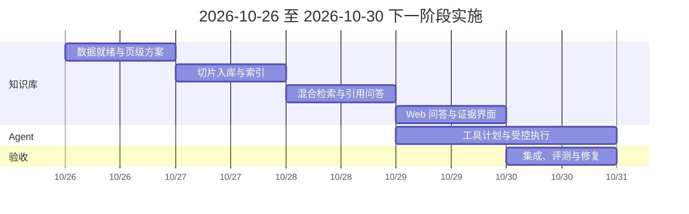

# 下一阶段 V1 每日开发计划

> 周期：2026-10-26 至 2026-10-30  
> 资源：1 名主开发人员 + AI 辅助  
> 本周目标：在 D1-D5 已验收平台之上，交付“数据补齐 + 知识库问答 + 最小 Agent”纵向闭环  
> 直接依据：[V1 垂直切片计划第 13 节](01-development-plan.md#13-本周结束后的已知后续项)、[PRD](../PRD-Fund-Research-Knowledge-Agent.md)、[D5 验收记录](02-d5-acceptance-record.md)

## 0. 当前进度基线

本周计划从以下事实出发，不重复建设已验证能力：

- D1-D5 已完成：PostgreSQL、FastAPI、Worker、React Web、任务锁、SSE、批次快照、爬虫补全、下载、解析、结构化和 ECharts。
- 2,479 只 HKEX 基金和 775 条 crawler 来源已进入平台。
- 当前快照有 72 个指标、220 条持仓、282 条配置和 11 个开放质量问题。
- 当前只有 21 只基金具备结构化详情，2,427 只基金具备规模历史。
- 437 条 crawler 来源仍缺月报链接或运行方式。
- 单基金和 AGD276 三阶段任务已验证；47 只摩根批量任务暴露了 MinerU 高延迟和失败可见性问题。
- 批量范围、管理人隔离并发、MinerU 4 路并发、跨任务缓存和结构化 8 路并发已经实现。
- RAG、知识库切片、引用问答、Agent、DOCX/PNG 和完整 Tableau 工作簿尚未实现。

因此，本周不是“从零开始”，而是把已打通的数据更新链路延伸到知识消费和智能研究。

## 1. 本周目标

本周不追求一次性完成全部 V1，而是把项目最大亮点落地为可演示、可验证的闭环：

```text
已有基金与报告数据
→ 页级知识切片
→ 数据查询 + 全文/向量混合检索
→ 带原文页码引用的智能问答
→ Agent 理解研究意图
→ 确认后调用查询或补数工具
→ 返回证据和后续任务
```

本周结束时必须能够展示：

1. 围绕已发布基金报告提出事实查询、解释和跨基金比较问题；
2. 回答优先引用结构化数据，文字解释必须返回文档、报告期和页码；
3. 证据不足时明确拒答，不生成无依据结论；
4. 通过自然语言创建受控任务前先展示计划和影响范围；
5. Web 页面完成问答、证据查看和 Agent 计划确认。

本周不包含 Windows 共享部署、Bloomberg、自定义看板设计器和全量历史报告冷启动重建。

## 2. 与 01 文档第 13 节的衔接

| 01 文档后续项 | 当前状态 | 本周动作 | 本周验收或跨周边界 |
|---|---|---|---|
| 1. 剩余公司下载器参数迁移 | 补全脚本已接入；公司特有下载参数尚未统一 | 周一冻结失败/未适配清单；周二选择高价值管理人补通接口；周五回归 | 完成接口清单和一个代表性管理人；其余公司按清单跨周迁移 |
| 2. 全量历史 PDF/Markdown/JSON/改名迁移 | 主数据和最新结构化批次已入；历史资料未全量纳入当前平台 | 周一盘点可迁移资产；周二批量导入已有 JSON 和索引缓存 | 完成所有“已有、可解析”资产的增量迁移；无原文冷启动不承诺本周完成 |
| 3. 完整任务队列、租约恢复、取消与回滚 | 单写锁、取消和快照已实现；崩溃恢复与回滚测试不足 | 周一补异常场景；周三执行中断任务回归；周五验收 | 完成租约过期、取消子进程、发布失败不切指针的自动化测试 |
| 4. 覆盖率 88.1% 提升到 90% | PRD 历史基线为 683/775；周一实测 I/J 完整 444/775、结构化详情 104/775 | 周一已建立真实三层覆盖口径；周二至周四持续补全；周五冻结结果 | 以 775 为分母冲击 ≥698；未达则记录逐基金原因，不伪造覆盖率 |
| 5. 页级知识库与 BGE-M3/reranker | pgvector 已安装，表、切片和模型未实现 | 周一定方案；周二建表和索引；周三混合检索与重排 | 本周完成页级索引和本地检索闭环 |
| 6. RAG、claim/citation、拒答 | 尚未实现 | 周三完成后端；周四完成 Web 引用体验；周五评测 | 本周完成首个可用问答版本和引用校验 |
| 7. 受限 Agent、确认、失败重试、补数、审计 | 尚无 Agent 状态和工具注册 | 周四计划确认；周五执行与补数闭环 | 本周完成最小 Agent，不追求开放式自主规划 |
| 8. DOCX/XLSX/PNG/Tableau | ECharts 已完成；文件导出和 TWBX 未完成 | 周三后端导出；周四 Web 下载；周五 Tableau 冒烟 | 至少完成 XLSX、PNG、DOCX 和 1 个已验证 TWBX 模板 |
| 9. 100 题、引用、P95、775 更新时效 | 当前无 RAG 评测；已有基础 API P95 冒烟 | 周一定 20 题；周三扩展；周五 100 题和性能复验 | 本周产出真实基线；外部服务或数据不足导致未达标时保留实测和缺口，不据此宣称完整 V1 |

### 2.1 本周承诺等级

**必须完成**

- 真实覆盖率和历史数据迁移清单；
- 页级知识切片、全文索引和可重复索引；
- 带页码引用的知识库问答与无答案拒答；
- Web 问答、证据查看和 Agent 计划确认；
- 最小 Agent 工具调用和“发现缺口 → 补数任务”闭环；
- 租约、取消、回滚、密钥和回归测试。

**达到前置条件后完成**

- BGE-M3 向量检索与本地 reranker；
- 775 只名单达到 90% 覆盖；
- 100 题问答准确率和引用正确率达到 PRD 门槛；
- 775 只全量更新达到 2 小时；
- Tableau TWBX 在本机版本中完成打开和刷新。

**跨周继续**

- 所有 27 家公司下载器扩展参数的完全统一；
- 无原文、无缓存条件下的全量历史冷启动重建；
- 更复杂 Agent 规划、报告模板和 V2 Windows 多用户能力。

未达到前置条件时，本周必须交付可运行的降级版本和真实测量数据，不能把全文检索、旧覆盖率或局部样本包装成已完成的 V1。

## 3. 关键前置条件

| 前置条件 | 要求 | 未满足时处理 |
|---|---|---|
| 页码证据 | 优先取得有效 MinerU Precise Token；或建立可靠的 PDF 页码映射 | 不得用无页码 Markdown 冒充可引用知识库 |
| 本地 Embedding | 确认文档建议的本地 Embedding 模型、运行方式和向量维度 | 先保留全文检索，向量检索标记为未验收 |
| Reranker | 确认本地模型和性能 | 先使用确定性混合排序，不伪称已启用 rerank |
| 当前快照 | 使用已发布快照，不允许问答读取 staging | 阻止验收 |
| 密钥安全 | 密钥不进入前端、日志或引用结果 | 阻止 V1 验收 |

## 4. 一周路线



## 5. 每日计划

### 周一 10/26：数据就绪与知识库方案冻结（已完成）

目标：确定哪些文档能够作为“可引用知识”，完成页码证据方案和索引范围冻结。

任务：

- 盘点当前快照中的 PDF、MinerU manifest、结构化结果和报告期；
- 分别计算“来源完整率、已有 PDF 率、结构化详情率”，区分 PRD 的 683/775 历史基线与平台当前 338/775；
- 盘点全量历史 PDF、Markdown、JSON、改名记录的目录、哈希和可迁移比例；
- 列出剩余公司下载器的扩展参数、未适配命令和补全缺口；
- 区分 Precise 缓存、Agent 缓存及缺失页码的文档；
- 获取有效 MinerU Token，或实现 PDF 原文页到 Markdown 的可靠页码映射；
- 冻结知识库第一版基金范围和文档范围；
- 确认本地 Embedding、rerank 模型的运行依赖和向量维度；
- 设计租约过期、Worker 中断、外部进程取消和发布失败回滚的测试场景；
- 建立 20 道初始问答样本，覆盖事实查询、跨基金比较、无答案问题；
- 梳理知识库、引用、Agent、导出和审计所需的数据结构，完成设计评审。

交付：

- 知识库索引范围清单；
- 页码证据方案；
- 三层覆盖率及历史数据迁移清单；
- 公司适配缺口清单；
- 任务恢复与回滚测试清单；
- 第一版问答测试集；
- 知识库、Agent、导出和审计数据模型设计。

验收：

- 每个准备入库的切片都能定位到基金、报告版本和页码；
- 无法确定页码的文档明确排除，不进入“可引用”索引；
- 覆盖率和历史数据范围有统一口径，不使用历史 88.1% 代替平台当前实测；
- 测试集中每题都有基金、报告期、标准答案和证据位置。

完成记录：[周一数据就绪与知识库冻结](04-day1-data-readiness-and-kb-freeze.md)。
实体审计、冻结范围、第一版 20 题和设计评审均已落盘；当前实测为来源完整
444/775、结构化详情 104/775，第一版可引用范围为 99 份带真实 PDF 页码的文档，
5 份报告期冲突文档明确排除。

### 周二 10/27：页级切片、索引与检索底座（已完成）

目标：把报告内容转换为可按基金和报告期检索的证据切片。

任务：

- 新增页、章节、表格切片和引用所需的数据结构及 migration；
- 增加 Agent 运行、工具调用、会话、导出产物和向量/索引状态的 migration；
- 从 MinerU `content_list.json`、Markdown 和 PDF 页构建页级切片；
- 写入基金、报告期、文档版本、页码、章节、来源路径和快照；
- 建立 PostgreSQL 全文索引和 pgvector 向量索引；
- 实现幂等重新索引，避免重复切片和重复向量；
- 实现检索调试接口，支持按基金、报告期和文本范围过滤；
- 导入所有当前已存在且可追溯的历史结构化 JSON、Markdown 和改名资料；
- 对现有可引用文档执行首批索引；
- 启动 775 只名单的来源补全和缺口分类任务，优先处理影响覆盖率最大的管理人；
- 为租约过期、外部进程取消和发布失败补齐自动化测试。

交付：

- 知识切片和向量数据；
- 索引构建脚本；
- 全文检索与向量检索服务；
- 索引质量报告；
- 历史数据迁移报告和覆盖率缺口清单；
- 任务恢复回归结果。

验收：

- 相同文档重复索引不产生重复记录；
- 检索结果 100% 带基金、报告期、页码和原文路径；
- 关闭向量服务后，全文检索仍可用；
- 已有历史 JSON/Markdown 的迁移不产生重复批次；
- 中断任务不污染当前发布快照。

完成记录：[周二页级切片、索引与检索底座](05-day2-page-index-and-search.md)。
当前快照已索引 99 份文档、386 页、1,423 个切片；可追溯历史批次包含
169 份文档、521 页、4,530 个切片；全部 5,953 个切片已有 BGE-M3 1024 维向量。
331 只缺口来源补全任务已结束，成功 241、跳过 75、失败 15；I/J 完整来源
由 444/775 提升到 686/775。

### 周三 10/28：混合检索与带引用问答

目标：完成首个可用的知识库问答 API。

任务：

- 实现“结构化 SQL 优先、原文 RAG 补充”的问题路由；
- 联合基金范围、报告期、全文分数、向量分数和质量状态进行召回；
- 接入 rerank；未满足前置条件时启用确定性混合排序并标记限制；
- 实现问答响应：答案、指标口径、引用、限制和所用快照；
- 实现证据不足拒答；
- 校验每个事实性 claim 至少对应一个有效 citation；
- 添加查询、引用、无答案和跨基金比较测试。
- 增加确定性 XLSX 和 PNG 导出服务，保留快照、引用和指标口径；
- 继续执行来源补全任务，每日更新 775 只名单的覆盖率和剩余缺口；
- 补齐 Agent 运行、模型调用、费用和工具审计写入结构。

交付：

- `POST /api/chat` 或等价问答接口；
- 引用证据结构；
- 问答评测脚本；
- 首轮 20 题评测结果；
- XLSX/PNG 导出接口；
- 覆盖率日进度和剩余缺口清单。

验收：

- 事实查询优先使用结构化数据；
- 文字解释返回正确文档和页码；
- 证据不足时明确拒绝回答；
- 引用不跨基金、不跨报告期、不跨快照；
- 导出文件可打开，并包含快照、口径和证据引用。

### 周四 10/29：Web 知识问答与 Agent 计划

目标：让投研用户能够实际使用问答和唯一原文证据。

任务：

- 增加知识问答页面和基金范围选择；
- 实现流式回答、引用卡片、页码跳转、原文预览和限制说明；
- 展示“结构化结果 / 原文解释 / 混合分析”的问题类型；
- 增加 XLSX、PNG 和 DOCX 下载入口，展示快照、口径与引用清单；
- 校验 Tableau Desktop 只读视图连接，准备 1 个预设 TWBX 模板和打开冒烟；
- 增加 Agent 对话入口和自然语言任务识别；
- 实现结构化计划预览：范围、阶段、预计基金数、将调用的工具和影响；
- 写任务必须等待用户确认，禁止直接执行；
- 增加加载、证据不足、接口失败和权限错误状态。
- 将 20 题扩展为 100 题测试集，补齐事实、比较、趋势、原文定位和无答案类型。

交付：

- Web 知识问答页面；
- 可点击引用与原文定位；
- XLSX/PNG/DOCX 下载入口；
- 一个可打开的 TWBX 模板；
- Agent 计划确认界面；
- 主要交互的前端测试；
- 100 题评测集。

验收：

- 用户可从基金详情直接发起问答；
- 引用能打开对应文档和页码；
- 用户可下载带来源的可复核研究产物；
- Tableau Desktop 可连接只读视图并打开模板；
- Agent 在执行写任务前展示范围与影响；
- 未确认时不会下载、解析、结构化或修改快照。

### 周五 10/30：Agent 工具闭环、评测与发布

目标：完成最小 Agent 工具闭环并执行本周综合验收。

任务：

- 注册查询、知识检索、创建任务和读取任务状态四类工具；
- 注册 XLSX、PNG、DOCX 和 Tableau 工作簿交付工具；
- 实现 Agent 计划执行、工具结果汇总、失败分类和重试边界；
- 完成“问答发现缺口 → 用户确认 → 创建补数任务 → 新快照 → 重新查询”的演示；
- 验证租约过期接管、取消外部 MinerU/Qwen 子进程、发布失败回滚和 Worker 异常退出；
- 冻结 775 只名单覆盖率结果，逐只记录成功、允许替代和缺口原因；
- 在缓存和外部服务可用条件下执行 775 只更新时效基线，记录实际耗时与瓶颈；
- 执行 100 题评测；正式通过数不足时保留真实结果；
- 执行引用逐条人工核验、单基金 P95、批量查询和 RAG 问答延迟基线；
- 完成 XLSX、PNG、DOCX 和 Tableau 工作簿的产物校验；
- 扫描日志、前端和引用结果中的密钥与敏感信息；
- 更新运行手册、API 契约、C4、前端信息架构和验收记录。

交付：

- Agent 最小工具闭环；
- 100 题问答与引用评测报告；
- 775 只覆盖率和更新时效报告；
- 任务恢复、取消和发布回滚报告；
- XLSX、PNG、DOCX 与 TWBX 验收产物；
- 完整演示脚本；
- V1 知识库与 Agent 阶段验收记录。

验收：

- 至少完成一个“问答 → 证据 → 补数任务 → 新快照 → 再问答”的闭环；
- 冻结名单实测覆盖率达到目标，或明确逐基金缺口；不得用旧基线替代；
- 中断、取消和发布失败均不污染正式快照；
- 至少一个 Tableau Desktop 工作簿可打开并刷新只读数据；
- Agent 无法调用未注册工具或任意 Shell；
- 引用正确率达到当前评测目标，或明确记录未达标项；
- 运行、失败、拒答和恢复路径均有可重放记录。

## 6. 周五完成标准

| 里程碑 | 完成标准 |
|---|---|
| 知识库 | 当前选定报告范围可检索、可追溯、可重复索引 |
| 智能问答 | 事实、解释、比较和无答案四类问题可运行 |
| 引用 | 回答可回到基金、文档版本和页码 |
| Agent | 自然语言计划、用户确认、受控工具调用和补数闭环 |
| Web | 问答、引用、原文预览和 Agent 计划可操作 |
| 质量 | 引用错误、无依据回答和跨快照污染有自动检查 |
| 安全 | 无任意 Shell、无明文密钥、写任务仍需确认 |

## 7. 本周明确不做

- Windows 多用户部署和权限体系；
- Bloomberg、ETF 历史和互认基金历史持仓接入；
- 自定义看板设计器、自由图表编排；
- 全部历史报告的无缓存冷启动重建；
- Tableau Server/Cloud 嵌入；
- 自动交易建议或交易执行。

## 8. 风险与降范围顺序

若进度受阻，按以下顺序保留主干：

1. 保留页级引用、事实问答和无答案拒答；
2. 保留结构化查询优先与原文补充；
3. 保留 Agent 计划确认和创建任务工具；
4. 保留 Web 问答与证据查看；
5. 暂缓复杂 rerank、图表生成和多种报告模板；
6. 不删除引用、快照标识、权限边界和失败原因。
