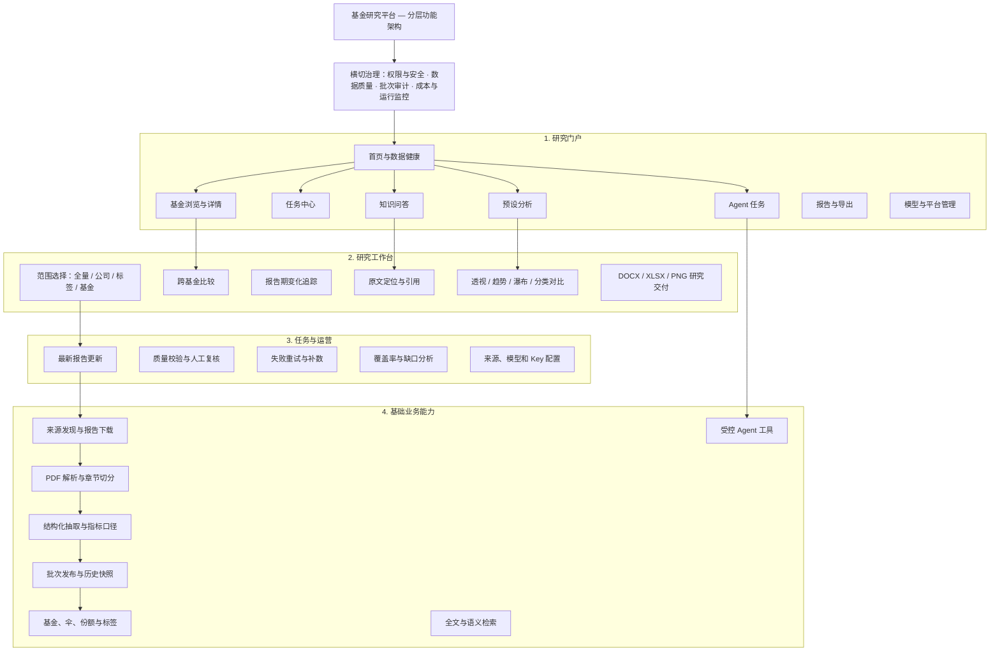

# 分层功能架构

> 视图类型：Functional Architecture  
> 范围：基金研究平台对用户提供的业务能力  
> 读者：产品负责人、投研人员、开发人员  
> 版本：V1 / V2

## 1. 构图原则

本图参考“门户层—应用层—支撑能力层”的分层方法，重点表达业务功能，不展示具体数据库、框架或外部模型产品。

共有四个业务层：

1. 研究门户：用户进入能力和当前上下文；
2. 研究工作台：投研人员的核心日常任务；
3. 任务与运营：让数据可更新、可补数、可审查；
4. 基础业务能力：供多个上层功能复用的领域能力。

安全、数据质量、审计和运维作为横切控制，不混入业务能力层。

## 2. 功能架构图

## 3. 能力地图

| 层 | 能力 | V1 | V2 |
|---|---|---|---|
| 研究门户 | 首页、基金浏览、详情、任务、分析、问答、报告、管理 | 完整闭环 | 共享查看和角色差异 |
| 研究工作台 | 范围选择、比较、变化追踪、原文引用、预设分析和导出 | 完整 | 保持，增加共享审计 |
| 任务与运营 | 最新报告更新、校验、复核、补数、覆盖率和配置 | 27 家公司起步 | 扩展到其余管理人 |
| 基础业务能力 | 主数据、来源、下载、解析、结构化、检索、工具和快照 | 完整 | 增加港交所、ETF、互认和 Bloomberg 能力 |
| 横切治理 | 权限、安全、质量、审计、成本和监控 | 本地单用户 | 三角色和共享运维 |

## 4. 主要用户任务

| 任务 | 入口 | 核心输出 | V1 | V2 |
|---|---|---|---|---|
| 批量更新最新月报 | 任务中心 | 下载、解析和结构化结果 | 支持 | 支持，排队 |
| 补全缺失月报入口 | 任务中心下载阶段 | 官网补全月报链接和运行方式，持久化后继续下载 | 支持已适配管理人 | 保持 |
| 查询某基金投资构成 | 基金详情 | 指标、表格和来源链接 | 支持 | 支持 |
| 比较两只基金 | 比较工作区 | 横向表格和差异说明 | 支持 | 支持 |
| 追踪两个报告期变化 | 分析页 | 趋势、变化和原文证据 | 支持 | 支持 |
| 询问报告中的原因 | 知识问答 | 带页码的回答 | 支持 | 支持 |
| 布置补数和报告任务 | Agent | 计划、任务、报告和日志 | 支持 | 支持，增加 V2 工具 |
| 查看网页数据透视 | 全局右侧“数据透视” | ECharts 规模直方图、规模趋势 | 支持 | 保持 |
| 深入分析与工作簿交付 | 数据透视中的“在 Tableau 中分析” | Tableau Desktop 工作簿 | 支持 | 保持 |

## 5. 功能边界

- 功能图不表示服务部署方式；
- 预设分析是固定工具，不建设自由拖拽看板；
- V1 不自动生成完整 19 页 Excel 底稿；
- V1 不接 Bloomberg，收益通过导入文件进入；
- Agent 不能直接操作数据库文件或 Shell，只能调用基础业务能力；
- V2 不新增评论、收藏、团队模板和额外通知系统。
