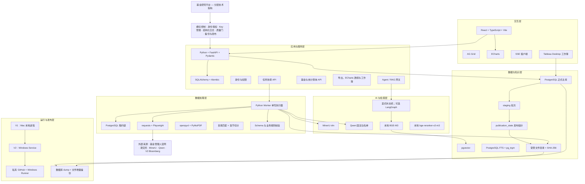

# 分层技术架构

> 视图类型：Technology Architecture  
> 范围：交互、API、处理、AI/RAG、数据和运行平台的技术栈  
> 读者：开发、测试、运维  
> 版本：V1 / V2

## 1. 构图原则

本图只表达技术组件和技术选型，不重复业务功能说明。分层参考云平台与 SOA 的“资源—服务—应用”思路，并结合本项目单服务器、模块化单体、单写多读的约束。

## 2. 技术架构图

## 3. 技术栈矩阵

| 层 | V1 | V2 | 备注 |
|---|---|---|---|
| 交互 | React、TypeScript、Vite、AG Grid、ECharts | 保持 | 浏览器访问 |
| API | Python 3.11、FastAPI、Pydantic、SSE | 保持 | 单进程可托管静态前端 |
| 数据库 | PostgreSQL 15+、pgvector | 保持 | 唯一正式数据库 |
| ORM/迁移 | SQLAlchemy、Alembic | 保持 | 禁止手改生产 schema |
| Worker | Python 独立进程 | Windows Service | 单写 |
| 下载 | requests、Playwright | 保持 | 域名限流和重试 |
| Office/PDF | openpyxl、PyMuPDF、pypdf | 保持 | 文件写入 staging |
| 解析 | MinerU vlm + 本地文本降级 | 保持 | 版本入审计 |
| 模型 | Qwen 固定白名单 | 保持 | 不开放任意模型 |
| Agent | Python 状态机，可选 LangGraph | 保持 | 工具白名单 |
| Embedding/Rerank | BGE-M3、bge-reranker-v2-m3 | 保持 | 本地优先 |
| Tableau | Tableau Desktop + PostgreSQL/JDBC | 保持 | 仅作为深入分析和研究交付出口，不嵌入 Web |
| 运行平台 | macOS 本机 | Windows x64 常开主机 | 路径和进程需抽象 |
| 发布 | 本地启动 | GitHub Runner、版本包、deploy.ps1 | 可回滚 |
| 备份 | 本机批次备份 | 定时数据库与文件备份 | 与 batch_id 对齐 |

## 4. 关键约束

1. PostgreSQL 是唯一正式数据库，Excel 只作为导入和导出。
2. Worker 不直接修改 `publication_state`；发布由 API 的发布服务完成。
3. Agent 和 Worker 不共享进程内可变状态，所有任务状态落 PostgreSQL。
4. 外部模型调用不进入查询主链路；基础查询不依赖 Qwen。
5. 数据库和文件均按 `batch_id` 版本化。
6. 本地开发与 Windows 部署共用 schema 和核心代码，不维护两套业务逻辑。
7. Mermaid 图和代码目录都不是运行时依赖。
