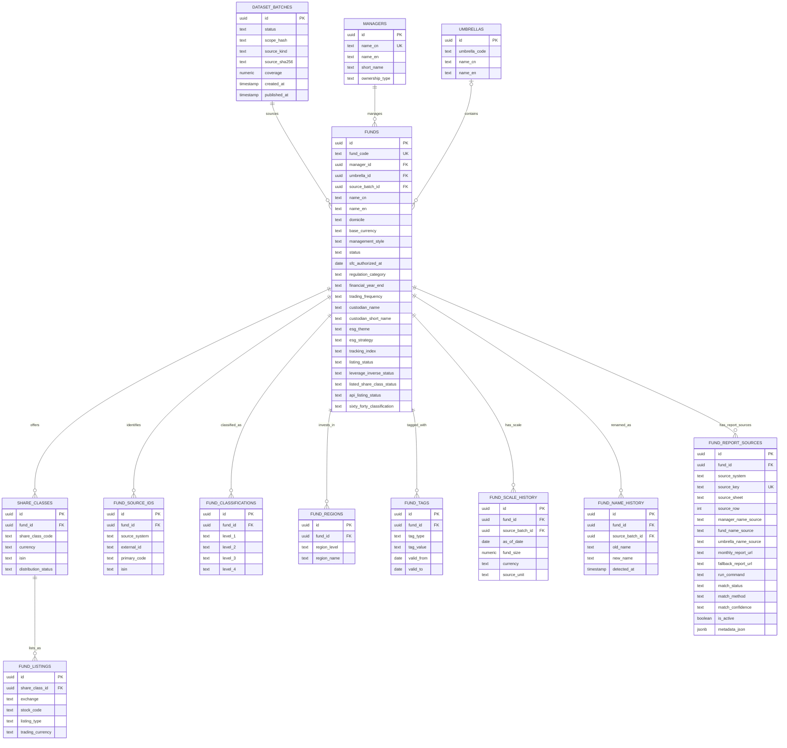
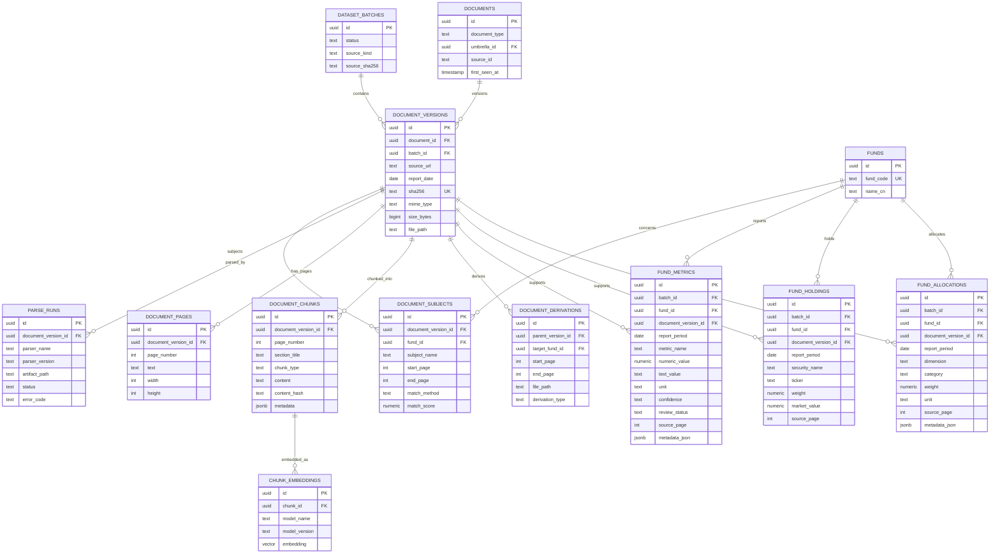
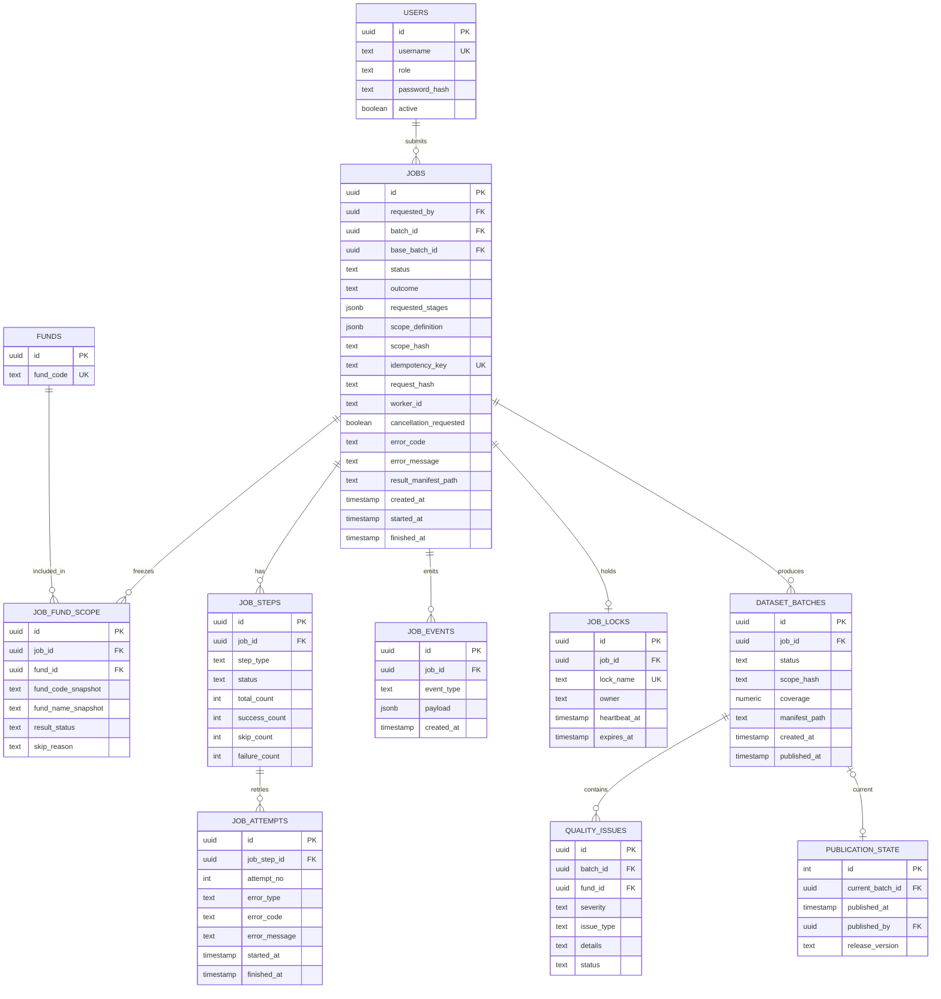
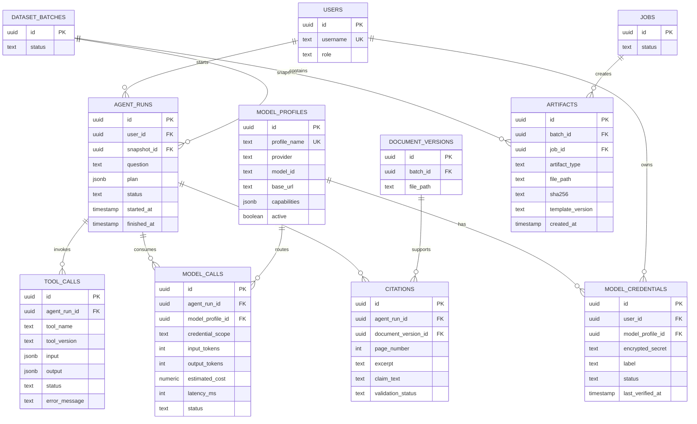

# 核心数据库关系设计

> 视图类型：Conceptual / Logical ER  
> 数据库：PostgreSQL + pgvector  
> 读者：后端、数据库、数据工程、测试  
> 状态：V0.1，字段名称可在生成 Alembic migration 时微调

## 1. 设计原则

1. 基金是稳定业务实体，基金代码是导入时的唯一键；名称只用于搜索和历史追踪。
2. 份额类别、上市信息、标签、分类、地区和规模历史不塞进 `funds` 宽表。
3. 伞级报告可以服务多个子基金，因此文档和基金之间必须是多对多关系。
4. 文档版本不可覆盖；同一来源的新文件新增版本记录。
5. 指标、持仓、地区和行业配置必须能回到文档版本与页码。
6. 任务范围在开始时冻结到 `job_fund_scope`，覆盖率分母不随主数据更新变化。
7. 所有业务结果按 `batch_id` 版本化，发布只切换 `publication_state.current_batch_id`。
8. 时间统一存 UTC，展示时转换为 Asia/Hong_Kong。
9. HKEX 综合资料库是基金主数据权威来源；crawler 工作簿只补充报告链接、下载命令和适配元数据。

## 2. 主数据 ER



### 主数据约束

| 约束 | 规则 |
|---|---|
| 基金代码 | `UNIQUE(fund_code)`，按字符串保存，去除首尾空格 |
| 伞编号 | 允许为空；存在时以 `umbrella_code` 为稳定实体键；编号缺失的基金保留 `umbrella_id = NULL` |
| 管理人 | 同时保留中英文名，名称变化不覆盖当前记录 |
| 份额 | `UNIQUE(fund_id, share_class_code, currency)` |
| ISIN | 非空时 `UNIQUE(isin)`；同一基金可有多个 ISIN |
| 规模 | `UNIQUE(fund_id, as_of_date, source_batch_id)` |
| 标签 | 同一基金同一时间不得存在重复 `(tag_type, tag_value, valid_from)` |
| 缺失值 | 规模、状态和伞编号缺失时存 `NULL`/`UNKNOWN`，不写 0 |
| 补充来源 | `FUND_REPORT_SOURCES.source_key` 全局唯一；`fund_id` 可为空，不得因未匹配删除记录 |

HKEX 输入表有 2,479 个唯一基金代码和 187 个规范化管理人。原始管理人文本
有 191 个值，但其中 4 组仅尾部空格不同。伞编号有 306 个，原始“编号+名称”
组合有 308 个，差异来自伞名称变更。2026-08-31 规模有 926 条非空值，
不能把其余 1,553 条解释为零规模。

`FUND_REPORT_SOURCES` 以 `source_key = source_system + 工作表 + Excel 行号`
保持可重复导入。`monthly_report_url` 和 `run_command` 是 crawler 工作簿的
补充事实，不参与基金主身份；匹配顺序为基金代码、管理人+名称+伞、
管理人+名称、历史名称，无法唯一匹配时保留记录并进入质量问题。

HKEX 当前没有独立份额类别 ID。V1 为每只基金建立一个
`share_class_code = fund_code` 的默认份额锚点，用于关联上市代号；这是
1:1 临时假设。后续取得份额级可靠来源时，必须新增真实份额记录并通过迁移
拆分该锚点，不能把普通基金代码永久解释为份额代码。

## 3. 文档、解析与证据 ER



### 文档关系约束

- `DOCUMENT_VERSIONS.sha256` 全局唯一，用于避免重复解析同一文件；
- 同一基金、报告期、报告类型可以存在多个版本，但只能有一个被标记为 `preferred`;
- `DOCUMENT_SUBJECTS` 记录伞级年报中的章节映射，例如富达 ILAS 或汇丰年报；
- `DOCUMENT_SUBJECTS` 必须满足 `start_page <= end_page`；
- 切分 PDF 在 `DOCUMENT_DERIVATIONS` 中记录来源页范围，不伪装成新的官方来源；
- `FUND_METRICS`、`FUND_HOLDINGS` 和 `FUND_ALLOCATIONS` 必须引用具体
  `batch_id` 和 `document_version_id`；
- `FUND_METRICS.batch_id` 保证同一 PDF 在多个批次复用时，新的模型抽取结果不会覆盖旧快照；
- `FUND_METRICS.numeric_value` 和 `text_value` 至少一个非空，信用评级等枚举值存于 `text_value`；
- 同一指标同一报告期可以有 `review_status = pending` 的候选值，但发布查询只读取 approved 或确认后的 preferred 值；
- embedding 使用 `(chunk_id, model_name, model_version)` 唯一约束，模型升级不覆盖旧向量。

## 4. 任务与发布 ER



### 任务与发布约束

- `UNIQUE(idempotency_key)` 防止用户重复点击产生两个等价任务；
- `JOB_FUND_SCOPE` 冻结基金代码、名称和本次范围，覆盖率分母从这里计算；
- `JOB_LOCKS` 全表只允许一个有效 `lock_name = 'global_write'`；
- 同一任务可多次重试，但正式发布只引用一个 `batch_id`；
- `PUBLICATION_STATE` 只有一行，`id = 1`；
- `PUBLICATION_STATE.current_batch_id` 必须指向 `DATASET_BATCHES.status = published`；
- 发布时先把批次置为 `published`，再在同一事务更新发布指针；
- Worker 只提交发布清单，API 的发布服务执行指针切换；
- 发布失败时批次状态保持 `staging` 或 `publish_failed`，当前指针不变。

## 5. Agent、模型与审计 ER



### Agent 与审计约束

- API Key 只保存密文或密钥引用，不保存明文；
- `credential_scope` 只能是 `platform` 或 `user`；
- 每次回答必须保存所用 `snapshot_id`；
- 每个事实性 claim 至少有一个通过校验的 citation；
- citation 必须指向与问题基金匹配的 `document_version_id` 和真实页码；
- 模型调用失败、重试和费用都写入审计，不因失败删除；
- artifact 记录模板版本和 SHA-256，确保可重现。

## 6. 索引与性能建议

| 表 | 建议索引 |
|---|---|
| `funds` | `(manager_id)`, `(umbrella_id)`, `(status)`, `(name_cn)` trigram |
| `fund_scale_history` | `(fund_id, as_of_date DESC)`, `(source_batch_id)` |
| `fund_tags` | `(tag_type, tag_value)` |
| `fund_report_sources` | `(fund_id, is_active)`, `UNIQUE(source_key)` |
| `document_versions` | `(document_id, report_date DESC)`, `(batch_id)`, `(sha256)` |
| `document_subjects` | `(fund_id, document_version_id)`, `(document_version_id, start_page)` |
| `document_chunks` | GIN 全文、`(document_version_id, page_number)` |
| `chunk_embeddings` | HNSW/IVFFlat 向量索引，前置 metadata filter |
| `jobs` | `(status, created_at)`, `(requested_by)` |
| `job_fund_scope` | `(job_id, result_status)`, `(fund_id)` |
| `job_events` | `(job_id, created_at)` |
| `job_locks` | `UNIQUE(lock_name)`, `(expires_at)` |
| `fund_metrics` | `(fund_id, report_period, metric_name)` |
| `citations` | `(agent_run_id)`, `(document_version_id, page_number)` |

## 7. 迁移顺序

```text
001 users / managers / umbrellas / funds / share classes
002 tags / classifications / regions / listings / source ids / report sources
003 batches / documents / document versions / document subjects
004 jobs / scope / steps / attempts / events / locks
005 parse runs / pages / chunks / embeddings
006 metrics / holdings / allocations / quality issues
007 publication state / artifacts
008 agent runs / model profiles / credentials / calls / citations
009 read-only analytics views for ECharts and Tableau Desktop
```

每次 migration 必须包含：

- 向前迁移；
- 索引和约束；
- 可回滚说明；
- fixture 或数据迁移脚本；
- 空表和有数据两种验证。

## 8. 数据库字段中文数据字典

`PK` 表示主键，`FK` 表示外键，`UK` 表示唯一约束。下表中的字段顺序与 ER 图一致，供开发、测试、数据质量和 Agent 工具共同使用。

| 数据表 | 表用途 | 字段（类型/约束）→ 中文释义 |
|---|---|---|
| `MANAGERS` | 基金管理人主数据 | `id`（uuid/PK）→ 管理人内部主键；`name_cn`（text/UK）→ 管理人规范中文全称；`name_en`（text）→ 管理人英文全称；`short_name`（text）→ 展示用管理人简称；`ownership_type`（text）→ 中资、外资或合资等归属类型 |
| `UMBRELLAS` | 伞型基金及系列信息 | `id`（uuid/PK）→ 伞内部主键；`umbrella_code`（text）→ 港交所或来源系统伞编号，可为空；`name_cn`（text）→ 伞的中文名称；`name_en`（text）→ 伞的英文名称 |
| `FUNDS` | 基金稳定主实体 | `id`（uuid/PK）→ 基金内部主键；`fund_code`（text/UK）→ HKEX 基金唯一代码；`manager_id`（uuid/FK）→ 所属基金管理人；`umbrella_id`（uuid/FK）→ 所属伞，可为空；`source_batch_id`（uuid/FK）→ 当前记录来源导入批次；`name_cn/name_en`（text）→ 当前中英文名；`domicile/base_currency/management_style/status/sfc_authorized_at` → 注册地、基础币种、主动被动、运作状态和认可日期；`regulation_category` → HKEX 基金分类原文；`financial_year_end/trading_frequency` → 财年和交易频度；`custodian_name/custodian_short_name` → 托管人；`esg_theme/esg_strategy` → ESG 主题和策略；`tracking_index` → 跟踪指数；`listing_status/leverage_inverse_status/listed_share_class_status/api_listing_status/sixty_forty_classification` → HKEX 上市、杠反、份额、API 上市及 60-40 分类 |
| `SHARE_CLASSES` | 基金份额类别 | `id`（uuid/PK）→ 份额类别内部主键；`fund_id`（uuid/FK）→ 所属基金；`share_class_code`（text）→ 来源份额代码；当前 HKEX 无独立份额 ID 时使用基金代码作为 1:1 默认锚点；`currency` → 份额计价币种；`isin` → ISIN；`distribution_status` → 分派、累积或终止等状态 |
| `FUND_LISTINGS` | 基金份额上市信息 | `id`（uuid/PK）→ 上市记录主键；`share_class_id`（uuid/FK）→ 对应份额；`exchange`（text）→ 上市交易所；`stock_code`（text）→ 交易所股份代号；`listing_type`（text）→ 普通上市、杠杆、反向或其他上市类型；`trading_currency`（text）→ 交易币种 |
| `FUND_SOURCE_IDS` | 跨来源基金标识映射 | `id`（uuid/PK）→ 映射主键；`fund_id`（uuid/FK）→ 对应基金；`source_system`（text）→ 来源系统名称，当前权威来源为 `hkex-master`；`external_id`（text）→ HKEX 复合 ID；`primary_code`（text）→ 产品主级别代码；`isin`（text）→ ISIN；`metadata_json`（jsonb）→ HKEX 原始行快照和基金代码 |
| `FUND_CLASSIFICATIONS` | 基金资产类别层级 | `id`（uuid/PK）→ 分类记录主键；`fund_id`（uuid/FK）→ 对应基金；`level_1`（text）→ 一级资产类别；`level_2`（text）→ 二级资产类别；`level_3`（text）→ 三级资产类别；`level_4`（text）→ 四级资产类别 |
| `FUND_REGIONS` | 基金投资地域 | `id`（uuid/PK）→ 地区记录主键；`fund_id`（uuid/FK）→ 对应基金；`region_level`（text）→ 地区维度级别；`region_name`（text）→ 地区名称 |
| `FUND_TAGS` | 业务标签及有效期 | `id`（uuid/PK）→ 标签记录主键；`fund_id`（uuid/FK）→ 对应基金；`tag_type`（text）→ 标签类型，如北上、MPF、竞品库；`tag_value`（text）→ 标签值；`valid_from`（date）→ 标签生效日期；`valid_to`（date）→ 标签失效日期，空表示仍有效 |
| `FUND_SCALE_HISTORY` | 基金月末规模序列 | `id`（uuid/PK）→ 规模记录主键；`fund_id`（uuid/FK）→ 对应基金；`source_batch_id`（uuid/FK）→ 数据来源批次；`as_of_date`（date）→ 规模截止日期；`fund_size`（numeric）→ 基金规模原值，空表示未披露；`currency`（text）→ 原币种；`source_unit`（text）→ 来源单位，当前导入为亿港币 |
| `FUND_NAME_HISTORY` | 基金改名历史 | `id`（uuid/PK）→ 改名记录主键；`fund_id`（uuid/FK）→ 对应基金；`source_batch_id`（uuid/FK）→ 发现改名的导入批次；`old_name`（text）→ 变更前名称；`new_name`（text）→ 变更后名称；`detected_at`（timestamp）→ 系统发现变更时间 |
| `FUND_REPORT_SOURCES` | Crawler 补充的报告入口 | `id`（uuid/PK）→ 主键；`fund_id`（uuid/FK）→ 匹配后的 HKEX 基金，可为空；`source_system`（text）→ 当前为 `crawler-list-v1`；`source_key`（text/UK）→ 工作表加 Excel 行号形成的稳定键；`source_sheet/source_row` → 来源位置；`manager_name_source/fund_name_source/umbrella_name_source` → 补充表原始名称；`monthly_report_url` → 月报或站点链接；`fallback_report_url` → 备选链接；`run_command` → 现有下载器命令；`match_status` → matched、ambiguous、unmatched；`match_method/match_confidence` → 匹配方法与置信度；`is_active` → 当前是否有可执行来源；`metadata_json` → 候选代码、原序号及 `backfill` 补全审计（status、script、reason、attempted_at） |
| `DATASET_BATCHES` | 不可变数据批次和发布状态 | `id`（uuid/PK）→ 批次主键，也是文件和业务结果的版本键；`job_id`（uuid/FK）→ 生成本批次的任务；`status`（text）→ staging、published、publish_failed 等批次状态；`scope_hash`（text）→ 冻结范围指纹；`source_kind`（text）→ HKEX、crawler、结构化输入组合；`source_sha256`（text）→ 权威主数据工作簿哈希；`coverage`（numeric）→ 本批次按冻结名单计算的覆盖率；`manifest_path`（text）→ 批次文件清单位置；`created_at/published_at` → 创建与发布时间 |
| `DOCUMENTS` | 报告的逻辑文档 | `id`（uuid/PK）→ 文档主键；`document_type`（text）→ 月报、年报、中报或替代财报类型；`umbrella_id`（uuid/FK）→ 所属伞，基金级文档可为空；`source_id`（text）→ 来源站点或公告系统标识；`first_seen_at`（timestamp）→ 首次发现时间 |
| `DOCUMENT_VERSIONS` | 报告来源文件和不可变版本 | `id`（uuid/PK）→ 文档版本主键；`document_id`（uuid/FK）→ 所属逻辑文档；`batch_id`（uuid/FK）→ 进入哪个数据批次；`source_url`（text）→ 原始下载地址；`report_date`（date）→ 报告期末日期；`sha256`（text/UK）→ 文件内容哈希和去重键；`mime_type`（text）→ 文件媒体类型；`size_bytes`（bigint）→ 文件字节数；`file_path`（text）→ 受管目录中的不可变文件路径 |
| `DOCUMENT_SUBJECTS` | 文档与基金的多对多章节映射 | `id`（uuid/PK）→ 映射主键；`document_version_id`（uuid/FK）→ 来源文档版本；`fund_id`（uuid/FK）→ 命中的基金；`subject_name`（text）→ 文档中的子基金或章节名称；`start_page`（int）→ 章节起始页；`end_page`（int）→ 章节结束页；`match_method`（text）→ 精确名、归一化名或人工确认等匹配方式；`match_score`（numeric）→ 名称匹配得分 |
| `PARSE_RUNS` | PDF 解析执行记录 | `id`（uuid/PK）→ 解析运行主键；`document_version_id`（uuid/FK）→ 被解析文档版本；`parser_name`（text）→ MinerU 或本地解析器名称；`parser_version`（text）→ 解析器版本；`artifact_path`（text）→ Markdown、content_list 和图片产物路径；`status`（text）→ 解析状态；`error_code`（text）→ 失败分类码 |
| `DOCUMENT_PAGES` | PDF 页级文本和尺寸 | `id`（uuid/PK）→ 页面记录主键；`document_version_id`（uuid/FK）→ 所属文档版本；`page_number`（int）→ 从 1 开始的 PDF 页码；`text`（text）→ 该页提取文本；`width`（int）→ 页面宽度；`height`（int）→ 页面高度 |
| `DOCUMENT_CHUNKS` | 可检索证据切片 | `id`（uuid/PK）→ 切片主键；`document_version_id`（uuid/FK）→ 来源文档版本；`page_number`（int）→ 主要来源页码；`section_title`（text）→ 所属章节标题；`chunk_type`（text）→ 正文、表格、标题或图注类型；`content`（text）→ 切片正文；`content_hash`（text）→ 切片内容哈希；`metadata`（jsonb）→ 表格边界、基金、报告期和解析信息 |
| `CHUNK_EMBEDDINGS` | 切片向量索引 | `id`（uuid/PK）→ 向量记录主键；`chunk_id`（uuid/FK）→ 对应证据切片；`model_name`（text）→ Embedding 模型名称；`model_version`（text）→ Embedding 模型版本；`embedding`（vector）→ 用于语义检索的向量 |
| `DOCUMENT_DERIVATIONS` | 从整伞报告切出的派生文件 | `id`（uuid/PK）→ 派生文件主键；`parent_version_id`（uuid/FK）→ 原始整伞报告版本；`target_fund_id`（uuid/FK）→ 切分后对应的基金；`start_page`（int）→ 派生文件起始页；`end_page`（int）→ 派生文件结束页；`file_path`（text）→ 派生 PDF 路径；`derivation_type`（text）→ 章节切分、裁页或格式转换类型 |
| `FUND_METRICS` | 基金结构化指标 | `id`（uuid/PK）→ 指标记录主键；`batch_id`（uuid/FK）→ 结果所属不可变批次；`fund_id`（uuid/FK）→ 对应基金；`document_version_id`（uuid/FK）→ 指标来源文档版本；`report_period`（date）→ 指标所属报告期；`metric_name`（text）→ 规范指标代码；`numeric_value`（numeric）→ 数值结果；`text_value`（text）→ 评级等文本指标；`unit`（text）→ 指标单位；`confidence`（text）→ 抽取置信等级；`review_status`（text）→ pending、approved、rejected；`source_page`（int）→ 原文页码；`metadata_json`（jsonb）→ 审计元数据 |
| `FUND_HOLDINGS` | 基金证券持仓明细 | `id`（uuid/PK）→ 持仓记录主键；`batch_id`（uuid/FK）→ 结果所属批次；`fund_id`（uuid/FK）→ 对应基金；`document_version_id`（uuid/FK）→ 来源文档版本；`report_period`（date）→ 报告期；`security_name/ticker` → 证券名称和标准化代码；`weight/market_value/source_page` → 权重、市值和来源页 |
| `FUND_ALLOCATIONS` | 基金地区、行业、期限和评级分布 | `id`（uuid/PK）→ 分布记录主键；`batch_id`（uuid/FK）→ 结果所属批次；`fund_id`（uuid/FK）→ 对应基金；`document_version_id`（uuid/FK）→ 来源文档版本；`report_period`（date）→ 报告期；`dimension/category/weight/unit` → 分布维度、分类、数值和单位；`source_page` → 原文页码；`metadata_json` → 分布口径等审计信息 |
| `USERS` | 本地或 V2 登录用户 | `id`（uuid/PK）→ 用户主键；`username`（text/UK）→ 登录名；`role`（text）→ 管理员或投研用户角色；`password_hash`（text）→ 密码哈希，V1 本地用户可为空；`active`（boolean）→ 账号是否可登录 |
| `JOBS` | 数据更新或分析任务主状态 | `id`（uuid/PK）→ 任务主键；`requested_by`（uuid/FK）→ 发起用户；`batch_id/base_batch_id` → 任务结果批次和起始发布快照；`status/outcome` → 主状态和最终结果；`requested_stages`（jsonb）→ 下载、解析、结构化等阶段数组；`scope_definition/scope_hash` → 原始范围和冻结指纹；`idempotency_key/request_hash` → 幂等键及相同请求校验；`worker_id` → 执行 Worker；`cancellation_requested` → 取消信号；`error_code/error_message` → 脱敏错误；`result_manifest_path` → API 发布后的清单；`created_at/started_at/finished_at` → 时间线 |
| `JOB_FUND_SCOPE` | 任务开始时的冻结基金名单 | `id`（uuid/PK）→ 范围行主键；`job_id`（uuid/FK）→ 所属任务；`fund_id`（uuid/FK）→ 冻结基金；`fund_code_snapshot`（text）→ 任务开始时代码快照；`fund_name_snapshot`（text）→ 任务开始时名称快照；`result_status`（text）→ 成功、跳过、失败或待处理；`skip_reason`（text）→ 跳过的具体业务原因 |
| `JOB_STEPS` | 任务阶段汇总 | `id`（uuid/PK）→ 阶段主键；`job_id`（uuid/FK）→ 所属任务；`step_type`（text）→ 导入、下载、解析、结构化、发布等阶段；`status`（text）→ 阶段状态；`total_count`（int）→ 阶段处理总数；`success_count`（int）→ 成功数；`skip_count`（int）→ 业务跳过数；`failure_count`（int）→ 失败数 |
| `JOB_ATTEMPTS` | 阶段内每次尝试 | `id`（uuid/PK）→ 尝试主键；`job_step_id`（uuid/FK）→ 对应任务阶段；`attempt_no`（int）→ 从 1 开始的尝试序号；`error_type`（text）→ 网络、解析、模型或校验等错误类别；`error_code`（text）→ 稳定机器错误码；`error_message`（text）→ 脱敏后的错误说明；`started_at`（timestamp）→ 尝试开始时间；`finished_at`（timestamp）→ 尝试结束时间 |
| `JOB_EVENTS` | 可重放的进度与状态事件 | `id`（uuid/PK）→ 事件主键，也作为 SSE event id；`job_id`（uuid/FK）→ 所属任务；`event_type`（text）→ stage_started、fund_progress、publish_failed 等事件类型；`payload`（jsonb）→ 事件结构化载荷；`created_at`（timestamp）→ 事件生成时间 |
| `JOB_LOCKS` | 全局单写租约 | `id`（uuid/PK）→ 锁记录主键；`job_id`（uuid/FK）→ 持锁任务；`lock_name`（text/UK）→ 当前固定为 `global_write`；`owner`（text）→ Worker 实例标识；`heartbeat_at`（timestamp）→ 最近续约时间；`expires_at`（timestamp）→ 租约失效时间 |
| `PUBLICATION_STATE` | 当前已发布批次指针 | `id`（int/PK）→ 固定单行主键 `1`；`current_batch_id`（uuid/FK）→ 当前正式快照批次；`published_at`（timestamp）→ 当前批次发布时间；`published_by`（uuid/FK）→ 发布操作用户；`release_version`（text）→ 发布时的应用版本 |
| `QUALITY_ISSUES` | 批次质量问题和复核状态 | `id`（uuid/PK）→ 问题主键；`batch_id`（uuid/FK）→ 所属批次；`fund_id`（uuid/FK）→ 相关基金，可为空；`severity`（text）→ info、warning、error 或 blocker；`issue_type`（text）→ 缺文件、口径冲突、权重异常等问题分类；`details`（text）→ 可审计的问题详情；`status`（text）→ open、resolved、waived 等处理状态 |
| `AGENT_RUNS` | 一次 Agent 问答或计划执行 | `id`（uuid/PK）→ Agent 运行主键；`user_id`（uuid/FK）→ 发起用户；`snapshot_id`（uuid/FK）→ 本次回答使用的数据快照；`question`（text）→ 用户原始问题或任务；`plan`（jsonb）→ 结构化执行计划和参数；`status`（text）→ 运行状态；`started_at`（timestamp）→ 开始时间；`finished_at`（timestamp）→ 结束时间 |
| `TOOL_CALLS` | Agent 工具调用审计 | `id`（uuid/PK）→ 工具调用主键；`agent_run_id`（uuid/FK）→ 所属 Agent 运行；`tool_name`（text）→ 工具名称；`tool_version`（text）→ 工具版本；`input`（jsonb）→ 脱敏后的输入参数；`output`（jsonb）→ 结构化输出摘要；`status`（text）→ 成功、失败或拒绝状态；`error_message`（text）→ 工具错误说明 |
| `MODEL_PROFILES` | 固定模型白名单配置 | `id`（uuid/PK）→ 模型配置主键；`profile_name`（text/UK）→ analysis、fallback 或 vision 配置名；`provider`（text）→ 模型服务商类型；`model_id`（text）→ 固定模型 ID；`base_url`（text）→ 固定服务地址；`capabilities`（jsonb）→ 文本、视觉、结构化能力声明；`active`（boolean）→ 是否允许使用 |
| `MODEL_CREDENTIALS` | 平台或个人模型 Key 密文引用 | `id`（uuid/PK）→ 凭据记录主键；`user_id`（uuid/FK）→ 个人 Key 所属用户，平台 Key 可为空；`model_profile_id`（uuid/FK）→ 对应模型配置；`encrypted_secret`（text）→ 加密后的密钥或密钥管理引用；`label`（text）→ 用户可见的凭据标签；`status`（text）→ active、invalid 或 revoked；`last_verified_at`（timestamp）→ 最近验证时间 |
| `MODEL_CALLS` | 模型调用、token 和费用审计 | `id`（uuid/PK）→ 模型调用主键；`agent_run_id`（uuid/FK）→ 所属 Agent 运行；`model_profile_id`（uuid/FK）→ 使用的模型配置；`credential_scope`（text）→ platform 或 user；`input_tokens`（int）→ 输入 token 数；`output_tokens`（int）→ 输出 token 数；`estimated_cost`（numeric）→ 按公开价格估算的费用；`latency_ms`（int）→ 调用耗时毫秒；`status`（text）→ 调用状态 |
| `CITATIONS` | 结论对应的原文证据 | `id`（uuid/PK）→ 引用主键；`agent_run_id`（uuid/FK）→ 所属 Agent 运行；`document_version_id`（uuid/FK）→ 精确文档版本；`page_number`（int）→ 原文页码；`excerpt`（text）→ 支撑结论的原文片段；`claim_text`（text）→ 被支持的 claim；`validation_status`（text）→ 引用校验状态 |
| `ARTIFACTS` | 导出和派生研究产物 | `id`（uuid/PK）→ 产物主键；`batch_id`（uuid/FK）→ 绑定数据快照；`job_id`（uuid/FK）→ 生成任务；`artifact_type`（text）→ DOCX、XLSX、PNG、切分 PDF 等类型；`file_path`（text）→ 受管文件路径；`sha256`（text）→ 产物内容哈希；`template_version`（text）→ 生成模板版本；`created_at`（timestamp）→ 生成时间 |
