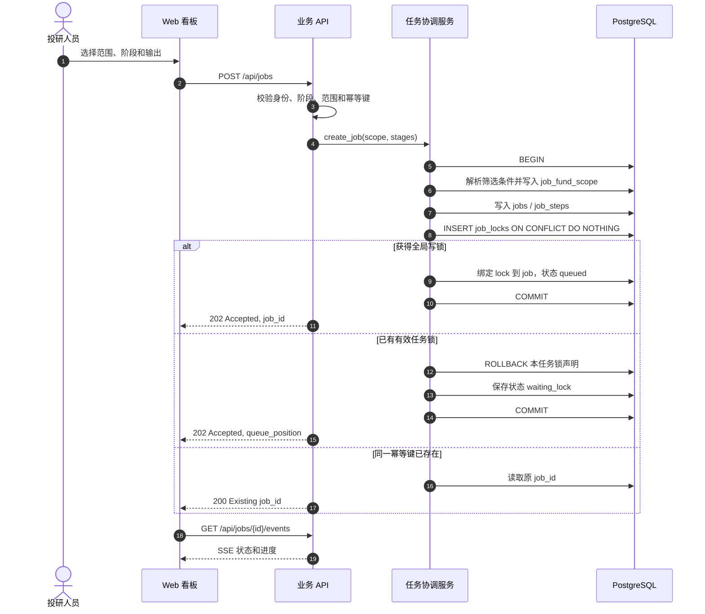
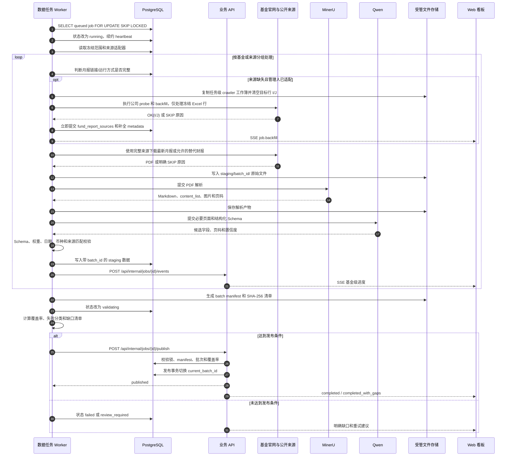
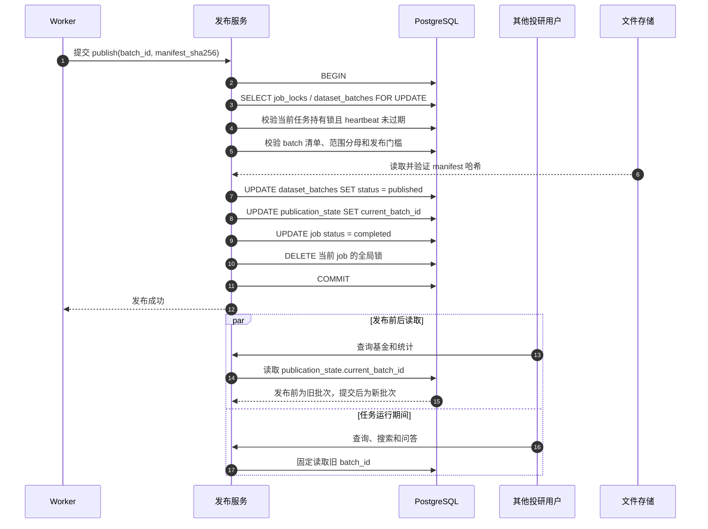
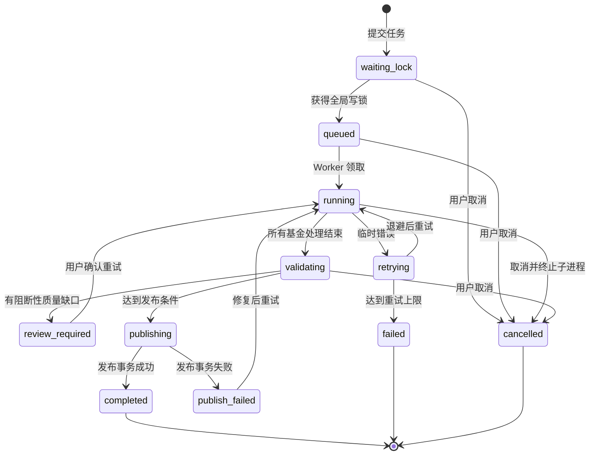

# 核心任务时序与发布事务

> 视图类型：UML Sequence、状态机、事务边界  
> 范围：预设数据更新任务和 Agent 触发的写任务  
> 读者：后端、Worker、Agent、测试、运维

## 1. 关键决策

1. PostgreSQL 任务表就是 V1/V2 的队列，不引入 Redis 或消息中间件。
2. 全系统只有一个 `global_write` 租约锁；V1 和 V2 都遵守。
3. 任务范围在提交事务中冻结到 `job_fund_scope`。
4. Worker 写 staging 和文件批次，但不直接切换正式发布指针。
5. API 的发布服务负责最终发布事务，保证发布规则只有一处实现。
6. 已发布快照不可修改；运行中任务不会让其他用户看到半成品。
7. 任务失败可以保留诊断产物，但不会切换 `current_batch_id`。

## 2. 任务提交与锁竞争



### 提交约束

- `scope_definition` 保存原始筛选条件；
- `job_fund_scope` 保存冻结后的基金 ID、代码和名称；
- 本次覆盖率的唯一分母是 `COUNT(job_fund_scope)`；
- 同一 `Idempotency-Key` 返回原任务，不重新执行；
- 任务未获得锁时可排队，但不得开始下载。

## 3. 数据更新 happy path



## 4. 发布与并发读取



### 发布事务伪代码

```sql
BEGIN;

SELECT *
FROM job_locks
WHERE lock_name = 'global_write'
FOR UPDATE;

SELECT *
FROM dataset_batches
WHERE id = :batch_id
FOR UPDATE;

-- 应用层校验 job_id、lock owner、heartbeat、manifest、
-- 冻结范围、最低质量和允许的 SKIP。

UPDATE dataset_batches
SET status = 'published', published_at = now()
WHERE id = :batch_id;

UPDATE publication_state
SET current_batch_id = :batch_id,
    published_at = now(),
    published_by = :user_id
WHERE id = 1;

UPDATE jobs
SET status = :final_status, finished_at = now()
WHERE id = :job_id;

DELETE FROM job_locks
WHERE lock_name = 'global_write' AND job_id = :job_id;

COMMIT;
```

数据库约束或触发器必须保证：

- `current_batch_id` 指向 `published` 批次；
- `global_write` 最多一行；
- 发布指针和批次状态在同一事务内变化；
- 事务提交后新的读请求才看到新批次。

## 5. 状态机



`completed_with_gaps` 作为 `jobs.outcome` 字段保存，不与主状态混用。主状态仍是 `completed`，但结果标记存在允许的 SKIP。

## 6. 错误与恢复

| 错误 | 任务状态 | 是否释放锁 | 处理 |
|---|---|---|---|
| 无锁 | `waiting_lock` | 无锁可释放 | 排队 |
| 下载超时 | `retrying` | 保持 | 指数退避 |
| 官网结构变化 | `review_required` | 保持直到任务结束 | 停止盲试，标记适配器 |
| 来源补全未命中 | `completed_with_gaps` 或 `failed` | 保持 | 保存 SKIP 原因；无成功下载时失败 |
| 来源补全脚本异常 | `retrying` 或 `failed` | 保持 | 保留原 I/J，记录脚本、退出码和 metadata |
| MinerU 单文件失败 | `running` | 保持 | 本地文本降级并降低质量 |
| Qwen 输出 Schema 错误 | `retrying` | 保持 | 修复一次，再失败进 review |
| Worker 崩溃 | `lease_expired` | 租约到期后恢复 | 新 Worker 恢复 |
| 发布事务失败 | `publish_failed` | 保持 | 不切换指针，允许重试 |
| 低于覆盖率门槛 | `review_required` | 保持或结束 | 用户决定继续、补数或取消 |

## 7. API 与时序对应

| 接口 | 用途 | 幂等性 |
|---|---|---|
| `POST /api/jobs` | 创建并冻结任务范围 | `Idempotency-Key` |
| `GET /api/jobs/{id}` | 获取任务快照 | 自然幂等 |
| `GET /api/jobs/{id}/events` | SSE 推送状态 | 自动重连使用 `Last-Event-ID` |
| `POST /api/jobs/{id}/cancel` | 取消任务 | 对相同请求幂等 |
| `POST /api/internal/jobs/{id}/events` | Worker 上报事件 | `event_id` 唯一 |
| `POST /api/internal/jobs/{id}/publish` | 提交发布申请 | `batch_id + manifest_sha256` |
| `GET /api/snapshots/current` | 获取当前快照元数据 | 自然幂等 |

## 8. 待实现前确认

- Worker 是否通过 API 轮询事件，还是直接写 `job_events`；
- 达到 90% 但存在 SKIP 时是否自动发布，或必须由用户确认；
- 取消任务时是否终止正在进行的 MinerU/Qwen 请求；
- 任务锁丢失后是否允许重新申请，还是整批重跑；
- API 与 Worker 的内部调用认证方式。
