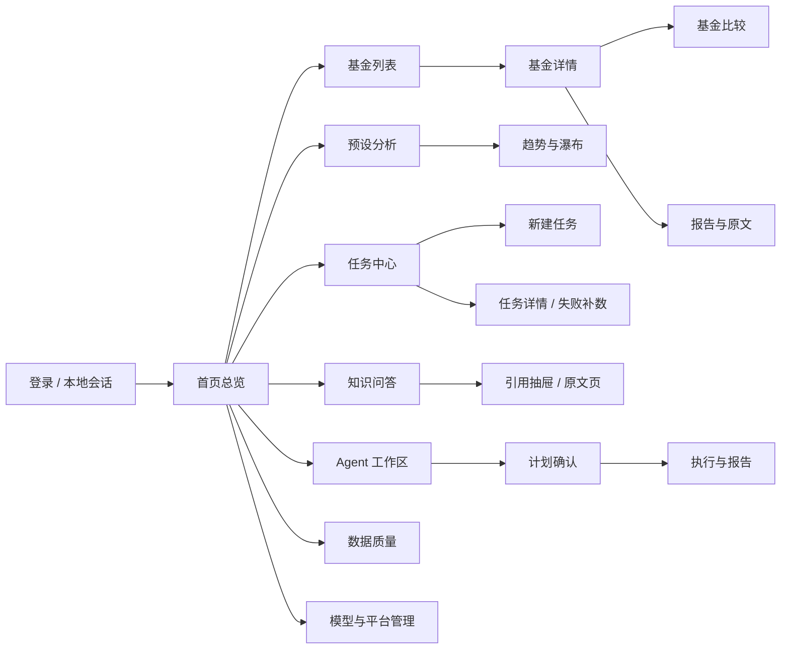

# 前端信息架构与低保真原型

> 视图类型：Information Architecture / Low-fidelity Wireframe  
> 目标用户：基金投研人员；V2 增加管理员  
> 首个基准尺寸：1440 × 900 桌面浏览器  
> 状态：可进入开发讨论的 V0.1

## 1. 设计目标

前端围绕一条主工作流组织：

```text
确定基金范围
→ 更新或选择已发布数据
→ 查看结构和变化
→ 追踪原文
→ 比较和问答
→ 导出研究结果
```

设计约束：

- 任一页面都显示当前数据快照和最近更新时间；
- 任务运行期间仍可查询、搜索和问答；
- 数据错误、缺失、过期和未解析必须在视觉上区分；
- 所有事实性回答都可展开证据和打开原文页码；
- V1 不建设自由拖拽看板，分析能力以预设工具组织；
- 所有网页图表以 ECharts 为主实现；右侧“数据透视”只提供 1～2 个预设图，不承担任务进度和辅助信息；
- Tableau Desktop 工作簿作为深入分析和研究交付出口，不嵌入 Web；
- 页面不暴露模型 Key、SQL 连接和本地文件路径。

## 2. 页面路由图



## 3. 全局页面框架

```text
┌──────────────────────────────────────────────────────────────────────────────┐
│ Logo  快照：2026-10-08 已发布  [任务：汇丰 解析 72%  失败 2  ▸]  [搜索]  用户│
├───────────────┬──────────────────────────────────────────────┬───────────────┤
│ 首页          │ 页面标题与当前筛选                           │ 数据透视      │
│ 基金          │ ┌──────────────────────────────────────────┐ │ ECharts 视图  │
│ 任务          │ │                                          │ │ ┌───────────┐ │
│ 分析          │ │               主内容区                   │ │ │规模直方图 │ │
│ 知识问答      │ │                                          │ │ └───────────┘ │
│ Agent         │ │                                          │ │ ┌───────────┐ │
│ 数据质量      │ │                                          │ │ │规模趋势图 │ │
│ 管理          │ └──────────────────────────────────────────┘ │ └───────────┘ │
│               │                                              │ [切换预设]    │
│               │                                              │ [Tableau 分析]│
└───────────────┴──────────────────────────────────────────────┴───────────────┘
```

### 全局元素

| 区域 | 内容 | 行为 |
|---|---|---|
| 顶部快照条 | 当前批次、报告期、当前任务阶段和成功/失败数 | 点击快照查看批次；点击任务打开抽屉 |
| 全局搜索 | 基金代码、中英文名、ISIN、管理人、伞 | 即时建议，确认后跳转 |
| 左侧导航 | 八个一级入口 | 保留当前基金范围 |
| 右侧数据透视 | 1～2 个 ECharts 预设图 | 跟随当前主内容区基金或范围刷新 |
| 用户菜单 | 模型凭证、导出、退出 | V2 显示角色 |

### ECharts 数据透视侧栏

- 默认展示“当前基金规模直方图”和“当前基金规模趋势图”；
- 当主内容区切换基金、标签或公司时，侧栏把同一组筛选参数传给 `/api/analytics/perspectives`；
- API 返回维度、数值、单位、快照和质量状态，React 负责转换为 ECharts option；
- 只允许切换已批准的 1～2 个预设视图，不提供自由拖拽；
- ECharts 与 Tableau Desktop 工作簿使用同一只读分析视图和指标口径；
- 点击“在 Tableau 中分析”打开对应 `.twbx` 工作簿，用于深入分析、留档和交付；
- 不加载 iframe、不依赖 Tableau Server/Cloud，也不把 Tableau 管理凭据暴露给浏览器。

## 4. 首页总览

```text
┌──────────────────────────────────────────────────────────────────────────────┐
│ 首页                                     最新批次：2026-10-08  [查看批次]    │
├──────────────────────────────────────────────────────────────────────────────┤
│ 基金 2,479 | 当前范围 775 | 已覆盖 683 | 覆盖率 88.1% | 目标 ≥90%           │
│ 报告新鲜度 ████████░░ 82%   解析成功 █████████░ 91%   待复核 37              │
├──────────────────────────────────┬───────────────────────────────────────────┤
│ 覆盖率与缺口原因                 │ 月末总规模趋势                            │
│ [资产类别堆叠条形图]             │ [折线图]                                  │
├──────────────────────────────────┼───────────────────────────────────────────┤
│ 数据质量提醒                     │ 最近发布批次                              │
│ • 14 份报告超过 45 天            │ 覆盖 683 / 775，缺口原因分布              │
│ • 3 只基金权重合计异常            │ [查看批次详情]                           │
├──────────────────────────────────┴───────────────────────────────────────────┤
│ 快捷操作：[更新最新月报] [查询基金] [提问] [生成报告]                        │
└──────────────────────────────────────────────────────────────────────────────┘
```

当前任务只出现在全局顶部快照条，不在首页重复放置。V2 的任务抽屉显示发起人和排队用户，所有用户看到相同发布快照。

## 5. 基金列表与详情

### 5.1 基金列表

```text
┌──────────────────────────────────────────────────────────────────────────────┐
│ 基金                                                                        │
├──────────────────────────────────────────────────────────────────────────────┤
│ [搜索] 公司▼ 标签▼ 资产类别▼ 状态▼ 报告期▼          [重置] [保存范围]      │
├──────────────────────────────────────────────────────────────────────────────┤
│ □ 基金名称       代码   管理人   资产类别  规模  覆盖状态  最新报告  操作  │
│ □ [基金 A]       ...    ...      ...       ...   已解析   2026-08   [详情]  │
│ □ [基金 B]       ...    ...      ...       ...   缺月报   —         [补数]  │
│ □ [基金 C]       ...    ...      ...       ...   待复核   2026-06   [详情]  │
├──────────────────────────────────────────────────────────────────────────────┤
│ 已选 12 只   [加入比较] [创建任务] [导出表格]      第 1 / 25 页              │
└──────────────────────────────────────────────────────────────────────────────┘
```

状态必须使用文字和图标双重表达，不能只依赖颜色。

### 5.2 基金详情

```text
┌──────────────────────────────────────────────────────────────────────────────┐
│ 基金名称 / 英文名 / 代码 / ISIN                          [加入比较] [提问]   │
│ 管理人 · 伞 · 注册地 · 币种 · 状态 · 当前批次                               │
├──────────────────────────────────────────────────────────────────────────────┤
│ [概览] [投资构成] [历史指标] [报告文件] [数据血缘] [问答]                    │
├──────────────────────────────┬───────────────────────────────────────────────┤
│ 关键指标卡                   │ 原文证据                                     │
│ 规模 / 报告期 / 久期 / 收益  │ 来源文件、页码、解析质量、最后更新时间       │
├──────────────────────────────┼───────────────────────────────────────────────┤
│ 地区配置                     │ 前十大持仓                                   │
│ [图或表]                     │ [可排序表格]                                  │
└──────────────────────────────┴───────────────────────────────────────────────┘
```

关键交互：

- 每个结构化数值有信息图标，显示口径、来源页和置信度；
- 缺失显示 `未披露`、`未解析`、`报告过期`，不显示 0；
- “报告文件”页展示月报、替代财报、章节切分和哈希；
- “数据血缘”展示文件 → 解析器 → 模型 → 指标记录。

## 6. 新建任务与任务详情

### 6.1 新建任务

```text
┌──────────────────────────────────────────────────────────────────────────────┐
│ 新建数据更新任务                                                  第 1 / 3 步│
├──────────────────────────────────────────────────────────────────────────────┤
│ 1 选择范围       2 选择阶段            3 确认与提交                         │
│                                                                              │
│ 范围： [指定基金 ▼]                                                         │
│ 可选项：全量基金 / 按管理人 / 按资产类别 / 指定基金                          │
│ 预计基金：1 只                                                              │
│                                                                              │
│ 阶段： [x] 下载  [x] 解析  [x] 结构化  [ ] 重新生成导出                      │
│ 允许财报替代：[x] 月报优先  [x] 年报/中报回退  [x] 港交所兜底                │
│                                                                              │
│ 当前任务：无运行任务                              [取消] [下一步]            │
└──────────────────────────────────────────────────────────────────────────────┘
```

确认页必须显示：

- 冻结范围总数；
- 预计耗时范围；
- 将使用的模型和数据出站范围；
- 是否存在其他排队任务；
- 失败时是否允许部分发布及发布门槛。

当前实现直接提供全量 2,479 只、187 个管理人、5 个资产类别和单基金代码
四种确定性范围。范围数量在提交时由 API 重新计算并冻结，前端显示值只作
预估，不作为任务分母。

### 6.2 任务详情

```text
┌──────────────────────────────────────────────────────────────────────────────┐
│ 任务 JOB-20261022-003    运行中    发起人：当前用户                          │
│ 阶段：解析 72%   成功 211  跳过 7  失败 3  已用 00:46:12                    │
├──────────────────────────────────────────────────────────────────────────────┤
│ [暂停/取消] [重试失败项] [查看日志]                          [返回任务列表]  │
├──────────────────────────────────────────────────────────────────────────────┤
│ 基金名称        当前阶段   结果     原因/质量      开始时间      操作        │
│ 基金 A          结构化     成功     —             10:21          [查看]      │
│ 基金 B          下载       跳过     官网无月报    10:20          [补数]      │
│ 基金 C          解析       失败     MinerU 超时   10:19          [重试]      │
├──────────────────────────────────────────────────────────────────────────────┤
│ 失败原因分布：[下载 1] [解析 1] [结构校验 1]                                │
└──────────────────────────────────────────────────────────────────────────────┘
```

V2 中“取消”仅对发起人或管理员可见。

下载阶段如触发已适配管理人的爬虫补全，任务详情通过 `job.backfill` SSE
显示工作表、冻结行号、执行脚本以及 succeeded/skipped/failed 行。补全
未命中时展示公司脚本返回的具体原因；管理人未适配时显示“暂无爬虫补全
适配器”。平台不在 Web 中开放任意脚本或任意 Shell 调用。

终态任务也必须回放事件，不能只对活动任务订阅 SSE，否则用户会在失败后
看不到已经发生的补全阶段。下载重试通过 `job.retry` 展示尝试次数和失败
类别。

任务事件状态统一显示英文技术标签，例如 `RUNNING`、`COMPLETED`、
`SUCCEEDED`、`SKIPPED`、`FAILED`；事件类型继续保留 `job.stage`、
`job.backfill`、`job.fund` 等稳定英文标识。

MinerU 和结构化阶段按产物数量发送 `processed/total`，例如
`PARSE · RUNNING · 14/45`，长任务不再只显示阶段名称。

## 7. 预设分析工作区

```text
┌──────────────────────────────────────────────────────────────────────────────┐
│ 预设分析    范围：当前筛选 775 只    报告期：2026-08    [导 出]             │
├──────────────────────────────────────────────────────────────────────────────┤
│ [分类透视] [规模趋势] [类别瀑布] [大类资产] [自定义筛选]                     │
├──────────────────────────────────────────────────────────────────────────────┤
│ 资产类别   基金数   期初规模   期末规模   净增长   净流入   业绩贡献         │
│ 权益        ...      ...        ...        ...      ...      ...             │
│ 固收        ...      ...        ...        ...      ...      ...             │
├──────────────────────────────────────────────────────────────────────────────┤
│ [全市场月末规模趋势图]                                                       │
├──────────────────────────────────────────────────────────────────────────────┤
│ ECharts：规模直方图 / 规模趋势       [在 Tableau 中分析] [刷新透视]          │
└──────────────────────────────────────────────────────────────────────────────┘
```

分析结果必须显示：

- 范围分母和快照；
- 空值排除数量；
- 收益数据是否已导入；
- ECharts 与 Tableau Desktop 工作簿是否使用同一视图与口径。

## 8. 知识问答与 Agent

### 8.1 知识问答

```text
┌──────────────────────────────────────────────────────────────────────────────┐
│ 知识问答     范围：这只基金 ▼     报告期：最新 ▼        [深度分析]          │
├──────────────────────────────────────────────────────────────────────────────┤
│ 问：该基金本期久期为什么下降？                                               │
│                                                                              │
│ 答：本期久期由 ... 降至 ...。主要变化来自 ...。                              │
│                                                                              │
│ 数据依据：                                                                   │
│ • 2026 中期报告 第 18 页 [查看原文]                                          │
│ • 2026 年报 第 42 页 [查看原文]                                              │
│                                                                              │
│ [复制] [导出 DOCX] [继续追问]                                                │
├──────────────────────────────────────────────────────────────────────────────┤
│ 输入问题...                                                          [发送]  │
└──────────────────────────────────────────────────────────────────────────────┘
```

无证据时显示：

```text
现有资料不足以回答该问题。
缺少：该基金 2026-08 月报中的组合久期披露。
可执行：[更新报告] [查看相关文件] [缩小报告期]
```

### 8.2 Agent 计划确认

```text
┌──────────────────────────────────────────────────────────────────────────────┐
│ Agent 计划                                                                   │
├──────────────────────────────────────────────────────────────────────────────┤
│ 任务：补齐 12 只缺口基金并生成比较报告                                       │
│                                                                              │
│ 1. 查询当前快照和 12 只基金缺口                     [只读]                  │
│ 2. 下载 8 份月报、4 份年报章节                      [写入，需任务锁]        │
│ 3. 解析并结构化                                     [外部 MinerU/Qwen]      │
│ 4. 生成 XLSX + DOCX，保留页码引用                   [导出]                  │
│                                                                              │
│ 预计影响：12 只基金   外部模型调用：约 28 次   不会修改历史快照              │
│                                                       [调整] [确认执行]      │
└──────────────────────────────────────────────────────────────────────────────┘
```

“确认执行”只提交任务，不保证立即获得锁。执行中页面持续显示计划步骤、任务锁和证据。

## 9. 页面状态与错误

| 状态 | 页面表现 |
|---|---|
| 加载中 | 骨架屏，不用全屏阻塞 |
| 无数据 | 解释原因并给出范围、报告期或补数入口 |
| 数据缺失 | 显示缺失标签，不显示 0 |
| 任务运行 | 顶部常驻任务状态；查询读取旧快照 |
| 任务失败 | 显示错误类别、基金、重试建议和日志入口 |
| 图表数据不可用 | 右侧显示数据缺口、快照或接口错误，并保留“在 Tableau 中分析”入口 |
| 引用不足 | 回答停止并显示缺少的证据 |
| 权限不足 | 隐藏操作或显示具体权限要求 |
| 外部模型离线 | 显示“基础模式”，查询和导出仍可用 |

## 10. 前端组件拆分建议

| 页面/能力 | 主要组件 | API |
|---|---|---|
| 全局外壳 | `AppShell`, `SnapshotBadge`, `TaskProgressBadge`, `GlobalSearch` | `/api/snapshots/current`, `/api/jobs/{id}` |
| 数据透视 | `PerspectivePanel`, `EChartsChart`, `ChartViewSelector`, `WorkbookAction` | `/api/analytics/perspectives`, `/api/analytics/tableau/workbooks` |
| 首页 | `CoverageCard`, `TaskSummary`, `QualityAlerts` | `/api/analytics/overview` |
| 基金列表 | `FundFilterBar`, `FundTable`, `BulkActionBar` | `/api/funds` |
| 基金详情 | `FundHeader`, `MetricCard`, `EvidencePopover` | `/api/funds/{code}/*` |
| 任务 | `ScopeWizard`, `StageSelector`, `JobProgress` | `/api/jobs/*` |
| 分析 | `PivotTable`, `TrendChart`, `WaterfallChart` | `/api/analytics/*` |
| 问答 | `QuestionComposer`, `AnswerStream`, `CitationDrawer` | `/api/chat` |
| Agent | `AgentComposer`, `PlanReview`, `RunTimeline` | `/api/agent/*` |
| 管理 | `ModelProfileForm`, `CredentialMask` | `/api/model-*` |

## 11. V1 / V2 前端差异

| 能力 | V1 | V2 |
|---|---|---|
| 身份 | 本地用户 | 登录、管理员和投研用户 |
| 任务 | 单任务，本地取消 | 排队、发起人、管理员取消 |
| 协作 | 无 | 共享快照和任务可见性 |
| Key | 本机配置 | 平台 Key + 个人覆盖 |
| 数据源 | 27 家公司起步 | 增加港交所、ETF、互认和 Bloomberg |
| 数据透视 | ECharts 渲染全部网页图表；Tableau Desktop 负责深入分析和交付 | 保持相同分工 |
| 页面主体 | 与设计一致 | 复用同一组件和路由 |

## 12. Assumptions

- 右侧数据透视由 ECharts 渲染，不依赖 Tableau Server/Cloud 或 Embedding API；
- Tableau Desktop 只作为深入分析和工作簿交付出口，需要本机 Desktop 许可证；
- “1～2 张”表示同时允许的预设图数量，默认显示规模直方图和规模趋势两张。
