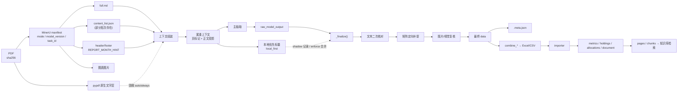

# P1 — 结构化字段数据流与回溯说明

> 状态：Draft v0.2（2026-10-30）  
> 适用范围：`code/structured_data/` 的固收、权益/中国精选月报结构化链路  
> 关联文档：[07 指标字典](07-p1-metric-dictionary.md)、[09 RAG 证据协议](09-p1-rag-evidence-contract.md)、[11 字段流水线固定化设计](11-field-pipeline-hardening.md)

## 0. v0.2 已落地的变化

本版把“代码负责找和算”从设计目标推进到可运行实现，同时保留旧链路作为回退：

| 变化 | 入口 | 默认行为 | 作用 |
|---|---|---|---|
| 确定性标量预抽取 | `local_first.py` | `FACTSHEET_LOCAL_FIRST=shadow` | 规模、日期、久期、YTM、评级先由代码解析 |
| 生产合并适配器 | `local_first_adapter.py` | `shadow` 只记录；`enforce` 才合并高置信值 | 不未经 A/B 直接覆盖模型结果 |
| 披露状态路由 | `probe_disclosures()` | 文本无标题/表头时记为 `disclosed=false` | 跳过无效的文本矩阵补提，保留视觉复核 |
| 紧凑上下文 | `parse_mineru_pdf.load_mineru_bundle()` | `FACTSHEET_CONTEXT_MODE=compact` | 用页标记 + 正文投影替代重复 `content_list` JSON |
| 追溯字段 | `_meta.local_first`、`field_evidence.local_first` | 随每份结果写入 | 记录规则、状态、置信度、页码/块号和原文引文 |

所有新增逻辑都保留开关和回退路径：`FACTSHEET_LOCAL_FIRST=off|shadow|enforce`，`FACTSHEET_CONTEXT_MODE=full|compact`。

## 1. 一条字段链的六个环节

本项目的结构化字段不是“模型一次输出”的结果，而是六个环节的组合：

| 环节 | 做什么 | 主要实现 |
|---|---|---|
| 定位 | 在 PDF/Markdown 中找到字段所在区域 | MinerU 产物、证据索引、提示词锚点、管理人画像别名 |
| 确定性预抽取 | 标量字段先走代码，不调用模型 | `local_first.py` 的标签/表格锚点解析 |
| 抽取 | 把原文变成中间结构 | `deepseek-flash` 主抽取，必要时 `deepseek-v4-pro` |
| 规范化 | 单位、币种、月份、评级、名称简繁转换 | `_finalize()` 及各类 `_normalize_*` |
| 计算/判定 | 换汇、中位评级、合计、优先份额类别 | 纯代码，不交给模型 |
| 校验 | 范围、合计、冲突、误用检测 | `_validation_issues()`、`_allocation_is_suspicious()` |
| 留证 | 保存原文证据与调用记录 | `field_evidence`、`_meta`、manifest |

理解这条链的关键：**模型负责“读”，代码负责“算”和“判”。** 任何字段最终值都应能回答三个问题：原文在哪、模型给了什么、代码做了什么。

## 2. 端到端数据流



### 2.1 两类的上下文差异

| | 固收 | 权益/中国精选 |
|---|---|---|
| 主文本 | MinerU `full.md` | MinerU `full.md` |
| 附加文本 | `content_list` + header/footer + 可选原生文字层 | `content_list` + header/footer |
| 原生 PDF 文字层 | `FACTSHEET_PDF_TEXT_LAYER=always/auto/never` | **不使用** |
| 自动省略原生层 | 有（按字符数比例判断） | 不适用（本来就不发） |
| 代码里的 `pdf_text` | 组装后的文本，`auto` 时可能已不含原生层 | MinerU 路径下等于 MinerU 上下文；`file-id` 回退路径除外 |
| 上下文形态 | 默认 `compact`；`full` 供 A/B | 同左 |

这解释了同一份 PDF 在固收和权益下表现不同：权益根本没有原生层兜底，`fund_size_hkd_100m` 完全依赖 MinerU 文本。

### 2.2 紧凑上下文如何保持可回溯

`compact` 不是摘要，也不会把表格压成一句话。它做的是三件事：

1. 以 `content_list.json` 的 `page_idx` 为页边界，生成 `[PAGE n]`；
2. 发送每个块的正文/表格 HTML，去掉 `bbox/type` 等 JSON 元数据；
3. 把 Markdown 中未被 `content_list` 覆盖的段落追加到 `[MARKDOWN_SUPPLEMENT]`，并尽量回填页码。

因此模型仍能看到表格列和正文，只是同一批文字不再同时以 Markdown 和完整 JSON 发两遍。`_meta.mineru.context_mode/context_chars/context_full_chars` 记录本次实际使用的形态。

## 3. 通用加工规则

这些规则对所有字段生效，阅读后面的字段表时不需要重复理解。

| 规则 | 函数 | 行为 |
|---|---|---|
| 简繁与标点统一 | `_to_simple()` `extract_fixed_income.py:189` | OpenCC `t2s`；全角 `％（）：` 转半角。**输出不是 PDF 字节级原文** |
| 本地标量优先 | `local_first.extract_local_scalars()` | 只接受标签+金额+币种+单位等强约束；宽评级桶不猜具体档位 |
| 数字解析 | `_number()` `:1070` | 从字符串中取第一个数字，去千分位；`1,768.3` → `1768.3` |
| 币种归一 | `_normalize_currency()` `:1017` | 美元/美金/USD/`$` → `USD`；港元/港幣 → `HKD`；人民币/RMB → `CNY` |
| 单位倍数 | `_unit_multiplier()` `:1053` | 百万/百萬/million → 1e6；十亿 → 1e9；亿 → 1e8；万 → 1e4 |
| 加权列表清洗 | `_clean_weighted_items()` `:218` | 名称和比例**同时存在**才保留；缺一即丢弃 |
| 久期汇总标签过滤 | `_is_duration_summary_label()` `:200` | “平均久期/组合久期/加权平均存续期”不能当分布 bucket |
| 合计 | `_distribution_total()` `:251` | 比例或久期贡献求和 |
| 月份归一 | `_normalize_report_month()` 固收 `:1199` / 权益 `:222` | 见 5.2、6.2；两类语义不同 |
| 评级归一 | `normalize_rating()` `rating.py:47` | 大写、去空格、去括号后缀；别名映射到 `NR` |
| 中位评级 | `derive_median_rating()` `rating.py:79` | 按 AAA→D→NR 排序，累计权重首次 ≥50% 的档位 |

## 4. 回溯锚点

一次结构化结果可以从 L0–L5 六个层级回溯。层级越低，越接近原始事实。

| 层级 | 锚点 | 存放位置 | 能回答的问题 |
|---|---|---|---|
| L0 源文件 | `source_sha256`、`source_size_bytes`、`source_pdf` | `data/**/markdown/**/manifest.json` | 是否同一份 PDF |
| L1 解析产物 | `task_id`、`mode`、`model_version`、`markdown_path`、`artifact_url`、`context_mode`、`context_sha256` | 同上；结果 `_meta.mineru` | 用的哪次 MinerU、哪种模式、当时实际上下文是否被复现 |
| L2 调用与规则 | `raw_model_output`、`refinement_output`、`matrix_text_refinement_output`、`vision_refinement_output`、`complex_field_reviews`、`local_first`、`token_usage.calls` | `<pdf>.fixed_income.meta.json` | 模型/代码各给了什么、走了哪条规则、调用了几次、花了多少 |
| L3 最终字段 | `data.*` | `<pdf>.fixed_income.json` | 系统最终采用了什么 |
| L4 汇总与落库 | `_source_json`、`fund_id × report_period × metric_name` | combined JSON / `fund_metrics`、`fund_holdings`、`fund_allocations` | 哪个批次、哪只基金、哪个指标 |
| L5 检索引用 | `document_pages`、`document_chunks`、`citations` | 知识库表 | 答案引用了哪一页哪一段 |

### 4.1 回溯一条指标的标准步骤

```text
1. 在 `fund_metrics` 表拿到 fund_id / report_period / metric_name / batch_id
2. 由 document_version_id 找到 `document_versions.file_path`（PDF）和 source_id（sha256）
3. 打开对应批次 structure_data/_work/**/per_pdf/<stem>.fixed_income.json
4. 打开同名 .meta.json，检查 raw_model_output 与 refinement_output
5. 用 manifest.json 的 markdown_path 回到 full.md；必要时用 source_pdf 回看原页
6. 对照 field_evidence 或 disclosure_info 确认该值对应的原文片段
```

### 4.2 本地优先字段的追溯

`_meta.local_first` 是 shadow/enforce 都保留的审计块，至少包含：

```json
{
  "available": true,
  "mode": "shadow",
  "routing": {"accept": ["fund_size"], "review": [], "local_model": [], "absent": []},
  "fields": {
    "fund_size": {
      "value": {"amount": 1768.3, "currency": "USD", "unit": "百萬", "hkd_100m": 138.7102, "fx_rate": 7.84427},
      "status": "ok",
      "rule": "text_label_value",
      "confidence": 0.97,
      "evidence": [{"page": 0, "block": 4, "kind": "text", "quote": "總資產值（百萬） 1,768.3 美元"}]
    }
  },
  "disclosures": {"duration_distribution": {"disclosed": false}},
  "text_skip_fields": ["duration_distribution", "geographic_allocation"],
  "matrix_text_skip_fields": ["duration_distribution", "geographic_allocation"]
}
```

`enforce` 合并成功后，最终结果的 `field_evidence.local_first` 再记录实际采用的字段、规则和证据；未采用的低置信值只留在 `_meta.local_first`，不会进入知识库。

### 4.2 回溯时最容易踩的三个坑

1. **最终值不等于模型值。** 规模是代码换算，评级可能来自分布中位数，合计是代码求和。
2. **字段存在不等于有数据。** `dividend` 只有币种和频率时仍是一个对象，但完整率不计入。
3. **文本不是原文。** 所有字符串经过 `_to_simple()`，债券名、地区名都可能已被简繁转换和标点归一。

## 5. 固收字段链路

固收输出 11 个字段，另有 4 个中间/辅助字段（`fund_size_original`、`credit_rating_distribution`、`disclosure_info`、`field_evidence`）。

### 5.1 总览

| 字段 | 主来源 | 中间产物 | 代码最终化 | 兜底/复核 | 留证 |
|---|---|---|---|---|---|
| `fund_name` | PDF 文件名 | 无（模型值被忽略） | `_to_simple(pdf_path.stem)` | 无 | 文件名 |
| `report_date` | 月份提示 + 正文 | 模型 `report_date` | `_normalize_report_month()` | 正则 | `_meta` 中无独立证据 |
| `fund_size_hkd_100m` | 规模原文 | `fund_size_original` | 汇率换算 | 文本正则（无视觉兜底） | `field_evidence.fund_size_original` |
| `portfolio_duration_years` | 久期原文 | 模型数值 | `_number()` | 文本正则 → 视觉 | `field_evidence` |
| `portfolio_ytm_percent` | 收益率原文 | 模型数值 | `_number()` | 文本正则 → 视觉 | `field_evidence` |
| `credit_rating` | 平均评级或评级分布 | `credit_rating` / `credit_rating_distribution` | `normalize_rating()` → `derive_median_rating()` | 视觉复核 | `field_evidence` |
| `top_holdings` | 前十大持仓表 | 模型数组 | `_clean_weighted_items()` | 文本矩阵补提 → 视觉 | `field_evidence.top_holdings` |
| `top_holdings_total_percent` | 模型或持仓求和 | 模型数值 | 缺失时求和 | combine 阶段再算一次 | 无独立证据 |
| `duration_distribution` | 久期分布图表 | 模型/视觉数组 | `_clean_weighted_items()` | 文本补提 → 视觉 | `field_evidence` + `disclosure_info` |
| `geographic_allocation` | 地区分布图表 | 模型/视觉数组 | `_clean_weighted_items()` | 文本补提 → 视觉 | 同上 |
| `dividend` | 派息表 | 模型对象 | 归一 + 份额评分合并 | 二次核对 | `field_evidence`（提示词要求） |

这些中间字段不一定出现在最终 JSON；`disclosure_info` 会随固收结果保留。

### 5.2 逐字段说明

#### `fund_name`

- 原文：不读正文，直接取 PDF 文件名去后缀。
- 模型：也会返回，但 `_finalize()` 不采用。
- 代码：`_to_simple(pdf_path.stem)`，繁体转简体、全角标点转半角。
- 影响：上游文件命名错误会直接进入结构化结果和知识库标题。

#### `report_date`

- 原文：首页“截至/資料截至/As of”日期，或页眉页脚月份。
- 中间：模型 `report_date`；MinerU 从 header/footer 生成 `[REPORT_MONTH_HINT]`。
- 代码：`_normalize_report_month(f"{raw.report_date}\n{pdf_text}")`，优先取原生 PDF 中“截至/截止/资料截至/As of”后的完整 `YYYY-MM-DD`；没有日时再使用 `[REPORT_MONTH_HINT]` 或 `YYYY-MM`。
- 语义：固收/货币基金取**数据截止日**，不是出版月；数据库缺少日时才退化为当月 1 日。
- 失败模式：正文同时出现奖项、业绩、成立日时可能取错；目前没有独立校验。

#### `fund_size_hkd_100m`

完整链路见 5.3。要点：

- 模型只输出 `{amount, currency, unit}`，不换汇。
- 代码 `_compute_fund_size_hkd_100m()` `:1182` 执行 `金额 × 倍数 × 汇率 ÷ 1e8`。
- 兜底 `_parse_fund_size_from_text()` `:1093` 只认“币种在数字前”或“数字+单位+币种”两种形态。
- 当前对“`總資產值（百萬）` 换行 `1,768.3 美元`”这种“单位在标签里、币种在数字后”的版式匹配不到。
- 汇率不写入 meta，是当前最大的回溯缺口（见 9.1）。

#### `portfolio_duration_years`

- 原文锚点：组合久期、平均久期、加权平均存续期、Duration、Average duration。
- 中间：模型数值。
- 代码：`_number()`；缺失时 `_parse_metric_from_text()` `:1116` 从文本窗口里找数值。
- 校验：`0 <= value <= 30`；若与 `portfolio_ytm_percent` 完全相等，触发二次核对。
- 失败模式：把“平均到期年限”当久期；“6.7/10.3”这类双值只取第一个。

#### `portfolio_ytm_percent`

- 原文锚点：到期收益率、最差收益率、YTM、YTW、Yield to maturity / worst。
- 代码：`_number()`；缺失时正则要求窗口内出现 `%`。
- 校验：`0 <= value <= 30`。
- 失败模式：把信用评级分布里的百分比误当收益率；提示词已明确排除。

#### `credit_rating`

- 原文：平均信用评级/平均信贷评级/Average rating。
- 中间：`credit_rating` 或 `credit_rating_distribution[]`。
- 代码：`normalize_rating()`；为空时 `derive_median_rating()` 按 AAA→D→NR 累计到 50%。
- 证据：`field_evidence.credit_rating` 或 `credit_rating_distribution`。
- 校验：只检查是否为空，没有档位合法性校验。
- 注意：`NR` 权重很大时，中位数会得到 `NR`，这是正常结果，不应强行改成投资级。

#### `top_holdings`

- 原文：前十大/主要债券持仓表；债券名要求完整保留票息、到期日、币种、级别、ISIN。
- 中间：`[{name, weight_percent}]`。
- 代码：`_clean_weighted_items()` 丢弃缺名称或缺比例的项；名称做 `_to_simple()`。
- 兜底：矩阵文本补提 → 视觉复核。
- 校验：每项必须有名称和比例；不校验条数是否等于 10。
- 注意：名称并非字节级原文，简繁已转换。

#### `top_holdings_total_percent`

- 中间：模型值；缺失时 `_finalize()` 对持仓比例求和。
- 下游：`combine_fixed_income.py:117` 在写 Excel 前再次按持仓重算，覆盖旧值。
- 回溯：以 combined/Excel 的值为准，per-PDF JSON 可能不是最终值。

#### `duration_distribution`

- 原文：明确标题为“久期分布/期限分布/到期年限分布/Duration distribution”的图表或表格。
- 中间：`[{bucket, weight_percent}]`；视觉路径可能带 `value/unit/measure_type`。
- 代码：过滤“平均久期/组合久期”等汇总标签；保留 `value`、`unit`、`measure_type`。
- 校验：`unit=percent` 时合计 95–105；`unit=years` 时合计 0–30。
- 证据：`field_evidence.duration_distribution`；视觉复核另存 `disclosure_info.duration_distribution`。

#### `geographic_allocation`

- 原文：明确标题为“地区分布/地域分布/国家分布/市场分布”的图表或表格。
- 代码：`_clean_weighted_items(name_key="region")`。
- 校验：合计 95–105；**不支持“原文只披露局部”这一例外**，局部披露会被记为校验问题。
- 兜底：矩阵文本补提 → 视觉；视觉“未披露”不会清空已有的文本结果。

#### `dividend`

- 原文：派息表；优先美元每月派息份额。
- 中间：`{share_class, currency, frequency, dividend_per_unit, annualized_dividend_yield_percent, note}`。
- 代码：币种归一、频率保留枚举、`note` 清理；合并时 `_dividend_score()` `:1317` 给美元 +20、每月 +20、有收益率 +10、累计类 -40。
- 校验：不校验金额和收益率的范围。
- 注意：只有份额类别/币种/频率也能留下一个对象，但完整率不计入（见 7.1）。

### 5.3 样例：`fund_size_hkd_100m`

```text
PDF 第 1 页（原生文字层）
  基金資料 (A（每月派息）－美元類別)
  基本貨幣
  美元
  總資產值（百萬）
  1,768.3 美元

MinerU full.md（同一区域）
  基金資料 (A（每月派息）－美元類別)
  ## 基本貨幣
  SEDOL 編號
  B4Y3842
  → “美元”和“1,768.3”整行丢失

模型中间产物
  fund_size_original = {amount: 1768.3, currency: "美元", unit: "百万"}

代码换算
  1768.3 × 1,000,000 × 7.84427 ÷ 100,000,000 = 138.7103

最终
  fund_size_hkd_100m = 138.7103
```

- 文件：`data/jobs/<job>/staging/<job>/factsheet/固收/摩根基金_-_新兴市场债券基金.pdf`
- Markdown：`.../markdown/固收/摩根基金_-_新兴市场债券基金__7e12bd805a27/full.md:27`
- 结果：`data/_ab/cold_20261028/baseline/results/固收/摩根基金_-_新兴市场债券基金.json`

这条链原来暴露两个问题：MinerU 对该版式会丢“标签值对”的数值；旧正则也不识别“单位在标签中、币种在数字后”的版式。

v0.2 已在 `local_first.extract_fund_size()` 中同时支持原生文字层和 MinerU 表格/跨行版式，并强制要求
“标签 + 金额 + 币种 + 单位”四个条件同时成立。离线验证结果：

| 来源 | 可解析 | 说明 |
|---|---:|---|
| 该批次 44 份月报 | 44/44 | 固收 10、权益 30、混合 3、货币 1 |
| 固收久期/YTM/评级 | 10/10、7/10、7/10 | 缺失项保留 `absent`/`unparsed`，不猜值 |

因此规模字段不再需要进入字段核对或矩阵补提；本地值在 `shadow` 下只记录，在 `enforce` 下才覆盖。

### 5.4 合并优先级

`_merge_raw()` `:1335` 的规则是“主抽取优先，空值才用二次核对补”：

| 情况 | 采用 |
|---|---|
| 主抽取非空 | 主抽取 |
| 主抽取为空、二次核对非空 | 二次核对 |
| 久期与收益率完全相等 | 用二次核对的久期覆盖 |
| 派息 | `_dividend_score()` 更高者 |
| 证据 | 主证据保留，二次证据加 `refined_` 前缀 |

这是**字段级**合并，不是整条记录替换。回溯时要同时看 `raw_model_output` 和 `refinement_output`。

## 6. 权益/中国精选字段链路

权益输出 8 个字段。与固收最大的差异是没有原生文字层，且多一步 Ticker 解析。

### 6.1 总览

| 字段 | 主来源 | 中间产物 | 代码最终化 | 兜底/复核 | 留证 |
|---|---|---|---|---|---|
| `fund_name` | PDF 文件名 | 无 | `_to_simple(pdf_path.stem)` | 无 | 文件名 |
| `report_date` | 月报标题/出版月 | 模型 `report_date` | `_normalize_report_month(pdf_text, raw)` | 正则 | `_meta.report_date_validation` |
| `fund_size_hkd_100m` | 规模原文 | `fund_size_original` | 汇率换算 | 文本正则（仅 Markdown） | `field_evidence` |
| `top_holdings` | 前十大持仓表 | 模型数组 | `_clean_weighted_items()` | 矩阵补提 → Ticker 复核 | `field_evidence` |
| `top_holdings_total_percent` | 模型或求和 | 模型数值 | 缺失时求和 | combine 阶段再算 | 无 |
| `geographic_allocation` | 地区图表 | 模型/视觉数组 | 清洗 + 反误用 | 矩阵补提 → 视觉 | `field_evidence` |
| `sector_allocation` | 行业图表 | 模型/视觉数组 | 清洗 + 反误用 | 矩阵补提 → 视觉 | `field_evidence` |
| `dividend` | 派息表 | 模型对象 | `_clean_dividend()` | 无 | `field_evidence` |

### 6.2 逐字段说明

#### `report_date`（权益语义不同）

- 原文：月报**标题月份**，如“2026年6月（截至2026年5月29日）”输出 `2026-06`。
- 代码优先级：月份提示 → “2026年6月刊/报” → 首页关键词日期 → 全文关键词日期 → 模型值 → 首页前 350 字符。
- 与固收相反：权益优先出版月，固收优先截止月。
- 校验：`_report_date_validation()` 把模型值、最终值和文本候选都写入 meta，可直接对比。

#### `fund_size_hkd_100m`（权益）

- 与固收共用同一个换算函数。
- 但 `pdf_text` 只有 MinerU 上下文，正则看不到原生层。
- 在本轮 2 份权益样本中，PDF 原生层明确有 `2,964.2 美元` / `368.8 美元`，MinerU Markdown 却完全丢失，最终为 `null`。
- 结论：权益的规模字段目前**没有可靠的兜底**。

#### `top_holdings` 与 Ticker

- 模型先输出 `{ticker, name, weight_percent}`。
- 代码清洗后进入 `resolve_holding_tickers()` `holding_tickers.py:374`，四段式：
  1. 读缓存 `data/_cache/equity_security_master.json`；
  2. 报告中已有可信 Ticker 直接用；
  3. 未命中项批量做**无 thinking、无联网**轻量核对；
  4. 仍不确定的少数项才开启 thinking + 联网。
- 结果与错误写入 `_meta.ticker_resolution_output` / `ticker_resolution_error`。
- 注意：缓存键包含中文名称和 Ticker 别名，拒绝 ISIN/CUSIP/SEDOL/债券代码。

#### `geographic_allocation` / `sector_allocation`

- 原文：必须来自明确标题的地区/行业配置表。
- 代码有三道反误用：
  - `_allocation_is_suspicious()` `:302`：合计 >102 可疑；≥5 项且 ≥80 视为局部有效；<3 项且 <80 可疑；
  - `_allocation_mirrors_holdings()` `:357`：检测是否把持仓表比例原样抄成地区/行业；
  - `_prefer_refined_allocation()` `:332`：二次结果明显更完整时才替换。
- 校验：可疑或镜像持仓会写入 `validation_issues`。
- 与固收差异：权益允许“原文明确局部披露”的合计不足 100，固收校验没有这个例外。

#### `dividend`

- 代码 `_clean_dividend()` `:283`：**没有具体金额或收益率就返回 `null`**。
- 频率不在枚举内归一为 `unknown`。
- 因此权益不会出现“只有币种和频率的空派息对象”，这与固收不同。

## 7. 完整率与质量口径

### 7.1 完整率怎么算

计算脚本：`code/structured_data/ab_extraction_cost.py`。

- 分母是固定字段清单，不是 PDF 实际披露项：
  - 固收 10 个（最终 JSON 有 11 个，`top_holdings_total_percent` 是派生值，不计入分母）：`fund_name`、`report_date`、`fund_size_hkd_100m`、`portfolio_duration_years`、`portfolio_ytm_percent`、`credit_rating`、`top_holdings`、`duration_distribution`、`geographic_allocation`、`dividend`
  - 权益 7 个（最终 JSON 有 8 个，`top_holdings_total_percent` 同样不计入）：`fund_name`、`report_date`、`fund_size_hkd_100m`、`top_holdings`、`geographic_allocation`、`sector_allocation`、`dividend`
- 判定：`null`、空串、空列表、空对象为未填充。
- 字典中 `note`、`currency`、`frequency`、`unit`、`_source_json` 不计为有效内容。
- `dividend` 必须至少有一个真实派息金额或收益率（`dividend_per_unit`、`annualized_dividend_yield_percent`、`yield_percent`、`rate_percent`）。

示例：4 份样本 = 2×10 + 2×7 = 34 个字段位；baseline 23 个有效 → `23/34 = 67.65%`。

### 7.2 完整率不等于正确率

- 完整率只看“有没有值”，不看值是否对。
- `validation_issues` 看“值是否可疑”，两者独立统计。
- 一个字段可能有值但被校验标记为异常；也可能为空但属于“原文未披露”，不应算错。

### 7.3 固收校验项

| 校验 | 规则 |
|---|---|
| 必填标量 | `fund_size_hkd_100m`、`portfolio_duration_years`、`portfolio_ytm_percent`、`credit_rating` 为空则记问题 |
| 久期范围 | 0–30 |
| 收益率范围 | 0–30 |
| 列表项 | 每项必须有名称和比例 |
| 久期分布 | `percent` 合计 95–105；`years` 合计 0–30 |
| 地区分布 | 合计 95–105 |

## 8. 下游落库与检索映射

| 结构化字段 | Excel 列 | 数据库落点 | 检索/引用 |
|---|---|---|---|
| `fund_size_hkd_100m` | `规模_亿港币` | `fund_metrics(fund_size_hkd_100m, unit=HKD_100M)` | 指标卡、报告引用 |
| `portfolio_duration_years` | `组合久期_年` | `fund_metrics(..., unit=years)` | 同上 |
| `portfolio_ytm_percent` | `到期收益率_%` | `fund_metrics(..., unit=percent)` | 同上 |
| `credit_rating` | `信用评级` | `fund_metrics(credit_rating)` | 同上 |
| `top_holdings` | 持仓 sheet/宽表 | `fund_holdings` | 持仓明细、证据 |
| `top_holdings_total_percent` | `持仓合计比例_%` | `fund_metrics` | 质量提示 |
| `geographic_allocation` | 地区矩阵 | `fund_allocations(dimension=geography)` | 地区图表 |
| `sector_allocation` | 行业矩阵 | `fund_allocations(dimension=sector)` | 行业图表 |
| `duration_distribution` | 久期矩阵 | `fund_allocations(dimension=duration)` | 久期图表 |
| `dividend.*` | `派息*` 列 | `fund_metrics(dividend_*)` | 派息卡 |
| — | — | `documents` / `document_versions` | `document_pages` / `document_chunks` |

落库实现：

- 标量：`platform/api/app/importers/service.py:1190` `_import_metrics()`
- 持仓：`:1325` `_import_holdings()`；`source_page` 目前固定 `None`
- 分布：`:1373` `_import_allocations()`
- 页面/切片：`platform/api/app/knowledge/indexing.py:333` `_upsert_pages()`；`PARSER_VERSION = "mineru-pdf-pages-v1"`

## 9. 当前回溯缺口

按影响排序。

### 9.1 汇率留痕仍只覆盖本地优先路径

v0.2 的 `field_evidence.local_first.fund_size.value` 已保存 `fx_rate`，可以还原本地路径的换算；但
`_compute_fund_size_hkd_100m()` 走模型结果时仍只返回数字，没有保存：

- 使用的汇率
- 汇率来源（API 还是 `FX_FALLBACK`）
- 汇率日期
- 原始金额与单位

结果：看到 `138.7103` 时，本地路径可还原，模型路径仍只能靠反推。后续应在两条路径统一写入
`fund_size_conversion`：

```json
"fund_size_conversion": {
  "amount": 1768.3,
  "currency": "USD",
  "unit": "million",
  "fx_rate": 7.84427,
  "fx_source": "api|fallback",
  "fx_date": "2026-10-28",
  "formula": "amount*1e6*fx_rate/1e8"
}
```

### 9.2 本地证据已是页/块引用，模型证据仍不是

- 模型 `field_evidence` 仍是自由文本；本地 `field_evidence.local_first` 已是 `page + block + quote + source`。
- `document_pages` 有页码，但结构化字段没有回指页码。
- `fund_holdings.source_page` 固定 `None`。
- 部分 MinerU 批次没有 `content_list.json`；本地实现会用原生页文本反查页码，但块号仍可能缺失。

后续应把模型证据也收敛到同一结构：`{"page_idx": 0, "block_index": 12, "quote": "總資產值（百萬）1,768.3 美元"}`。

### 9.3 版本信息不完整

结果 `_meta` 记录了模型、MinerU manifest、token，但没有：

- prompt 文件哈希
- JSON Schema 哈希
- 字段流水线版本
- 解析规则版本

导致“同一 PDF 两次结果不同”时无法判断是模型、提示词还是代码变了。

### 9.4 Schema 与代码漂移

- `fixed_income_schema.json` 没有 `fund_size_original`、`credit_rating_distribution`、`field_evidence`，但实际提示词使用的是代码里的 `MODEL_SCHEMA`。
- `fixed_income_schema.json` 的 `duration_distribution` 没有 `value/unit/measure_type`，但代码和视觉路径会读写这些键。
- 两条 schema 并存，容易让维护者改错文件。

建议：只保留一个 schema 源，启动时校验必需键。

### 9.5 固收与权益的文本层策略不一致

- 固收有原生层兜底，但 `auto` 会误删。
- 权益始终没有原生层。

结果：同类字段（如规模）在两个类别下可靠性不同，无法用同一套回溯预期。

### 9.6 合并来源不可见

`_merge_raw()` 决定最终值来自主抽取还是二次核对，但最终 JSON 没有 `field_provenance`。回溯时必须同时打开 `raw_model_output` 和 `refinement_output` 手工比对。

建议增加：

```json
"field_provenance": {
  "fund_size_hkd_100m": {"source": "primary", "transform": "fx_convert"},
  "credit_rating": {"source": "derived", "from": "credit_rating_distribution"},
  "geographic_allocation": {"source": "vision_review"}
}
```

### 9.7 上下文没有持久化

`pdf_text` 只在内存中；meta 记录 `context_chars`、`context_full_chars`、`context_sha256`、`markdown_chars`、`native_chars`、`native_included`。现在可以判断两次调用是否用了同一上下文，但仍不能从 meta 逐字还原全文；完整复现仍需 sidecar 压缩包或重新加载 MinerU 产物。

## 10. 复现与核对

### 10.1 单份 PDF

```bash
python code/structured_data/extract_fixed_income.py \
  data/<run>/factsheet/固收/<fund>.pdf \
  --source mineru --mineru-cache-only
```

输出：

```text
data/_structured/per_pdf/<stem>.fixed_income.json
data/_structured/per_pdf/<stem>.fixed_income.meta.json
```

### 10.2 查看某字段的来龙去脉

```bash
python - <<'PY'
import json
p = "data/_ab/cold_20261028/baseline/results/固收/摩根基金_-_新兴市场债券基金.json"
d = json.load(open(p))["result"]
print("final:", d["data"]["fund_size_hkd_100m"])
print("raw:", d["_meta"]["raw_model_output"].get("fund_size_original"))
print("evidence:", d["_meta"]["raw_model_output"]["field_evidence"].get("fund_size_original"))
print("text_layer:", d["_meta"]["pdf_text_layer"])
PY
```

### 10.3 对照原生文字层

```bash
python - <<'PY'
from pypdf import PdfReader
p = "data/<run>/factsheet/固收/<fund>.pdf"
for i, line in enumerate(PdfReader(p).pages[0].extract_text().splitlines()):
    if "總資產值" in line:
        print(i, line)
PY
```

## 11. 新增字段或管理人的维护清单

新增一个字段时，至少同步八处，否则会出现“能抽到但落不了库”或“库里有值但无法回溯”：

1. `fixed_income_prompt.md` / `equity_fund_prompt.md` 的字段规则；
2. `MODEL_SCHEMA`（固收在 `extract_fixed_income.py:84`）或 `equity_fund_schema.json`；
3. `_finalize()` 的归一与兜底；
4. `_validation_issues()` 的校验；
5. `combine_*` 的 Excel 列映射；
6. `importers/service.py` 的指标/持仓/分布落库；
7. `ab_extraction_cost.py` 的 `CORE_FIELDS`；
8. 本文档的字段表。

新增一个管理人时：

1. 在 `data/_cache/manager_profiles.json` 增加别名、稳定缺失字段、可跳过的复核；
2. 用至少 10 份样本验证别名是否命中；
3. 确认 `absent_fields` 不会因为新报告开始披露而被永久跳过（`field_is_absent()` 会在文本出现别名时自动恢复）；
4. 把该管理人的版式锚点补进字段流水线（见文档 11）。

## 12. v0.2 离线验证与成本重放

### 12.1 样本覆盖

使用 `data/jobs/10efb838-eb28-47f1-bffc-70ffbfef5d09/staging/10efb838-eb28-47f1-bffc-70ffbfef5d09` 的 44 份月报做离线验证，不调用付费模型：

| 类别 | 数量 | 规模成功 | 日期成功 |
|---|---:|---:|---:|
| 固收 | 10 | 10 | 10 |
| 权益 | 30 | 30 | 30 |
| 混合 | 3 | 3 | 3 |
| 货币 | 1 | 1 | 1 |

固收另测：久期 10/10、YTM 8/10、评级 7/10。评级失败项中，宽桶 `<BBB` 跨过 50% 分位时返回
`unparsed`，不把宽桶猜成 `BBB`。

### 12.2 紧凑上下文体积

对 40 份带 `content_list.json` 的样本做离线构建：

| 指标 | 数值 |
|---|---:|
| 完整上下文合计 | 1,089,005 字符 |
| 紧凑上下文合计 | 343,736 字符 |
| 降幅 | 68.4% |
| 正文数字保留率 | 99.9% |

数字保留率按“去掉 bbox/JSON 元数据后的原始正文数字”统计；丢失的 0.1% 主要是 Markdown 图片文件名中的哈希，不是业务字段。

### 12.3 历史调用离线重放

以 `data/_ab/cold_20261028/optimized` 的 4 份冷样本为基线，合计 89,564 token；其中两份固收原本各 6 次调用。
把本地优先结果映射到原调用链后，可少发：

- 1 次完整字段核对；
- 1 次矩阵浅层补提；
- 1 次矩阵备用补提。

估算节省约 22,654 token，占 4 份样本总量 25.3%，单份固收下降约 41%–47%。这是历史调用重放，不是新的真实付费 A/B；
正式验收仍需同时比较 token、调用次数、字段完整率、已披露字段的 null 数、`validation_issues` 和本地/模型冲突率。

### 12.4 口径差异

重放时 FX API 不可用，生产旧路径使用 fallback `7.8`，原型样本使用 `7.84427`，因此 `fund_size_hkd_100m`
末尾会有差异；规模原始金额、币种、单位和来源证据本身一致。任何把该字段用于正式报表的结果，都应先确认
`fx_rate`/`fx_source` 已在结果中留痕。
