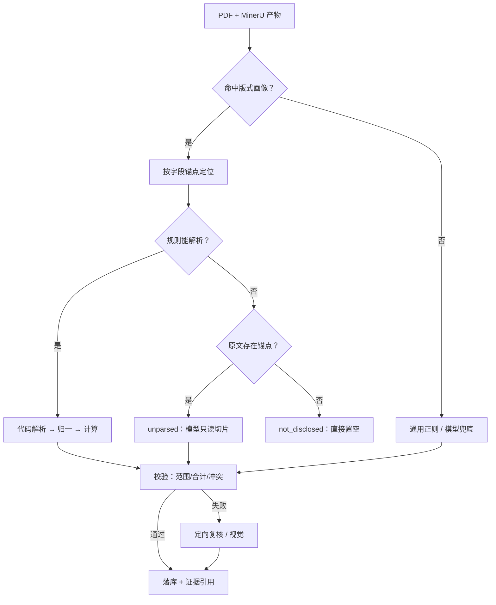

# P1 — 字段流水线固定化与 Token 优化设计

> 状态：Implemented v0.4（2026-10-30）  
> 目标：让每条字段链路的“定位—抽取—换算—校验”尽量固定，减少模型自由判断和重复调用  
> 前置阅读：[10 结构化字段数据流与回溯说明](10-structured-field-lineage.md)

## 0. v0.2 实现状态

本版不再只是方案，已落地以下可运行部分：

| 方案 | 实现 | 状态 |
|---|---|---|
| 确定性标量 | `local_first.py` + `local_first_adapter.py` | 已实现，默认 `shadow` |
| 披露状态路由 | `probe_disclosures()`、`text_skip_fields`、`matrix_text_skip_fields` | 已接入固收/权益 |
| 紧凑上下文 | `FACTSHEET_CONTEXT_MODE=compact` | 默认开启，`full` 可回退 |
| A/B 变体 | `compact`、`local_compact` | 已加入 `ab_extraction_cost.py` |
| 字段契约 JSON | `field_pipeline.py` + `pipelines/*.json` | 已实现，默认回退 `_generic` |
| 严格 Schema / 块引用输出 | `evidence_contract.py` + `[PAGE]/[BLOCK]` | 已实现，代码校验并回填引文 |

默认值的选择是“先减少无信息重复，再逐步覆盖取值”：紧凑上下文不改变字段规则；本地优先仍停在
`shadow`，必须用 A/B 和冷样本确认后才切 `enforce`。v0.4 将模型证据收敛为页/块引用，
并把版式识别、漂移回退、换算与字段决策写入运行元数据。

## 1. 结论先行

当前 token 的主要浪费不是“上下文太长”，而是：

1. **同一份 PDF 平均调用 5.5 次**（固收固定 6 次），其中两次矩阵补提只产出 127 / 104 个 token，基本是在全文里找“本来就不在文本里的东西”；
2. **缺失即复核**：字段为空就再发一遍全文，不区分“原文没披露”和“原文有但没抽到”；
3. **模型承担了本可由代码完成的定位与判断**：规模、日期、评级中位数、合计、份额类别优先级都可以固定；
4. **有 `content_list` 的批次把同一内容发了两遍**：Markdown 与完整 JSON 同时进入上下文，后者体积是前者的 1.8–4.7 倍。

设计方向不是“换更强模型”，而是：

```text
把“找”和“算”交给代码，把“读”交给模型，把“判”收敛成规则。
```

## 2. 现状成本结构（实测）

### 2.1 调用次数

以 `data/_ab/cold_20261028/optimized` 的 4 份样本为例：

| 类别 | 样本 | 调用次数 | 调用链 |
|---|---|---:|---|
| 固收 | 新兴市场债券基金 | 6 | 主抽取 → 字段核对 → 矩阵浅层 → 矩阵备用 → 指标视觉 → 复杂字段视觉 |
| 固收 | 新兴市场投资级别债券基金 | 6 | 同上 |
| 权益 | 中国基金 | 4 | 主抽取 → 字段核对 → 矩阵浅层 → 矩阵备用 |
| 权益 | 中东非洲新兴欧洲机会基金 | 6 | 上述 4 次 + Ticker 轻量 + Ticker 思考 |

平均 `22 次 / 4 份 = 5.5 次/PDF`。

### 2.2 单份固收的 token 分布

以 `新兴市场债券基金`（optimized，合计 27,243 token）为例：

| # | 调用 | 输入 | 输出 | 缓存命中 | 合计 | 占比 |
|---|---|---:|---:|---:|---:|---:|
| 1 | 主抽取 | 5,309 | 862 | 0 | 6,171 | 22.6% |
| 2 | 字段核对 | 4,916 | 685 | 3,072 | 5,601 | 20.6% |
| 3 | 矩阵浅层 | 3,482 | 127 | 3,072 | 3,609 | 13.2% |
| 4 | 矩阵备用 | 3,479 | 104 | 0 | 3,583 | 13.2% |
| 5 | 指标视觉 | 3,386 | 751 | 3,200 | 4,137 | 15.2% |
| 6 | 复杂字段视觉 | 3,589 | 553 | 3,455 | 4,142 | 15.2% |

可直接读出的浪费：

- 第 3、4 次合计 **7,192 token（26.4%）**，输出只有 **231 token**，基本是在确认“没有新内容”；
- 第 2 次字段核对与第 1 次内容高度重叠，仍花 **5,601 token**；
- 两次视觉调用合计 **8,279 token（30.4%）**，是图表字段的必要成本，但应只在“图表确实存在”时触发；
- 第 1、4 次缓存命中为 0，是两次完整 cache miss；第 1 次是主抽取，最值得压缩。

### 2.3 上下文重复

对 8 份含 `content_list` 的权益样本统计：

| 指标 | 数值 |
|---|---:|
| Markdown 字符数合计 | 55,148 |
| `content_list.json` 字符数合计 | 160,167 |
| JSON / Markdown | 2.90× |
| `content_list` 占上下文字符 | 74.4% |

最极端的一份：Markdown 3,365 字符，`content_list` 13,807 字符（4.1×）。

这些 JSON 与 Markdown 描述的是同一批文字，只是多了 `page_idx`、`bbox`、`type`。当前 `load_mineru_bundle()` 把两者同时拼进上下文，等于为“页码信息”支付了 3 倍文本成本。

v0.2 已用紧凑上下文消除这部分重复：40 份样本从 1,089,005 字符降到 343,736 字符（−68.4%），
正文数字保留率 99.9%。因此下面关于“上下文重复”的成本判断应视为改进前的基线。

### 2.4 规模字段的确定性验证

用一条针对该管理人页眉版式的正则，对批次内 45 份 PDF 的原生文字层测试：

```regex
(?:總資產值|总资产值|基金規模|基金规模|資產淨值|资产净值)
\s*[（(]?\s*(百萬|百万|million|億|亿|billion)?\s*[)）]?
\s*[^0-9]{0,60}?([0-9][0-9,.]*)\s*
(美元|美金|港元|港币|人民幣|人民币|歐元|欧元|USD|HKD|RMB|CNY|EUR)
```

| 来源 | 可解析 |
|---|---:|
| PDF 原生文字层 | **45 / 45** |
| MinerU Markdown（44 份有产物） | 28 / 44 |

结论：**这类字段完全不需要模型参与**。当前把它交给模型，只在 MinerU 丢失数值时才暴露问题。

## 3. 设计原则：找、抽、算、判分离

| 动作 | 交给谁 | 判定标准 | 例子 |
|---|---|---|---|
| 找（locate） | 代码 | 锚点、标题、页眉位置可枚举 | “總資產值（百萬）”后 80 字符 |
| 抽（extract） | 模型或代码 | 表格转写、跨行配对 | 前十大持仓、地区矩阵 |
| 算（compute） | 代码 | 有唯一公式 | 换汇、合计、中位数 |
| 判（decide） | 代码优先 | 有明确优先级 | 美元每月份额、局部披露是否有效 |

一个字段只要满足“锚点稳定 + 格式稳定 + 公式唯一”，就应该走纯代码；只有“名称与比例需要视觉配对”这类任务才值得调用模型。



## 4. 方案 A：字段流水线契约

### 4.1 契约结构

为每个“管理人 × 版式”维护一份可版本化的字段规则，而不是把规则散落在提示词和 `_finalize()` 里。

建议路径：

```text
code/structured_data/pipelines/
  jpm-hk-factsheet-2026.json
  hsbc-hk-factsheet-2026.json
  _generic.json
```

示例：

```json
{
  "pipeline_version": 1,
  "layout_id": "jpm-hk-factsheet-2026",
  "detect": {
    "all": ["基金資料", "總資產值"],
    "any": ["SICAV系列", "摩根基金", "摩根"]
  },
  "fields": {
    "fund_size": {
      "stage": "deterministic",
      "labels": ["總資產值（百萬）", "總資產值(百萬)", "基金規模"],
      "window": 120,
      "pattern": "(?:%LABELS%)\\s*[（(]?\\s*(?P<unit>百萬|百万|million)?\\s*[)）]?\\s*[^0-9]{0,60}?(?P<amount>[0-9][0-9,.]*)\\s*(?P<currency>美元|港元|港幣|USD|HKD)",
      "unit_fallback": "million",
      "normalize": "fund_size_hkd_100m",
      "range": [0, 100000],
      "fallback": ["native_text", "vision_header", "model_slice"],
      "evidence": {"page": 0, "anchor": "總資產值"}
    },
    "report_date": {
      "stage": "deterministic",
      "labels": ["截至", "資料截至", "As of", "Data as at"],
      "pattern": "(?P<year>20\\d{2})\\s*[年/-]\\s*(?P<month>\\d{1,2})",
      "normalize": "report_month",
      "fallback": ["month_hint", "model_slice"]
    },
    "dividend": {
      "stage": "model_slice",
      "labels": ["派息率", "上次分派", "分派頻率"],
      "selection": {
        "priority": ["USD+monthly", "USD+any", "any+monthly", "any+any"]
      },
      "fallback": ["vision_table"]
    }
  }
}
```

### 4.2 执行器

新增一个通用执行器，而不是继续在 `extract_fixed_income.py` 里堆分支：

```python
spec = load_pipeline(pdf_path)           # 版式识别，失败回退 _generic
index = build_evidence_index(bundle)     # page/block 索引
for field in spec.fields:
    slice_ = locate(index, spec.fields[field])
    value = parse(slice_, spec.fields[field])       # 纯代码
    if value is None and spec.allows_model(field):
        value = extract_with_model(slice_, field)   # 只发切片
    value = normalize(value, spec.fields[field])
    validate(field, value)
    record_provenance(field, stage, rule_id, evidence_ref)
```

### 4.3 优先级必须固定

每个字段按同一顺序尝试，结果和失败原因都写进 `field_provenance`：

```text
1. 管理人锚点 + 专用解析器
2. 通用正则（原生文字层）
3. 模型 + 切片（thinking off）
4. 模型 + 切片（thinking on）
5. 视觉（图表/表格）
```

当前是“模型优先、代码兜底”，对规模、日期这类字段应反过来。反过来的收益不是省一次调用，而是**根本不需要调用**。

## 5. 方案 B：证据索引与上下文瘦身

### 5.1 建立块索引

从 `content_list.json` 生成：

```json
{
  "page_idx": 0,
  "block_index": 12,
  "type": "table",
  "text": "總資產值（百萬） 1,768.3 美元",
  "bbox": [72, 140, 480, 210],
  "heading_path": ["基金資料", "基本貨幣"]
}
```

字段解析结果只记录 `page_idx + block_index`，需要展示时再回填 `text`。

没有 `content_list` 的批次（例如当前摩根批次）有两个选择：

- 让 MinerU 固定产出 `content_list`；
- 用 `pypdf` 逐页文本 + 归一化子串匹配，把 quote 映射回页码。

### 5.2 上下文只发一份（v0.2 已实现）

当前 `load_mineru_bundle()` `parse_mineru_pdf.py:739` 的上下文是：

```text
[REPORT_MONTH_HINT]
[HEADER_FOOTER]
[MARKDOWN]
[CONTENT_LIST_JSON]   ← 与 Markdown 重复
```

实现采用“投影 + 补充”而不是简单二选一：

1. 以 `content_list` 的 `page_idx` 生成 `[PAGE n]`，逐块发送正文/表格 HTML，去掉 `bbox/type/层级`；
2. 对 Markdown 中未被投影覆盖的块，按 24 字符 shingle 覆盖率 < 80% 判断为独有内容，追加到 `[MARKDOWN_SUPPLEMENT]`；
3. 通过 `FACTSHEET_CONTEXT_MODE=full` 可完整回退旧上下文，便于 A/B。

这样既保留页码回溯，也保留 Markdown 独有的说明文字；不会为了省 token 丢掉表格列。

离线体积验证（40 份带 `content_list` 的样本）：

| 指标 | 数值 |
|---|---:|
| 完整上下文 | 1,089,005 字符 |
| 紧凑上下文 | 343,736 字符 |
| 降幅 | 68.4% |
| 正文数字保留率 | 99.9% |

### 5.3 切片预算

| 字段组 | 建议切片 | 字符上限 |
|---|---|---:|
| 规模、日期、久期、收益率、评级 | 页眉 + 指标区 | 800 |
| 派息 | 派息表 ±1 块 | 1,200 |
| 前十大持仓 | 持仓表整表 | 2,500 |
| 地区/行业/久期分布 | 图表标题 + 表格整表 | 2,500 |
| 视觉复核 | 最多 12 张图 | 现状不变 |

### 5.4 缓存与切片的取舍

这是最容易设计错的地方：

- 同一 PDF 的多次调用共享前缀时，第 2 次以后是 cache hit，**单价低但 token 仍计数**；
- 如果把每次调用都换成不同切片，cache hit 会消失，cache miss 反而增加。

建议：

1. **主抽取保留一份完整、稳定的前缀**，保证缓存；
2. 能在代码里完成的字段，不进入任何调用；
3. 残余字段合并成**一次**补提，而不是每个字段一次；
4. 只有“切片刻度明显小于完整上下文”时，才用独立切片；否则继续复用完整前缀。

## 6. 方案 C：输出契约瘦身

### 6.1 证据从“复述”改为“引用”

旧版 `field_evidence` 要求模型抄写原文，输出 token 高且不可验证。v0.4 改为：

```json
{
  "field_evidence": {
    "fund_size": {"page_idx": 0, "block_index": 12},
    "top_holdings": {"page_idx": 1, "block_index": 3}
  }
}
```

代码侧解析（已实现）：

- 校验 `page_idx/block_index` 是否存在；
- 回填 `quote` 供人工查看；
- 引用不存在或仍输出旧式短句时判为 `invalid_evidence`，触发一次最多 300 token 的低成本重试；
- 最终结果中的 `field_evidence` 回填 `source/kind/quote`，供人工查看；`_meta.evidence_contract` 记录有效率与无效引用。

收益：输出更短、证据可机器校验、知识库引用可直接复用同一套页码。

### 6.2 严格 Schema

v0.4 为每次文本模型调用生成字段子 Schema：数组字段包含条数上限，`field_evidence`
不再允许自由文本。Qwen 供应商传 `response_format=json_schema` 且 `strict=true`；其他兼容
供应商保持 `json_object`，但同样收到字段子 Schema 提示词并由代码校验。完整 Schema 仍只作为
字段定义来源，调用不再要求矩阵补提重复输出整份结果。

### 6.3 输出上限与条数约束

按字段组设置 `max_tokens` 和条数上限，避免模型“补全”不存在的行：

| 字段组 | v0.4 `max_tokens` | 条数上限 |
|---|---:|---:|
| 主抽取 | 1,800 | 持仓 20、矩阵 40、久期/评级 20 |
| 合并文本补提 | 1,500 | 同上 |
| 矩阵补提 | 1,200 | 矩阵 40、久期 20 |
| 视觉复核 | 1,500 | 按字段上限 |
| JSON/证据修复 | 500 / 300 | — |

## 7. 方案 D：思考预算分层

当前 `enable_thinking` 是整份 PDF 一个开关。应改为**按字段组**决定：

| 层级 | 字段 | 模型 | thinking | 说明 |
|---|---|---|---|---|
| T0 纯代码 | `fund_name`、锚点规模、`report_date`（有 hint）、评级中位数、合计 | 不调用 | — | 规则可枚举 |
| T1 轻抽取 | 久期、收益率、平均评级、派息 | flash | off | 单值 + 明确锚点 |
| T2 表格转写 | 前十大、地区、行业、久期分布 | flash | off，校验失败再升级 | 失败由合计/镜像规则判定 |
| T3 语义判断 | 份额类别歧义、版式漂移、矩阵图文冲突 | flash/pro | on | 只发切片 |
| T4 外部知识 | Ticker 识别 | flash | on + 联网 | 已有缓存与轻量优先策略 |

实现上不需要改调用协议：`QwenClient.chat()` 已经支持每次调用传 `enable_thinking` 和 `thinking_budget`，只是目前所有调用共用同一个值。

## 8. 方案 E：披露状态驱动复核

### 8.1 三种“空”必须区分

| 状态 | 含义 | 处理 |
|---|---|---|
| `not_disclosed` | 原文没有该字段的锚点 | 直接输出空，**不复核** |
| `unparsed` | 锚点存在，但没有解析出值 | 只复核该切片 |
| `conflict` | 多个来源不一致 | 复核并记录冲突 |

改造前 `_needs_refinement()` 只看“值为空”，把三种情况混在一起，导致为“原文没披露”反复发全文。

### 8.2 判定方法

- `not_disclosed`：字段所有别名在证据索引中都不存在；
- `unparsed`：别名存在，但 `locate()` 后 `parse()` 返回 `None`；
- `conflict`：文本、视觉、二次核对给出不同值，且差异超过阈值。

### 8.3 对样本的影响

以 27,243 token 的固收样本为例：

- `duration_distribution` 在文本中没有明确分布表 → 不应触发第 3、4 次矩阵文本补提；
- `portfolio_ytm_percent`、`credit_rating` 文本缺失但图表可能存在 → 保留第 5 次视觉；
- 规模可由锚点直接解析 → 不再进入字段核对；
- 结果：6 次调用可收敛到 2–3 次。

### 8.4 v0.2 的接入方式

- `local_first_adapter.run_local_first()` 生成 `text_skip_fields` 与 `matrix_text_skip_fields`；
- 固收 `_needs_refinement(..., skip_text_fields=...)` 对 `absent` 标量直接返回否；
- 权益 `_needs_mineru_text_refinement(..., skip_text_fields=...)` 同时看规模和持仓；
- 权益矩阵文本补提读取 `local_text_skip`，但视觉路径不读取，因此“文本没披露”不会误跳过图片表格；
- `shadow` 下这些集合只写入 meta，不改变调用；只有 `enforce` 才生效。

权益链路此前只合并规模和日期，现在已把持仓/地区/行业的“文本无锚点”接入复核判断；这让权益也有机会从
4–6 次调用降到 2–3 次，但权益字段的确定性解析仍少于固收。

## 9. 方案 F：管理人/版式画像与漂移检测

### 9.1 画像内容

在现有 `manager_profiles.json`（目前只有 `aliases/absent_fields/skip_refinements/vision_review`）之上增加：

```json
{
  "manager": "摩根基金",
  "layout_id": "jpm-hk-factsheet-2026",
  "detect": {"all": ["基金資料", "總資產值"], "min_hits": 2},
  "field_pipelines": "pipelines/jpm-hk-factsheet-2026.json",
  "expected_pages": {"fund_size": [0, 1], "top_holdings": [0, 2]},
  "verified_samples": 45,
  "verified_at": "2026-10-28",
  "drift_threshold": 0.8
}
```

### 9.2 漂移检测

每次运行计算：

```text
anchor_hit_rate = 命中的字段锚点数 / 该版式声明的锚点数
```

- `>= 0.8`：按画像执行；
- `< 0.8`：标记 `layout_drift`，回退通用链路，并记录缺失锚点；
- 连续 N 份漂移：提示维护者更新画像，而不是自动改写。

这能避免“某管理人换版式后，旧正则静默产出 null”。

### 9.3 画像的边界

画像只描述“在哪里找”和“怎么配对”，**不保存字段值**。任何值必须每次从当期 PDF 重新解析，避免把历史值当成本期值。

## 10. 稳定性保障

### 10.1 每次结果必须记录的版本

```json
{
  "pipeline_version": 1,
  "layout_id": "jpm-hk-factsheet-2026",
  "layout_confidence": 0.96,
  "prompt_sha256": "...",
  "schema_sha256": "...",
  "mineru_model_version": "pipeline-lightweight",
  "fx_rate": 7.84427,
  "fx_source": "api",
  "field_provenance": {
    "fund_size_hkd_100m": {"stage": "deterministic", "rule": "header_size_v1"},
    "credit_rating": {"stage": "derived", "rule": "median_rating_v1"}
  }
}
```

### 10.2 决策日志

每个字段记录“尝试过哪些阶段、为什么失败”：

```json
{
  "field": "fund_size_hkd_100m",
  "attempts": [
    {"stage": "deterministic", "rule": "header_size_v1", "result": "ok"},
    {"stage": "native_text", "result": "skipped"}
  ]
}
```

这比只看最终值更能定位“为什么这份 PDF 是 null”。

### 10.3 回归门禁

每次改流水线，必须跑固定的 golden set：

- 每个管理人至少 10 份，覆盖固收/权益；
- 断言：已披露字段不得变 null；
- 断言：完整率不低于基线；
- 断言：`validation_issues` 不增加；
- 记录 token 与调用次数。

## 11. 预期收益（结构性估算，需 A/B 验证）

以单份固收样本 27,243 token 为基线：

| 措施 | 预计影响 | 依据 |
|---|---:|---|
| 规模/日期走确定性解析，跳过字段核对 | −5,600 | 第 2 次调用可省 |
| 文本无锚点时跳过矩阵浅层/备用 | −7,200 | 第 3、4 次输出仅 231 token |
| 视觉按“图表存在”触发 | −4,100 ~ 0 | 第 6 次可省；第 5 次视收益率/评级披露而定 |
| 主抽取上下文去重/切片 | −1,500 ~ −2,500 | 5,309 输入中约 3.5k 为上下文 |
| 证据改块引用、输出限长 | −300 ~ −600 | 当前输出 862 + 685 |

合计目标：**单份 8,000–12,000 token，较当前下降 55%–70%**。

v0.2 的离线结果已经验证其中两条最大的结构性收益：

| 措施 | 离线结果 | 口径 |
|---|---:|---|
| 紧凑上下文 | 上下文 −68.4% | 40 份样本字符数，不是 token 实测 |
| 本地标量 + 披露跳过 | 4 份冷样本 −22,654 token（−25.3%） | 历史调用重放；单份固收 −41%–47% |

注意：重放不是新付费 A/B；FX fallback 会让 `fund_size_hkd_100m` 末位不同。正式验收仍以真实调用为准。

这是按单份样本拆解的结构性估算，不是承诺值；必须用冷样本 A/B 验证，并同时看：

- `total_tokens`
- `cache_hit / cache_miss`
- `calls`
- 完整率
- `validation_issues`
- 已披露字段的 null 数

## 12. 分阶段落地

截至 v0.4，Phase 0–3 已实现。

### Phase 0：先修正确性（1–2 天，低风险）

1. ✅ `local_first.extract_fund_size()` 支持“单位在标签、币种在数字后”和跨行；
2. ✅ `auto` 用完整上下文作为完整性基准，紧凑上下文变短不会误触发原生层重复发送；
3. ✅ `native_pdf_text` 与组装上下文分离，保留兜底原料；
4. ✅ 本地与模型路径复用 `_fund_size_conversion()`，均记录 `fx_rate`、`fx_source` 与换算结果；
5. ✅ 本地路径记录 `rule/status/confidence/page/block/quote`；模型证据已收敛为可校验块引用。

验收：4 份冷样本规模字段全部恢复；完整率不低于 baseline。

### Phase 1：披露状态与调用收敛（3–5 天）

1. ✅ 从 Markdown/`content_list` 建页/块证据索引；
2. ✅ 本地标量使用 `ok/absent/unparsed/conflict` 四态；
3. ✅ 文本无锚点时跳过矩阵文本补提（固收/权益）；
4. ✅ 固收/权益的标量、持仓与矩阵残余字段合并为一次 `combined_text_refinement`；
5. ✅ `local_first` 记录 `routing/text_skip_fields/matrix_text_skip_fields`，每个补提/视觉调用写入 `call_decisions[].skip_reason`。

验收：调用次数从 6 降到 3–4；token 下降 ≥35%；完整率不降。

### Phase 2：字段流水线契约（1–2 周）

1. ✅ 落地 `pipelines/*.json` 与通用执行器 `field_pipeline.py`；
2. ✅ 已迁移规模、日期、久期、收益率、评级五个标量；
3. ✅ 管理人画像增加 `layout_id`、契约路径、锚点覆盖率与漂移阈值；
4. Ticker 继续沿用现有四段式，不改。

验收：单元测试覆盖特定版式命中、确定性标量、漂移回退与统一换算；运行元数据记录
`layout_drift`、缺失锚点和回退原因，供批处理告警聚合。

### Phase 3：输出与证据契约（1 周）

1. ✅ `field_evidence` 改为 `page_idx/block_index` 块引用，代码验证后回填原文；
2. ✅ Qwen 严格 JSON Schema，其他供应商使用同一字段子 Schema 提示并保留 JSON object 回退；
3. ✅ 按主抽取、合并补提、矩阵、视觉、修复设 `max_tokens`，并限制持仓/矩阵/分布条数；
4. ✅ 最终 JSON 与 `_meta.evidence_contract` 复用同一套 `page_idx/block_index`。

验收：离线测试覆盖块号与证据索引对齐、引用回填、数组上限和自由文本证据禁用；正式运行以
`_meta.evidence_contract.valid_rate` 监测证据可解析率，并用 A/B 验证实际输出 token 降幅。

## 13. 风险与回退

| 风险 | 表现 | 缓解 |
|---|---|---|
| 过度拟合单一管理人 | 换版式后大量 null | 通用正则兜底 + 漂移检测 + golden set |
| 锚点误命中 | 免责声明里的“總資產值”被当成字段 | 要求数字邻近 + 标题层级 + 页码范围 |
| 切片丢失上下文 | 表格标题在上一块、脚注在下一块 | 切片含 ±1 块，保留表标题 |
| 输出被 `max_tokens` 截断 | JSON 不完整 | 解析失败时提高上限重试一次 |
| 缓存收益下降 | 切片导致 cache miss 增加 | 主抽取保留完整前缀，补提复用同一前缀 |
| 规则与提示词冲突 | 两处说法不一致 | 规则只存一份；提示词引用规则 ID |

回退策略：任何新链路都保留 `legacy` 开关；失败时回退当前 `MODEL_SCHEMA + 全文` 路径，并在 meta 标记 `fallback_reason`。

## 14. 不建议做的事

- 不要为了省 token 把整份报告压缩成摘要再抽取：表格比例会在摘要里丢失，属于不可逆的信息损失。
- 不要让模型“顺便判断”规模换算或评级中位数：这些是确定性计算，交给模型只会增加波动。
- 不要在所有字段上统一开/关 thinking：标量字段开 thinking 是纯浪费，Ticker 识别关 thinking 会显著降低准确率。
- 不要用历史值填补本期缺失：知识库必须能区分“本期未披露”和“本期有值”。
