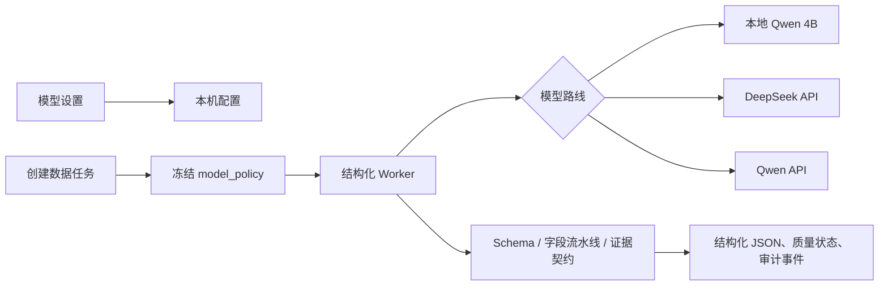

# P2 — 本地 Qwen 4B 结构化模型设计与开发计划

> 状态：实施中（A–E 已落地，F 进入质量验收）
> 版本：v0.1（2026-10-30）
> 范围：规范化流程中的结构化模型替代路径

本文件描述设计、接口和实施顺序；当前代码已完成开发测试接入，并已完成本机 Ollama/Qwen 权重安装；金标质量验收仍需按上线门槛执行。

## 实施进度（2026-10-30）

- **Phase A：已完成**：模型设置、任务级 `model_policy`、本地能力边界和回滚策略已冻结。
- **Phase B：已完成本机验证**：已安装 Ollama 0.40.13 与 `qwen3:4b`（Q4_K_M，约 2.5 GB），服务监听 `127.0.0.1:11434`，`/api/tags`、`/v1/models` 和原生 `/api/chat` 均已验证；安装脚本对已存在权重幂等跳过拉取。
- **Phase C：已完成初版**：设置页/API 支持本地地址、模型名、1–2 并发，并提供本地运行时健康检查。
- **Phase D：已完成初版**：创建任务支持本地/DeepSeek/Qwen；任务策略在后端持久化并在任务详情显示，续跑沿用原策略。
- **Phase E：已完成主链路初版**：本地 provider 走 MinerU 文本产物，禁用视觉/联网回退，继续使用现有 Schema、字段流水线和证据契约。
- **Phase F：进行中**：本机基础耗时已验证；仍需 20 份金标对比、5 只开发批次实测和失败场景验收。

当前已通过：后端 `134 passed, 26 skipped`（含本地 Ollama 客户端测试）、前端 TypeScript/Vite production build，以及本机真实 `qwen3:4b` 冒烟调用。上述结果不等于本地模型质量已达标。

## 1. 目标

在不改变下载、MinerU 解析、数据库发布和证据契约的前提下，为结构化任务增加本地 Qwen 4B 路线：

1. 模型设置可以配置本地模型服务地址、模型名称和并发参数；
2. 数据任务创建时可以按本次任务选择本地模型、DeepSeek 或云端 Qwen；
3. 任务提交后冻结模型策略，后续配置变更不影响该任务；
4. 页面显示基于基金数量、解析缓存和模型路线的预计耗时；
5. 本地路线无 API Key、无云端模型回退，并把无法由文本 4B 完成的视觉/联网环节标记为 review；
6. 结构化输出继续遵守现有 JSON Schema、字段流水线和页/块证据契约。

## 2. 非目标与边界

本阶段不做以下事项：

- 不替换 MinerU；MinerU 仍使用当前轻量型或 Token 路线；
- 不把普通 Qwen 4B 当作视觉模型；图表视觉复核仍走云端或 review；
- 不允许本地模型联网搜索、Ticker 查询或执行任意工具；
- 不改变下载器、数据库表结构和快照发布协议；
- 不要求本地模型承担全量 775 只基金的生产吞吐目标；
- 不在本阶段实现 Agent 的完整本地化，只预留同一模型网关接口。

## 3. 当前约束

当前结构化流程由 `QwenClient` 兼容层调用 DeepSeek/Qwen，批处理默认有较高并发。开发主机为 16GB Apple Silicon Mac，适合 Q4 量化的 4B 文本模型，但不适合同时运行高并发本地推理、视觉模型和全量任务。

本地模型必须使用：

- 模型：Qwen 4B Instruct，Q4 量化；具体模型名由设置项决定，默认 `qwen3:4b`；
- 服务：Ollama 或 llama.cpp 的 OpenAI-compatible HTTP 服务；
- 地址：默认 `http://127.0.0.1:11434/v1`；
- 并发：默认 1，允许值 1–2；
- thinking：默认关闭；
- 输入：MinerU Markdown 紧凑上下文及原生文本；
- 输出：JSON object，随后由本项目 Schema 和证据解析器校验。

## 4. 目标架构



模型路由只决定“结构化模型调用到哪里”，不改变 PDF 下载、MinerU 解析、确定性字段抽取、换算和发布逻辑。

## 5. 配置设计

### 5.1 模型设置

设置页面增加“本地 Qwen 4B”区块：

| 配置 | 默认值 | 约束 |
|---|---|---|
| `base_url` | `http://127.0.0.1:11434/v1` | 仅 HTTP(S)，默认本机地址 |
| `primary_model` | `qwen3:4b` | 非空，最长 200 字符 |
| `workers` | `1` | 1–2，16GB 主机推荐 1 |
| `api_key` | 空 | 本地路线不需要 |

全局结构化供应商增加 `local` 枚举，但任务级选择优先于全局默认。

建议的配置片段：

```ini
[api]
local_model_base_url = http://127.0.0.1:11434/v1

[models]
local_primary_model = qwen3:4b

[processing]
local_model_workers = 1
```

### 5.2 任务模型策略

`JobCreateRequest.model_policy` 保存任务提交时的不可变选择：

```json
{
  "structured_provider": "local",
  "local_model": "qwen3:4b",
  "local_workers": 1,
  "thinking": false,
  "vision_fallback": "review",
  "web_tools": false
}
```

允许值：

| `structured_provider` | 含义 |
|---|---|
| `local` | 本地 Qwen 4B，单并发，无云端回退 |
| `deepseek` | 使用模型设置中的 DeepSeek 配置 |
| `qwen` | 使用模型设置中的云端 Qwen 配置 |

如果未选择结构化阶段，`model_policy` 可以为空；如果选择结构化阶段但没有明确策略，使用提交时的全局默认值并写入任务快照。

## 6. 数据任务页交互

创建任务表单的阶段顺序保持：

1. 下载；
2. 解析：显示 MinerU 路线，并说明“已有缓存时复用”；
3. 结构化：显示三种模型选择。

模型选项文案：

- 本地 Qwen 4B：单并发、无云端模型费用、无视觉和联网回退；
- DeepSeek：使用模型设置中的主模型、备用模型和视觉模型；
- Qwen / DashScope：使用模型设置中的云端配置。

提交前显示：

```text
预计冻结：5 只基金
MinerU 解析：约 2–5 分钟（已有缓存：复用）
结构化：本地 Qwen 4B，约 15–30 分钟
```

预估仅用于排队前提示，任务事件中的实际耗时才是审计依据。

## 7. 耗时估算规则

### 7.1 MinerU

- 若输入任务已有完整 manifest：显示“复用已有缓存”；
- 若需要解析：以当前解析并发和基金数计算区间；
- 估算不能承诺外部 API 延迟，应标记“估算”。

### 7.2 结构化模型

开发阶段使用区间而非单点：

| 路线 | 估算基准 |
|---|---|
| 本地 Qwen 4B | 3–6 分钟/只，单并发，缓存上下文可用 |
| DeepSeek | 按当前云端并发折算，约 `ceil(N/8)` 到 `ceil(N/3)` 分钟 |
| 云端 Qwen | 沿用云端结构化并发，显示同一云端区间并注明依赖服务限流 |

上线前用 20 份金标 PDF 的 P50/P90 实测替换上述经验参数；不得把估算值写入任务完成耗时。

## 8. 本地模型能力契约

| 能力 | 本地 Qwen 4B |
|---|---|
| Markdown 文本抽取 | 支持 |
| JSON object 输出 | 支持，必须二次 Schema 校验 |
| 严格 JSON Schema | 以运行时能力探测为准，不依赖供应商特性 |
| PDF 文件上传 | 不支持，任务必须使用 MinerU 产物 |
| 图片/图表复核 | 不支持，进入 review |
| 联网搜索 / Ticker | 不支持，优先缓存/报告直出，否则 review |
| 云端回退 | 禁止，避免“本地选项”产生外部费用 |

任何本地调用失败都要在 `_meta` 和任务事件中记录：`provider_unavailable`、`local_runtime_not_ready` 或 `local_capability_unsupported`，不能静默改走 DeepSeek/Qwen。

## 9. 分阶段开发计划

### Phase A：设计评审与契约冻结（0.5–1 人日）

- 确认模型名称、运行时（Ollama 或 llama.cpp）和默认端口；
- 确认本地视觉字段的 review 策略；
- 确认时间估算口径和验收样本；
- 冻结 `local` provider 与 `model_policy` JSON 结构。

交付：本文件评审版、接口契约、20 份金标 PDF 清单。

### Phase B：本地运行时验证（1–2 人日）

- 安装 Qwen 4B Q4；
- 验证 `/v1/models`、Chat Completions、JSON object、超时和停止；
- 测量 1/2 并发的内存、首 token 延迟和生成速度；
- 明确本机的有效 context 与 `max_tokens`。

交付：运行时健康检查、基准记录、失败诊断说明。

### Phase C：模型设置（1–2 人日）

- 扩展模型设置 Schema 和本机配置；
- 增加本地地址、模型名、并发字段；
- 不要求本地 API Key；
- 增加本地服务不可用状态提示。

交付：设置页、API 测试和配置迁移测试。

### Phase D：任务级模型选择与耗时预估（1–2 人日）

- 创建任务增加结构化模型选项；
- 提交时冻结 `model_policy`；
- Worker 读取任务策略，不读取运行期间变化的全局设置；
- 显示 MinerU/结构化预计耗时；
- 在任务详情中展示实际模型路线。

交付：任务页、API 契约、幂等和断点续跑测试。

### Phase E：结构化适配（2–4 人日）

- 增加本地 OpenAI-compatible provider；
- 强制本地走 MinerU Markdown，不走 file upload；
- 关闭 vision、web search、联网 Ticker；
- 保留 Schema、字段流水线、换算、证据和 review 逻辑；
- 本地模型错误不得云端回退。

交付：固收和权益各一条本地结构化路径及运行审计。

### Phase F：质量与发布（2–3 人日）

- 20 份金标 PDF 对比 DeepSeek/Qwen；
- 验收字段完整率、关键标量准确率、证据有效率和 review 比例；
- 验收 5 只日常开发批次的实际耗时；
- 增加关闭本地服务、模型输出截断和 JSON 损坏测试；
- 评审通过后再把本地路线标为可用。

总投入估计：**7.5–14 人日**，不含模型下载和硬件采购。

## 10. 验收标准

### 功能

- 设置页可以保存并读取本地地址、模型名和并发；
- 创建任务可以选择本地/DeepSeek/Qwen；
- 任务详情能显示冻结的模型策略；
- 本地任务不发送 API Key，不访问云端模型端点；
- 本地服务不可用时任务明确失败或进入 review，不自动换云端。

### 质量

- 20 份金标 PDF 的关键标量准确率不低于现有基线的 95%；
- 证据引用有效率不低于 95%；
- 不能解析的视觉字段必须显式 review；
- JSON 解析失败可重试一次，仍失败则留存原始错误。

### 性能

- 首次模型加载耗时和内存有日志；
- 单只 PDF P50/P90 耗时有记录；
- 5 只开发任务在本机完成且不导致 PostgreSQL/API OOM；
- 并发配置为 1 时不产生并行本地请求。

## 11. 回滚与安全

- 全局默认仍可恢复到 DeepSeek 或云端 Qwen；
- 任务策略是快照，失败任务可以选择云端重新创建，不覆盖原结果；
- 本地端口只绑定 `127.0.0.1`；
- 日志不得写入 API Key、完整 PDF 或未经脱敏的模型请求；
- 本地模型文件放在受管缓存目录，不进入代码仓库和备份提交。

## 12. 待用户确认的决策

1. 本地运行时选 Ollama 还是 llama.cpp；
2. 默认模型确定为 `qwen3:4b`，还是指定某个 Qwen 4B Instruct 量化文件；
3. 本地路线遇到视觉字段时，是直接 review，还是允许手动选择云端视觉补提；
4. 5 只开发任务的目标 P90 是 30 分钟还是 45 分钟；
5. 20 份金标 PDF 的最低字段完整率和证据有效率阈值。
