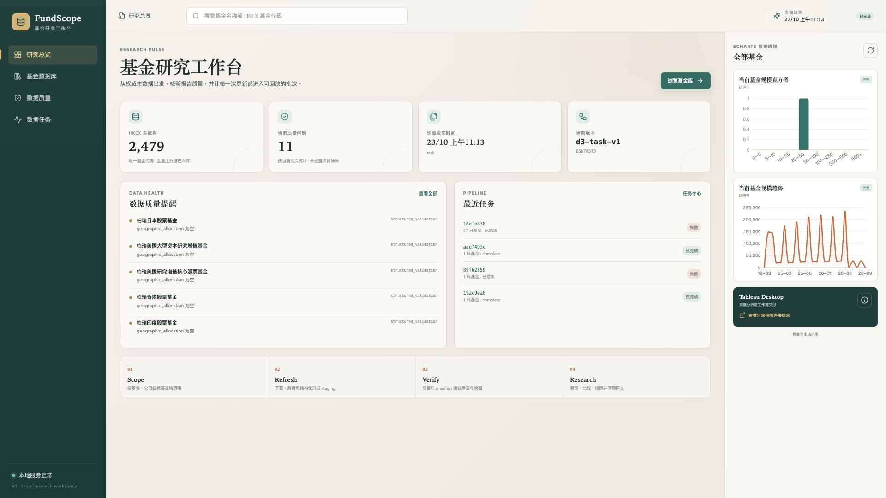
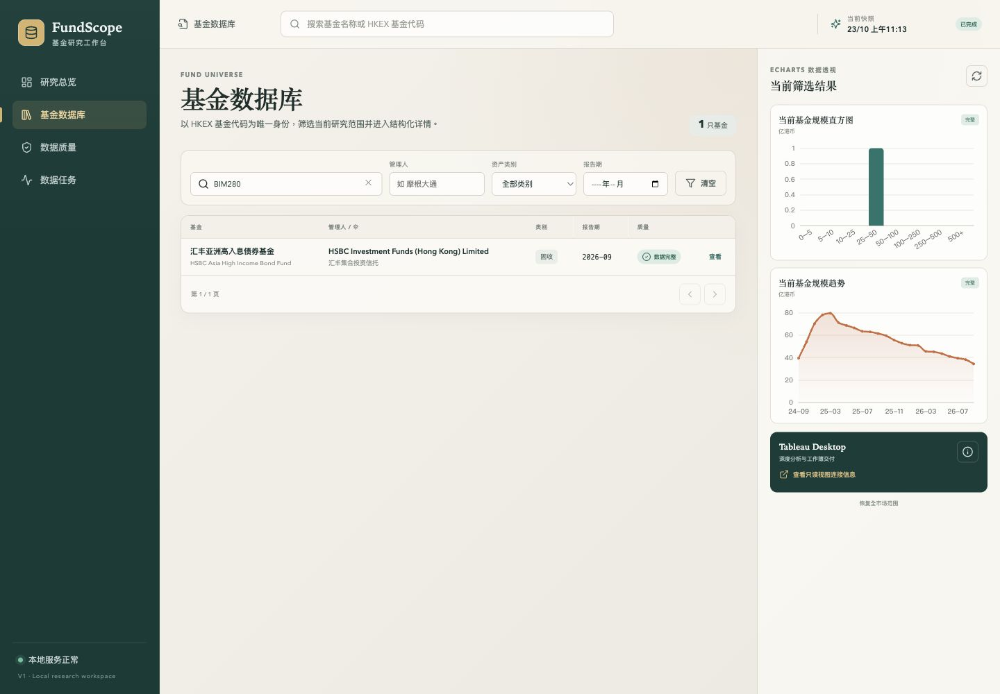
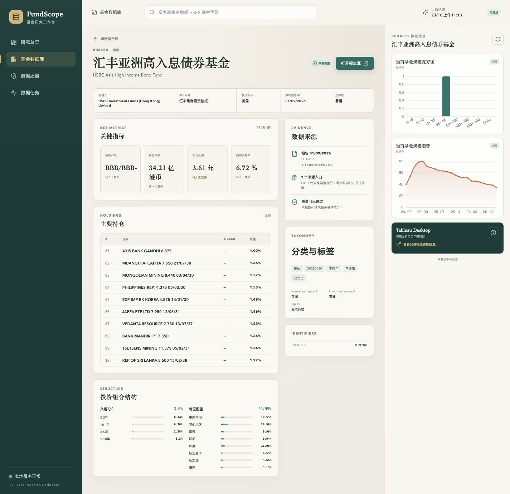
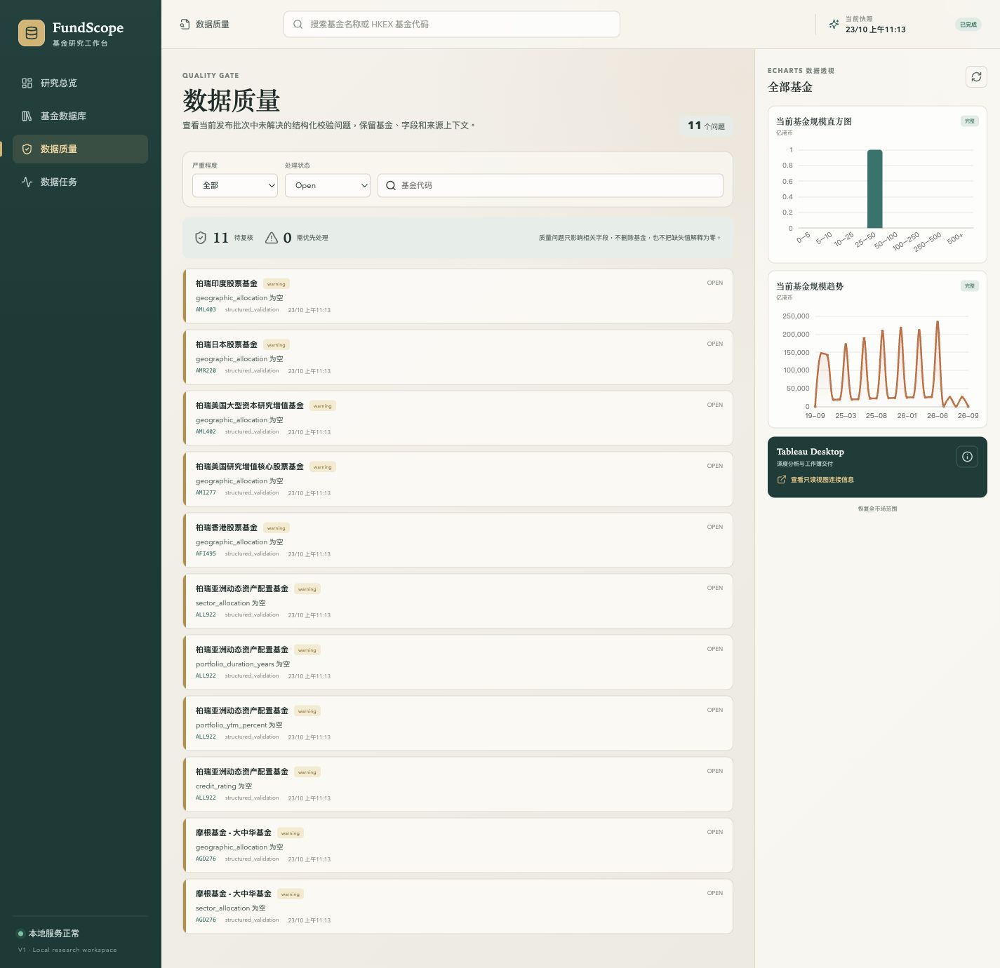
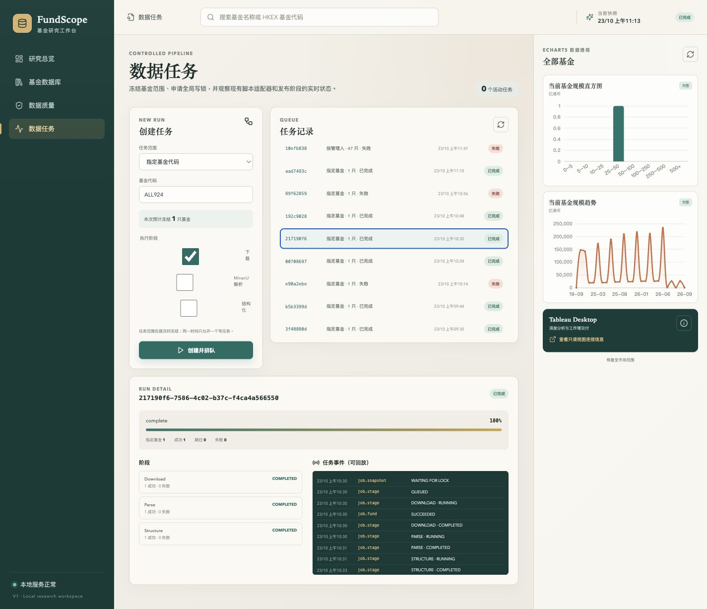

# 基金研究智能看板与知识库 Agent

> 项目进展简报 · 2026-10-23  
> 当前阶段：核心研究与更新流程已贯通，知识库和 Agent 进入下一阶段建设

## 一、项目概览

本项目把现有的基金报告下载、解析和结构化脚本升级为面向投研人员的知识库看板与 Agent。用户可以用预设条件批量更新基金报告，也可以在自然语言模式下调取数据、比较基金、追踪变化并生成带原文页码引用的表格和报告。V1 在单台 Mac 上完成完整功能验收；V2 将同一套能力部署到 Windows 服务器，供多名投研人员共享使用。

项目以“权威基金主数据、受控报告更新、统一结构化结果、可追溯知识检索和智能研究交互”为主线，将分散在不同管理人网站、PDF 文件、表格和脚本中的研究资料纳入统一工作流。其核心价值不只是提升报告处理效率，更在于建立一致的数据口径、可复用的研究资产和可核验的原文证据链，使投研结论能够回溯至明确的基金、报告版本和来源页面。

面向日常研究，系统将提供以下闭环：

```text
选择基金范围
→ 更新最新报告
→ 自动解析与结构化
→ 查询、比较和追踪
→ 定位原文
→ 形成研究表格和报告
```

由此，研究报告将从一次性交付物转变为可持续更新、可比较、可追溯的研究资产。

## 二、核心 Solution

### 2.1 当前工作流


核心 Solution 分为四个层次：

1. **统一基金数据**：以 HKEX 基金代码为主身份，统一管理人、基金类别、名称历史和报告来源。
2. **自动化更新**：按全量、管理人、资产类别或指定基金创建任务，自动完成报告补全、下载、解析和结构化。
3. **研究工作台**：集中查看基金详情、关键指标、持仓、配置、数据质量、任务状态和规模图表。
4. **知识库与 Agent**：后续提供原文检索、带页码引用的问答、跨基金比较、变化追踪和研究报告生成。

### 2.2 V1、V2 与当前进度

| 能力 | V1 计划 | V2 计划 | 当前进度 |
|---|---|---|---|
| 基金数据 | 统一 2,479 只基金主数据、来源和报告版本 | 增加披露易、ETF、互认基金和 Bloomberg 等数据来源 | 已建立完整基金主数据和来源底盘 |
| 更新任务 | 全量、管理人、资产类别、指定基金；下载、解析、结构化 | 多人共享、持久队列和后台服务 | 核心流程已贯通 |
| 研究看板 | 总览、基金库、详情、质量、任务、ECharts | 多人共享查看与角色权限 | 主要页面已交付 |
| 报告补全 | 复用 27 家现有下载和补全能力 | 扩大管理人覆盖和来源健康监控 | 已接入平台任务 |
| 结构化内容 | 指标、持仓、地区、行业、久期、评级等 | 扩大覆盖并支持共享审核 | 已形成可查询结果，覆盖仍需扩展 |
| 知识库与问答 | 页级检索、跨基金比较、变化追踪、页码引用 | 共享缓存和增量索引 | 待建设 |
| Agent | 计划确认、工具调用、补数、失败恢复 | 加入 V2 新数据工具 | 待建设 |
| 研究交付 | 在线表格、XLSX、DOCX、PNG、Tableau Desktop | 保持同一交付体系 | ECharts 已交付，其余待完善 |
| 运行方式 | Mac 本地单用户 | Windows 服务器、多人共享 | V1 本地环境已运行 |

## 三、当前进展

### 3.1 已实现能力

- 2,479 只 HKEX 基金可以在统一看板中查询。
- 775 条管理人报告来源已纳入统一管理。
- 支持全量、管理人、资产类别和单基金任务范围。
- 支持报告补全、下载、自动解析、结构化抽取和质量标记。
- 任务可查看阶段进度、补全过程、失败原因和最终结果。
- Web 提供基金总览、基金详情、数据质量、任务中心和两个 ECharts 规模图表。
- 每次更新形成独立快照，成功后统一切换，失败时保留上一份正式数据。
- 批量任务支持管理人级并行、单管理人串行和跨任务解析缓存复用。

### 3.2 当前数据情况

| 项目 | 当前结果 |
|---|---:|
| 基金主数据 | 2,479 只 |
| 管理人报告来源 | 775 条 |
| 已有结构化详情的基金 | 21 只 |
| 有规模历史的基金 | 2,427 只 |
| 当前待复核质量问题 | 11 条 |

当前完成的是可运行、可验证的核心纵向流程。基金主数据已全量覆盖，但报告结构化详情尚未扩展到全部基金。

## 四、当前 UI

基金相关页面以已完成下载、解析和结构化的 BIM280“汇丰亚洲高入息债券基金”为示例；总览和数据质量页使用全市场视角。

### 4.1 研究总览

展示基金总量、质量问题、当前快照和任务概览，并提供全市场 ECharts 规模视图。



### 4.2 基金查询

以 BIM280 搜索为例，页面显示基金名称、管理人、资产类别、报告期和质量状态。



### 4.3 基金详情

展示 BIM280 的基金规模、关键指标、主要持仓、报告来源和数据质量。



### 4.4 数据质量

展示当前快照中的开放质量问题，并保留按基金、严重程度和处理状态筛选的能力。



### 4.5 任务中心

展示 BIM280 已完成任务的下载、解析、结构化进度，并支持全量、管理人、资产类别和指定基金任务范围。



## 五、V1 下一阶段

1. 扩大报告和结构化结果覆盖，完成剩余来源补全。
2. 将历史 PDF、Markdown 和结构化结果迁移到统一版本体系。
3. 建设页级知识库、全文检索、向量检索和重排。
4. 推出带原文页码引用的单基金问答、跨基金比较和变化追踪。
5. 建立受控 Agent，支持任务规划、补数和失败恢复。
6. 完善 XLSX、DOCX、PNG 和 Tableau Desktop 工作簿交付。
7. 完成覆盖率、问答准确率、引用正确率和全量更新时间验收。

## 六、V1 验收目标

| 指标 | 目标 |
|---|---:|
| 当前任务名单报告覆盖率 | ≥90% |
| 100 题问答准确率 | ≥80% |
| 原文引用正确率 | ≥95% |
| 单基金基础查询 P95 | ≤2 秒 |
| 缓存正常时全量更新 | ≤2 小时 |

## 七、V2 方向

V2 将现有能力部署到 Windows 服务器，供约 3 名投研人员共享：

- 管理员与投研用户分权；
- 多读单写、统一快照和后台任务队列；
- 增加港交所增量、ETF、互认基金和 Bloomberg 数据；
- 提供公司默认模型与个人模型密钥管理；
- 完善服务自启动、监控、备份、恢复和版本回滚；
- 继续保持 ECharts 网页图表和 Tableau Desktop 工作簿出口。

## 八、当前重点风险

- 部分基金缺少月报或官网已下线，可能影响 90% 覆盖率；
- 复杂 PDF 表格仍可能出现字段识别和权重校验问题；
- 外部网站和模型服务的限流会影响全量更新时间；
- 历史报告尚未全部迁移，结构化覆盖仍是当前主要缺口；
- 知识库和 Agent 尚未建设，问答准确率和引用正确率暂不能验收；
- 正式多人共享前需完成密钥安全存储、权限和运维准备。

## 参考资料

- [产品需求文档](../PRD-Fund-Research-Knowledge-Agent.md)
- [C4 架构](../architecture/README.md)
- [D5 验收记录](../development/02-d5-acceptance-record.md)
